# Mini MES

[](https://github.com/trankhacduy91/MiniMES/actions/workflows/ci.yml)

Hệ thống điều hành sản xuất (MES) thu nhỏ cho một nhà máy lắp ráp điện tử: Work Order, truy xuất serial/lot, OEE, chất lượng, kết nối máy qua MQTT / OPC UA / Modbus. Đây là dự án học để chuyển sang vị trí **IT MES**; spec chi tiết ở [`spec/`](spec/), quyết định kiến trúc ở [`ARCHITECTURE.md`](ARCHITECTURE.md).

**Stack:** .NET 10 (LTS) · ASP.NET Core (Controller) · EF Core 10 + SQL Server 2022 · WPF (MVVM, CommunityToolkit.Mvvm) · Serilog · JWT · xUnit + Testcontainers · Docker Compose (SQL Server, Mosquitto) · GitHub Actions.

**License thư viện:** MediatR được ghim ở **12.x** (Apache 2.0); từ v13 MediatR chuyển sang license thương mại (có bản Community cần đăng ký key), nên không nâng cấp. Test `MediatR_stays_on_version_12` chặn việc vô tình nâng. FluentValidation, ClosedXML: Apache 2.0 / MIT.

**Trạng thái:**
- **M0 (nền tảng) xong:** solution Clean Architecture, Docker, đăng nhập theo role, audit trail không sửa được, API cấu hình nhà máy, CI, 2 app WPF đăng nhập được.
- **M1 (master data) xong:** Item, BOM đa cấp có version, routing, work center/máy, ca, lịch nhà máy, mã lỗi, lý do dừng; explode BOM bằng recursive CTE; import Excel; màn hình WPF Back-office. Xem [mục Master data](#master-data-m1).
- **M2 (work order) xong:** tạo WO có preview NVL, Release (chụp BOM/routing + sinh serial trong một transaction, không trùng khi release đồng thời), state machine Hold/Resume/Complete/Close/Cancel, Priority + dispatch list theo line, nhãn ZPL (Code128 + DataMatrix) xem trước qua Labelary và log in lại. Xem [mục Work order](#work-order-m2).
- **M3 (shop floor) xong:** scan serial tại trạm với route check (chặn nhảy bước, bo NG, bo Hold), chống scan lặp và scan đồng thời, cổng FAI, phiên trạm, Repair/Rework/Scrap; Kiosk WPF toàn màn hình cho máy quét mã vạch (NG + mã lỗi, form sửa chữa, SOP, offline); báo cáo FPY/RTY/WIP; đo hiệu năng trên 10 triệu dòng log (p95 24,8 ms). Xem [mục Shop floor](#shop-floor-m3) và [Performance](#performance).
- **M4 (kết nối máy) xong:** MQTT (Mosquitto, topic UNS ISA-95) → ingest chống trùng, bộ đếm tích lũy, batch writer; Offline tách khỏi Down (heartbeat + LWT); SignalR realtime có throttle; Andon raise/ack/resolve + tự raise + leo thang; dashboard line WPF và nút Andon trên Kiosk; simulator vai máy + vai trạm tự động. Xem [mục Machine connectivity](#machine-connectivity-m4).
- **M5 (OEE & downtime) xong:** A×P×Q ở một hàm thuần, khớp tính tay ca mẫu 79,8 %; snapshot theo giờ/ca có job bắt kịp và unique index; phân loại dừng (audit theo cột, đổi lý do thì tính lại ca); Pareto; cờ P > 100 % và `CounterMismatch`; dashboard OxyPlot, Excel, Line TV. Xem [mục OEE](#oee-m5).
- Các module tiếp theo (M6 → M3b → M7) làm theo [lộ trình](spec/spec-v2.md).

## Kiến trúc

Theo các tầng ISA-95; MES nằm ở Level 3, giữa ERP (Level 4) và máy (Level 0–2).

```
 L4  ERP (ngoài phạm vi)
 ──────────────────────────────────────────────────────────────────────────
 L3  MiniMes.Api (.NET 10, modular monolith) ─────────── SQL Server 2022
       ▲ REST + JWT (SignalR từ M4)                 ▲ MQTT subscribe (M4)
       │                                            │
   [WPF Back-office]  [WPF Kiosk]                   │
 ───────────────────────────────────────────────────┼──────────────────────
 L2  Mosquitto (MQTT broker)  ◀── Unified Namespace ┤
       [EdgeGateway] OPC UA + Modbus → MQTT (M4b) ──┘
 ──────────────────────────────────────────────────────────────────────────
 L1/L0  MachineSimulator: máy SMT (MQTT), lò reflow (OPC UA), máy dán keo (Modbus)
```

Bên trong backend (Clean Architecture, mũi tên = được tham chiếu tới):

```
Api ──► Application ──► Domain          Contracts: DTO dùng chung API ↔ WPF
 └──► Infrastructure ──┘                Client.Core ──► Contracts
      (EF Core, interceptor)            BackOffice.Wpf, Kiosk.Wpf ──► Client.Core
```

WPF chỉ thấy `Client.Core` nên không có cách nào nối thẳng DB. Chiều phụ thuộc được giữ bằng test ([`DependencyTests`](tests/MiniMes.UnitTests/Architecture/DependencyTests.cs)): sai là CI đỏ.

## Yêu cầu cài đặt

| Cần | Ghi chú |
| --- | --- |
| Windows 10/11 | App WPF chỉ chạy trên Windows; backend chạy được trên Linux/macOS |
| [.NET SDK 10](https://dotnet.microsoft.com/download/dotnet/10.0), bản `10.0.401` trở lên | Phiên bản ghim trong `global.json`; kiểm tra bằng `dotnet --version` ở thư mục repo |
| [Docker Desktop](https://www.docker.com/products/docker-desktop/) (bật WSL2) | Chạy SQL Server + Mosquitto, và cho integration test |
| IDE | Visual Studio 2026, Rider bản mới, hoặc VS Code + C# Dev Kit (cần mở được `.slnx`) |
| Git | |

Không cần cài SQL Server hay `dotnet-ef` riêng: SQL Server chạy trong Docker, `dotnet-ef` là local tool của repo.

## Chạy lần đầu

Các lệnh chạy ở thư mục gốc repo. Dùng PowerShell hoặc Git Bash.

**1. Cấu hình môi trường Docker**

```bash
cp .env.example .env
```

Mở `.env`:
- Đổi `MSSQL_SA_PASSWORD` (SQL Server yêu cầu ≥ 8 ký tự, có chữ hoa, chữ thường, số và ký tự đặc biệt; mật khẩu yếu thì container tự thoát).
- Nếu máy đã có SQL Server khác dùng cổng 1433 (ví dụ SQL Express), bỏ dấu `#` ở dòng `MSSQL_PORT` để container dùng cổng 14333. Kiểm tra: `netstat -ano | findstr :1433`.

**2. Bật SQL Server và Mosquitto**

```bash
docker compose up -d
docker compose ps        # chờ đến khi cả hai là "healthy" (~20-30 giây)
```

**3. Cấu hình bí mật cho API** (lưu ở user-secrets trên máy bạn, không nằm trong repo)

```bash
dotnet tool restore
dotnet user-secrets set "ConnectionStrings:Default" "Server=localhost,1433;Database=MiniMes;User Id=sa;Password=<MSSQL_SA_PASSWORD trong .env>;TrustServerCertificate=True" --project src/MiniMes.Api
dotnet user-secrets set "Jwt:Key" "<chuỗi ngẫu nhiên tối thiểu 32 ký tự>" --project src/MiniMes.Api
```

Nếu đã đặt `MSSQL_PORT=14333` ở bước 1 thì dùng `Server=localhost,14333`. Thiếu `Jwt:Key` (hoặc ngắn hơn 32 ký tự) thì API không khởi động.

**4. Build và tạo database**

```bash
dotnet build
dotnet ef database update --project src/MiniMes.Infrastructure --startup-project src/MiniMes.Api
```

Phải `dotnet build` (hoặc ít nhất `dotnet restore`) trước: trên bản clone mới, `dotnet ef` cần package đã được restore, nếu không sẽ báo `NETSDK1004: Assets file ... project.assets.json not found`.

**5. Chạy API**

```bash
dotnet run --project src/MiniMes.Api --launch-profile http
```

Lần chạy đầu, seeder tạo dữ liệu demo: 1 site, 1 area, 2 line, 10 station, 6 user, và master data của model `PCB-A` (xem [Master data](#master-data-m1)). Seeder chạy mỗi lần khởi động nhưng bỏ qua mã đã có, nên chạy lại không tạo trùng và không ghi đè dữ liệu bạn đã sửa. Mở **Swagger: http://localhost:5157/swagger** → `POST /api/auth/login` với `admin` / `Demo@12345` → copy `token` → nút **Authorize**.

**6. Chạy app WPF** (terminal khác, API phải đang chạy)

```bash
dotnet run --project src/MiniMes.BackOffice.Wpf   # văn phòng: mã + mật khẩu, vd. planner01 / Demo@12345
dotnet run --project src/MiniMes.Kiosk.Wpf        # trạm: gõ EMP00123 + Enter (như quẹt thẻ)
```

Địa chỉ API (`ApiBaseUrl`) và mã trạm của kiosk (`StationCode`, mặc định `L1-TEST-01`) nằm trong `appsettings.json` của từng app. Thử trạm khác: `dotnet run --project src/MiniMes.Kiosk.Wpf -- --StationCode=L2-PACK-01`.

## Tài khoản demo (chỉ Development)

| Mã | Mật khẩu | Role | Dùng ở |
| --- | --- | --- | --- |
| `admin` | `Demo@12345` | Admin | BackOffice, Swagger |
| `planner01` | `Demo@12345` | Planner | BackOffice |
| `sup01` | `Demo@12345` | Supervisor | BackOffice |
| `qc01` | `Demo@12345` | QC | BackOffice |
| `mt01` | `Demo@12345` | Maintenance | BackOffice |
| `wh01` | `Demo@12345` | Warehouse | BackOffice: nhập lot NVL, in nhãn lot (M6) |
| `EMP00123` | (không có, quẹt thẻ) | Operator | Kiosk |
| `SIM-STATION` | (không có, quẹt thẻ) | Operator | Machine simulator (vai trạm tự động, scan ghi `Source = Machine`) |

Tài khoản có mật khẩu không đăng nhập được bằng "quẹt thẻ" ở kiosk, và token kiosk chỉ mang role `Operator`.

## Kịch bản demo (13 bước)

Kịch bản end-to-end mà toàn dự án hướng tới ([spec-v2 B2](spec/spec-v2.md)). Sẽ hoàn thiện theo từng module; M0 cung cấp nền cho mọi bước (đăng nhập theo role, audit, Docker, khung WPF).

| # | Bước | Module | Trạng thái |
| --- | --- | --- | --- |
| 1 | Admin import Excel Item/BOM/Routing của model mới (file mẫu `PCB-B`) | M1 | xong |
| 2 | Planner tạo WO 200 pcs → Release → sinh serial, in nhãn ZPL | M2 | xong (in ra file `.zpl`; máy in thật ngoài phạm vi) |
| 3 | Kho nhập reel → QC làm IQC → lot `Available` | M6 | chưa làm |
| 4 | Operator nạp reel lên máy SMT, MES kiểm tra đúng vật tư và FIFO | M6 | chưa làm |
| 5 | FAI: serial đầu tiên qua hết các bước → QC duyệt → chạy hàng loạt | M2, M3, M7 | cổng FAI xong (M3); QC duyệt qua endpoint tạm, checklist FAI ở M7 |
| 6 | Simulator: SMT qua MQTT, lò reflow OPC UA, máy dán keo Modbus (qua gateway) | M4, M4b | MQTT + trạm tự động xong (M4); OPC UA, Modbus ở M4b |
| 7 | Operator scan trên kiosk, xem SOP; NG → Repair → Test lại → OK | M3 | xong |
| 8 | Ngắt mạng gateway–broker 60 s → đệm → gửi bù, không mất bộ đếm | M4b | chưa làm |
| 9 | Máy Down → Andon → quá 3 phút chưa Ack thì leo thang → chọn lý do dừng | M4, M5 | xong (M4); Pareto lý do dừng ở M5 |
| 10 | Nhiệt độ reflow trôi → SPC báo vi phạm → NCR, Hold serial liên quan | M7 | chưa làm |
| 11 | Trạm Pack: serial vào thùng 10 pcs → nhãn thùng → pallet | M3b | chưa làm |
| 12 | Reel lỗi → truy xuất xuôi serial → thùng → pallet → Hold | M6, M7 | chưa làm |
| 13 | WO Completed → báo cáo sản lượng/FPY/OEE, xuất Excel | M2, M3, M5 | FPY/WIP xong (M3); OEE, Excel ở M5 |

## Master data (M1)

Dữ liệu seed (theo [`docs/erd-master-data.md`](docs/erd-master-data.md) mục 3):

| Nhóm | Dữ liệu |
| --- | --- |
| Item | `PCB-A` (Finished), `PCBA-SMT` (Semi), 8 NVL (`PCB-BARE`, `RES-10K-0402`, `CAP-100N-0402`, `IC-MCU-QFN`, `SOLDER-PASTE` (kg), `CONN-USBC`, `SHIELD-CAN`, `PACK-BAG` (`SkipIqc`)) |
| BOM | `PCB-A` → `PCBA-SMT` → NVL, 2 cấp, v1 Approved, hiệu lực từ ngày seed |
| Routing | `PCB-A` v1: 10 SMT → 20 ASSY → 30 TEST → 40 PACK, mỗi bước có SOP ([`docs/sop/PCB-A/`](docs/sop/PCB-A/)) |
| Line 1 | 4 work center (`WC-SMT`, `WC-ASSY`, `WC-TEST`, `WC-PACK`); máy `L1-SMT-01` (MQTT), `L1-REFLOW-01` (OPC UA), `L1-GLUE-01` (Modbus), `L1-TEST-01` (MQTT); trạm M0 gắn vào work center |
| Ca | `S1` 06–14, `S2` 14–22 (T2–T7), `S3` 22–06 qua nửa đêm (T2–T6); đều 420 phút kế hoạch |
| Lịch | Ngày lễ VN của năm hiện tại (Bộ luật Lao động 2019, Điều 112) + 1 Chủ nhật tăng ca (`S1`) |
| Danh mục | 10 mã lỗi, 9 lý do dừng máy |

**Explode BOM** (tổng NVL cho 200 `PCB-A`, đi xuống mọi cấp, cộng hao hụt): trong Swagger lấy `id` của `PCB-A` bằng `GET /api/items?search=PCB-A`, rồi gọi `GET /api/items/{id}/explosion?qty=200`. Hoặc bằng curl:

```bash
TOKEN=$(curl -s -X POST http://localhost:5157/api/auth/login -H "Content-Type: application/json"   -d '{"employeeCode":"planner01","password":"Demo@12345"}' | jq -r .token)
curl -s -H "Authorization: Bearer $TOKEN" "http://localhost:5157/api/items/{id}/explosion?qty=200" | jq '.lines[] | {code, requiredQty}'
```

Kết quả đúng: `PCBA-SMT` 202, `PCB-BARE` 204, `RES-10K-0402` 2473, `CAP-100N-0402` 4121, `IC-MCU-QFN` 204, `SOLDER-PASTE` 0,12726 kg (hiển thị 0,127), `CONN-USBC` 201, `SHIELD-CAN` 201, `PACK-BAG` 200. Cây có số lượng từng nút: `GET /api/items/{id}/bom-tree?qty=200`. Cách tính và lý do dùng recursive CTE: [ADR-005](ARCHITECTURE.md#adr-005-explode-bom-bằng-recursive-cte-cây-bom-dựng-trong-bộ-nhớ).

**Màn hình WPF Back-office** (thêm/sửa/import master data cần role Admin, đăng nhập `admin`; các role khác chỉ xem): Items (lọc, phân trang), BOM (version, cây, explode), Routing (Up/Down, SOP URL), danh mục (work center, máy, ca, lịch, mã lỗi, lý do dừng), Import.

**Import Excel:** màn hình Import → *Download template* để lấy file mẫu, hoặc dùng [`docs/samples/import-PCB-B.xlsx`](docs/samples/import-PCB-B.xlsx) (model `PCB-B`) → *Validate* (kiểm tra, không ghi) → *Import* (chỉ bật khi 0 lỗi; ghi tất cả trong 1 transaction, BOM/routing ở trạng thái Draft). Cùng chức năng qua API: `POST /api/import/master-data?dryRun=true|false` (multipart, field `file`).

**Version BOM/Routing:** bản Approved bị khóa; muốn đổi thì *New version* (Draft) → sửa → *Approve*, version cũ tự đóng hiệu lực đúng lúc version mới bắt đầu ([ADR-006](ARCHITECTURE.md#adr-006-bom-và-routing-có-version-draft--approved-hiệu-lực-nửa-mở)).

## Work order (M2)

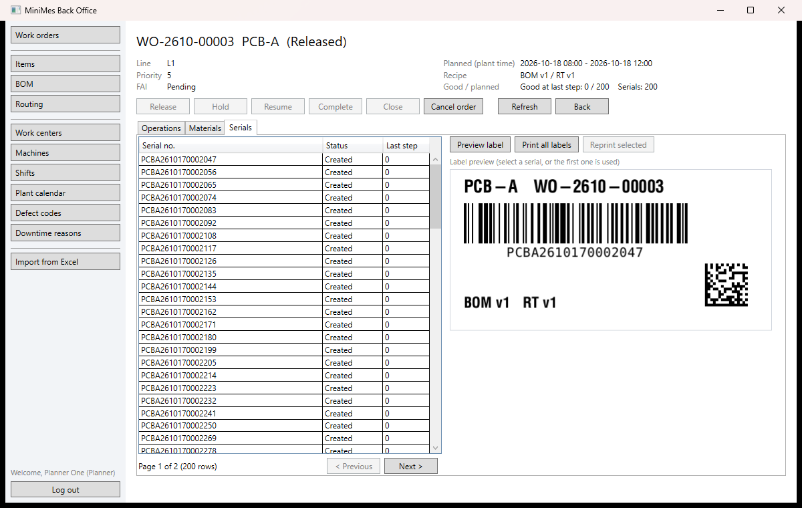

**Kịch bản demo bước 1–2 trên WPF Back-office** (đăng nhập `planner01`): **Work orders** → **New** → chọn `PCB-A`, 200, Line 1 → **Preview materials** (NVL theo từng bước, số chính xác và số cần xuất) → **Save** → màn hình chi tiết → **Release** → tab **Serials**: 200 serial → **Preview label** (ảnh nhãn thật từ Labelary) → **Print all labels** (lưu file `.zpl`, mỗi nhãn một dòng `LabelPrintLog`). Hold/Resume/Complete/Close cần role Supervisor (`sup01`).

| Việc | API |
| --- | --- |
| Tạo, xem, sửa (Draft) | `POST /api/work-orders/preview`, `POST /api/work-orders`, `GET /api/work-orders[/{id}]`, `PUT /api/work-orders/{id}` |
| Chuyển trạng thái | `POST /api/work-orders/{id}/{release\|hold\|resume\|complete\|close\|cancel}` với `{ rowVersion, reason? }` |
| Priority, điều độ | `PUT /api/work-orders/{id}/priority`, `GET /api/lines/{id}/dispatch-list` |
| Serial, nhãn | `GET /api/work-orders/{id}/serials`, `POST /api/work-orders/{id}/labels/preview`, `POST /api/work-orders/{id}/labels/print` |

Những điểm đáng nói khi phỏng vấn:
- **Serial không trùng** nhờ ba lớp, mỗi lớp một việc: SQL `SEQUENCE` cấp số (không khóa, có thể nhảy số nhưng không trùng), unique index `SerialNo` (lưới an toàn cuối), `rowversion` trên WO (chống release hai lần). Có test 2 request đồng thời, chạy 20 lần liên tiếp; thay sequence bằng `MAX+1` thì test đỏ.
- **Snapshot:** Release chép giá trị BOM/routing vào WO; approve BOM v2 sau đó không làm đổi WO đang chạy (có test).
- **State machine trong Domain:** server trả `allowedActions`, WPF bật/tắt nút theo đó, không lặp lại luật.
- Màn hình đang mở mà người khác vừa đổi WO: 409 hoặc 422, màn hình tự nạp lại và báo lý do. Chuyện "test xanh nhưng không vì lý do mình tưởng" ở [`docs/incidents.md`](docs/incidents.md).

## Shop floor (M3)

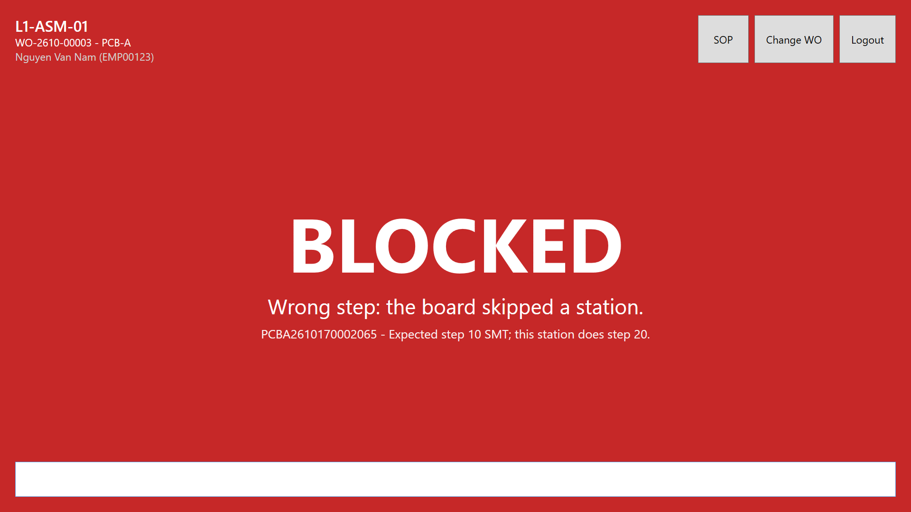

**Kiosk** (`src/MiniMes.Kiosk.Wpf`, trạm đặt trong `appsettings.json` hoặc `--StationCode=L1-TEST-01`): quét thẻ `EMP00123` → chọn WO từ dispatch list → màn hình scan toàn màn hình. Máy quét mã vạch "gõ" serial + Enter vào ô scan; mỗi lần quét hiện cả màn hình xanh (OK) hoặc đỏ (NG, BLOCKED kèm lý do), có âm báo, rồi tự về READY.
- **Trạm Test:** nút **NG** → chọn mã lỗi → quét bo.
- **Trạm `L1-REPAIR`:** quét bo NG (check-in) → form sửa chữa (hành động, linh kiện thay, quay lại bước nào) → bo về test lại.
- **Nút SOP:** mở PDF hướng dẫn của bước ngay trong kiosk.
- **Banner vàng:** WO đang chờ duyệt FAI.
- **Banner OFFLINE:** khi API không trả lời; lúc đó không cho quét.

**Back-office:** menu **Reports**: FPY theo bước (chỉ tính lần quét đầu của mỗi serial), RTY, final yield, WIP theo vị trí trên line.

| Việc | API |
| --- | --- |
| Phiên trạm | `POST /api/stations/{id}/sessions` `{ workOrderId }`, `DELETE /api/stations/{id}/sessions/{sessionId}` |
| Scan (kiosk và máy dùng chung) | `POST /api/stations/{id}/scan` `{ serialNo, result, defectCode?, source }`, bị chặn vẫn trả 200 + `reasonCode` |
| Repair, scrap | `POST /api/stations/{id}/repair`, `POST /api/serials/{serialNo}/scrap` (Supervisor) |
| Máy giả lập | `GET /api/stations/{id}/waiting-serials?take=1` |
| FAI (tạm, M7 thay) | `POST /api/work-orders/{id}/fai/result` `{ passed }` (QC) |
| SOP, báo cáo | `GET /api/sop/{**path}`, `GET /api/reports/fpy?workOrderId=`, `GET /api/reports/wip?workOrderId=` |

Những điểm đáng nói khi phỏng vấn:
- **Route check (interlock / poka-yoke) là một hàm thuần trong Domain.** Có 34 unit test: đủ 19 case của spec, cộng các test giữ đúng **thứ tự** kiểm tra (scan lặp phải thắng trạng thái Completed; bo FAI bị NG vẫn vào được Repair). Vì chặn nằm ở server, Kiosk, máy giả lập hay gọi API trực tiếp đều không qua mặt được.
- **Một lần scan = một transaction.** Bộ đếm tăng bằng `UPDATE ... SET QtyGood = QtyGood + 1`, không đọc rồi ghi. Mẫu FAI được gán bằng UPDATE có điều kiện `WHERE FaiSerialNo IS NULL`. Hai lần quét cùng một bo thì `RowVersion` của serial chỉ cho một lần ghi; lần kia đọc lại và trả "duplicate". Mỗi cơ chế có test đồng thời và mutation (bỏ cơ chế đi thì test đỏ).
- **FPY tính theo serial, không theo lượt quét.** `ROW_NUMBER()` lấy lần quét đầu tiên của mỗi serial tại mỗi bước. Đếm theo lượt quét (`QtyGood/(QtyGood+QtyNg)`) sẽ lẫn cả lượt test lại sau Repair: trong test là 66,67 % thay vì 70 %.
- **Kiosk cho máy quét mã vạch:** ô scan luôn giữ focus; lệnh scan cho phép hai lần quét chạy song song (máy quét nhanh hơn API); không dùng `MessageBox`. Chuyện "test xanh cả khi xóa cấu hình cần bảo vệ" ở [`docs/incidents.md`](docs/incidents.md).

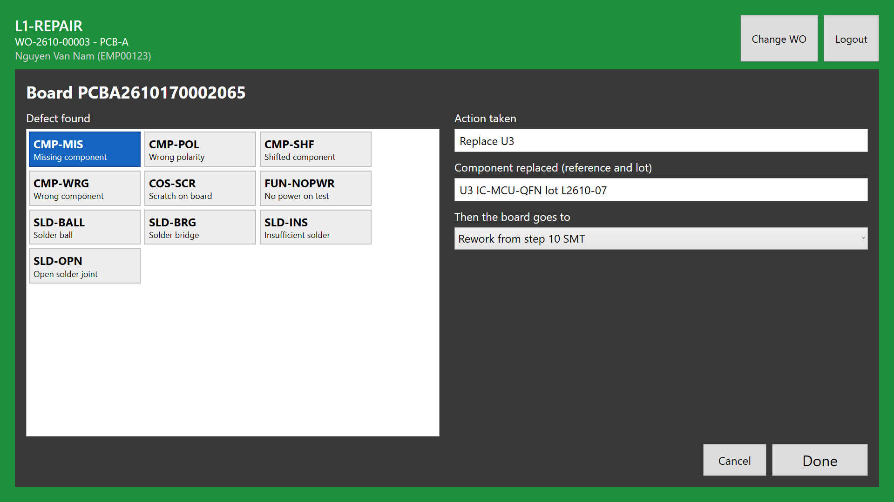

## Machine connectivity (M4)

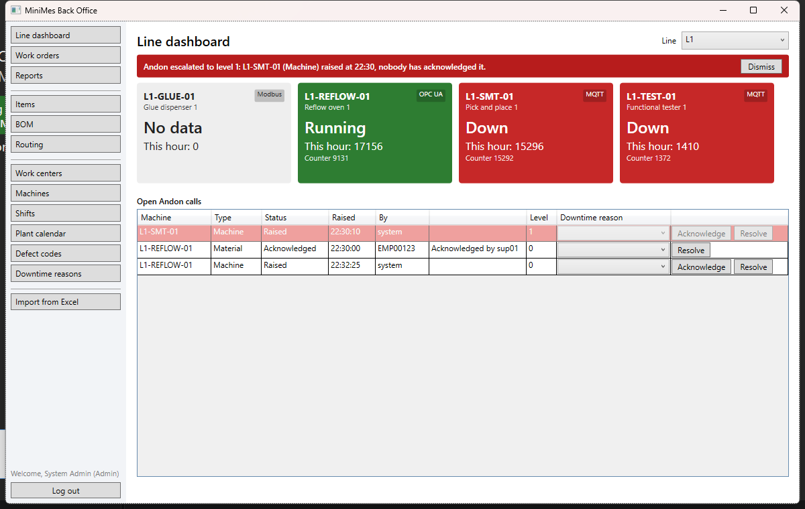

**Chạy:** `docker compose up -d` (SQL Server + Mosquitto) → API → `dotnet run --project src/MiniMes.MachineSimulator` (thêm `-- --auto-operator` để simulator scan cả trạm thủ công Assembly/Pack) → `dotnet run --project src/MiniMes.EdgeGateway` (lò reflow và máy dán keo, xem M4b) → BackOffice, menu **Line dashboard**. Lệnh simulator: `list`, `down L1-SMT-01 300`, `up`, `ng L1-TEST-01 1`, `reset`, `mute`/`unmute`, `dup`, `skew`, `tag <máy MQTT> <tag> <giá trị>` (gõ `help`).

- **Vai máy (MQTT):** mỗi máy một client có LWT; `state` retained, `count` là bộ đếm tích lũy (QoS 1), `heartbeat` 5 giây.
- **Vai trạm (HTTP):** máy SMT và Test lấy serial đang chờ ở bước của mình và gọi đúng `POST /api/stations/{id}/scan` của kiosk (badge `SIM-STATION`). Không có bo chờ thì máy chuyển `Idle`. Máy chỉ đếm khi scan được chấp nhận: Total Count (MQTT) và Good/NG (scan theo serial) kể cùng một câu chuyện ([ADR-007](ARCHITECTURE.md#adr-007-nguồn-dữ-liệu-oee-total-count-từ-máy-goodng-từ-scan-theo-serial)).
- **Kiosk:** nút **ANDON** (chọn máy nếu trạm có nhiều máy, rồi loại sự cố), chip trạng thái máy của trạm và Andon đang mở.

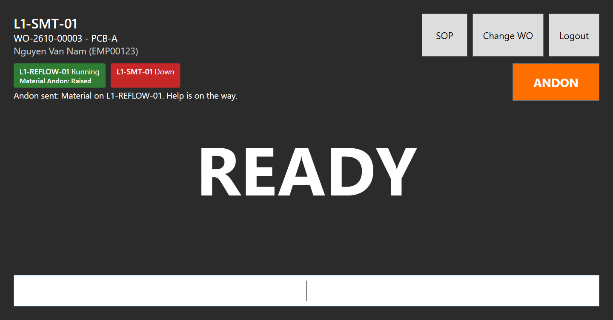

Số đo (máy dev, 27/10/2026; DoD M4):

| Đo gì | Kết quả | Yêu cầu |
| --- | --- | --- |
| Lệnh `down` → ô máy đỏ trên dashboard (UI Automation dò mỗi 50 ms) | 370 ms | < 2 s |
| `RaisedAt` → client SignalR nhận `AndonChanged` (10 lần) | min 11 ms, TB 31 ms, max 186 ms | < 2 s |
| Kill simulator → ô máy Offline (LWT + xác nhận 3 s) | 3,3 s | |
| Máy chu kỳ 0,2 s → số đếm trên dashboard | 1 lần/giây/máy, UI không nghẽn | ≤ 1 lần/giây |
| Tắt Mosquitto 2 phút (bước 5) | 0 máy bị Offline oan, máy về đúng state sau khi bật lại | không Offline oan |
| Tắt Mosquitto 25 s (bước 2); chạy 5 phút có reset, `dup`, tắt SQL Server 20 s (bước 4) | message đầu sau khi nối lại mang đủ số; `SUM(Delta)` = counter cuối − đầu của simulator | không mất số đếm |

| Việc | API |
| --- | --- |
| Snapshot dashboard | `GET /api/lines/{code}/status` (state, counter, số giờ này, tag process mới nhất, nguồn dữ liệu) |
| Realtime | SignalR `/hubs/machines`: `JoinLine(code)`; event `MachineStateChanged`, `MachineCounterUpdated`, `MachineProcessUpdated`, `AndonChanged`, `AndonEscalated`, `GatewayStatusChanged` (M4b) |
| Andon | `POST /api/andon` (Operator), `POST /api/andon/{id}/acknowledge`, `/resolve` `{ downtimeReasonId }`, `/cancel` (Supervisor, Maintenance), `GET /api/andon?status=open&line=L1`, `GET /api/andon/stats?from=&to=` |

Những điểm đáng nói khi phỏng vấn: bộ đếm tích lũy + QoS 1 + chống trùng `msgId` (mất mạng không mất sản lượng); đường nóng (RAM + SignalR) tách đường lạnh (`Channel` + batch); Offline khác Down; snapshot REST + push SignalR + resync sau reconnect; Andon một bản mở mỗi (máy, loại) bằng filtered unique index, hai người cùng ack thì `RowVersion` cho một người 409. Ghi chú học theo từng bước ở [`docs/learning/`](docs/learning/).

## OEE (M5)

OEE = Availability × Performance × Quality, tính ở **một** hàm thuần (`Domain/Oee/OeeCalculator`); dashboard, job và báo cáo đều gọi nó. Ca mẫu tính tay: [docs/oee-hand-calcs.md](docs/oee-hand-calcs.md) (79,84 %).

**Realtime vs định kỳ.** Dùng cả hai, cho hai nhu cầu khác nhau, nhưng cùng một hàm tính:

| | OEE ca hiện tại (realtime) | `OeeSnapshot` theo giờ / cuối ca (định kỳ) |
| --- | --- | --- |
| Tính khi nào | Mỗi lần dashboard hỏi, cắt cửa sổ đến "bây giờ" | Job mỗi phút chốt bucket đã qua `End + 5 phút` (grace chờ message QoS 1 về muộn) |
| Ưu | Số tức thời | Đã chốt thì không đổi (trừ khi đổi lý do dừng), dễ kiểm chứng; báo cáo nhiều ngày chỉ đọc vài dòng |
| Nhược | Tốn truy vấn mỗi lần mở; số nhảy khi dữ liệu về muộn | Trễ tới 1 giờ + grace |
| Dùng cho | Thẻ A/P/Q đang chạy, Line TV | Lịch sử, sản lượng theo giờ, Excel, so sánh ca/ngày |

Job **bắt kịp**: mỗi lượt hỏi "bucket nào đến hạn mà chưa chốt" (không "đúng phút 0 thì chốt"), nên API tắt 3 giờ thì lượt kế tiếp chốt bù 3 giờ (tối đa `Oee:CatchUpDays` = 2 ngày); chạy lại không sinh dòng trùng (upsert theo unique index `(MachineId, ShiftDate, ShiftId, Hour)`, `Hour = NULL` là tổng ca). Tổng nhiều giờ/ngày = cộng thời gian và số đếm rồi chia, không lấy trung bình các %.

**API** (mọi role đã đăng nhập đọc; đổi lý do: Supervisor/Admin):

| Endpoint | Nội dung |
| --- | --- |
| `GET /api/oee/current?machine=` \| `?line=` | Ca đang chạy, tính đến bây giờ; `Total` = cộng các máy |
| `GET /api/oee/shift?date&shift&machine\|line` | Dashboard: một ca (bỏ trống ngày + ca = ca đang chạy), cộng ở server, kèm các giờ đã chốt |
| `GET /api/oee/history?from&to&machine\|line&hourly` | Snapshot đã chốt (ngày sản xuất, `hourly=false` = chỉ tổng ca) |
| `GET /api/downtime/pareto?from&to&machine\|line&shift&by=minutes\|count&includePlanned` | Pareto lý do dừng, tối đa 31 ngày; tổng phút = phút mất Availability |
| `GET /api/downtime/unclassified?machineId&from&to` / `PUT /api/downtime/{id}/reason` | Danh sách cần phân loại / gán lý do (audit theo cột) |
| `GET /api/reports/oee.xlsx` / `downtime-pareto.xlsx?from&to&line` | Excel: số thật định dạng %, giờ nhà máy, sheet `Definitions` |
| SignalR `DowntimeNeedsClassification`, `OeeSnapshotClosed` | Đoạn dừng vừa kết thúc chưa có lý do; job vừa chốt giờ/ca của một máy |

**Dashboard WPF** (BackOffice, menu **OEE dashboard**): thẻ A/P/Q/OEE + huy hiệu cảnh báo, sản lượng tốt theo giờ so với mục tiêu theo cycle time, Pareto top 5 (theo phút hoặc số lần, rê chuột xem số), danh sách cần phân loại (Supervisor chọn lý do và lưu). Ca đang chạy tự làm mới mỗi 15 giây và ngay khi có SignalR. Biểu đồ: OxyPlot 2.2 (`PlotModel` ở ViewModel, `PlotView` ở WPF). DB Development có sẵn **ca mẫu** của spec (`L1-SMT-01`, S1 ngày 01/10/2026, `OeeDemoSeeder`): bỏ chọn *Current shift*, chọn ngày 01/10/2026, ca S1, máy `L1-SMT-01` → 79,8 %.

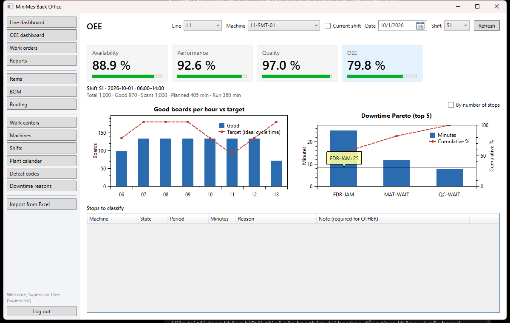

Nút **Export OEE / Export Pareto** trên dashboard tải file Excel của ngày đang xem (cùng query với màn hình).

**Line TV** (màn hình lớn ở line, app Kiosk): `MiniMes.Kiosk.Wpf.exe --mode=linetv --line=L1,L2`. Tự đăng nhập bằng badge `LINE-TV` (role Operator, seed sẵn; `LineTvBadge` trong appsettings), không cần chuột/bàn phím, tự đăng nhập lại khi token hết hạn. Hiện OEE ca đang chạy, tốt/kế hoạch, bảng giờ (▲/▼ + màu), Andon đang mở kèm cấp leo thang (đẩy ngay qua SignalR), trạng thái từng máy; nhiều line thì xoay vòng 20 giây (`LineTvRotateSeconds`, 0 = không xoay); mất API/SignalR thì hiện dải **OFFLINE — data at hh:mm**. Bố cục 1920×1080 cố định trong `Viewbox`: co giãn theo mọi độ phân giải. Triển khai: tắt chế độ ngủ/tắt màn hình của PC gắn TV (Power plan → *Turn off the display: Never*, *Sleep: Never*), để app trong Startup.

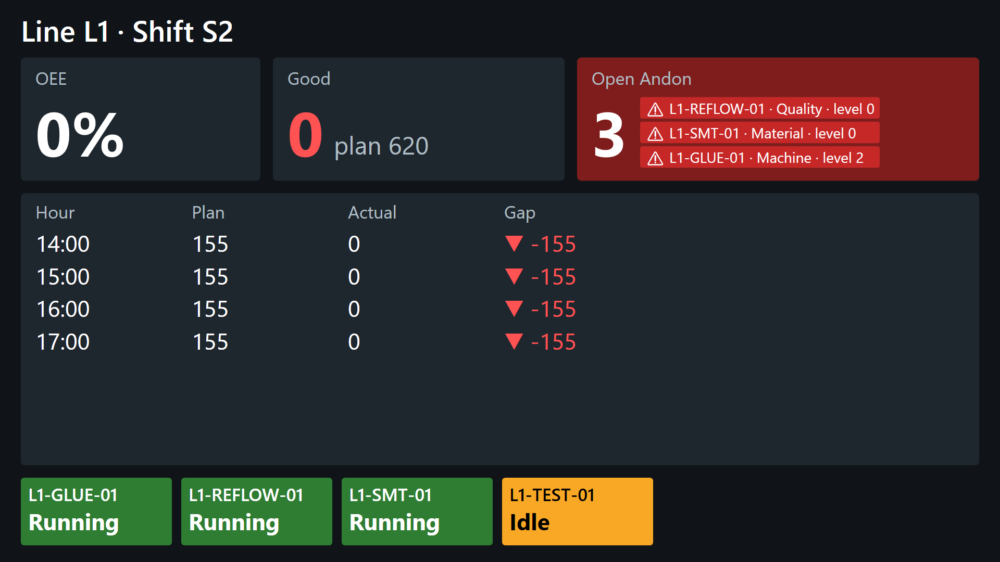

**Quy ước đã chọn** (spec M5 1.2.4–1.2.10): Total từ bộ đếm máy, Good từ scan theo serial; ngày sản xuất = ngày bắt đầu ca (giờ nhà máy); dừng < 60 s (`Oee:MicroStopThresholdSec`) là micro stop; Down/Setup/Offline chưa có lý do vẫn phạt A; Idle phạt A khi trạm của máy có scan trong ca; P > 100 % giữ số thô + cờ; bộ đếm máy và số dòng scan lệch > 2 % → cờ `CounterMismatch` (không sửa số).

**Demo** (spec M5 bước 9). DB Development có ba ca S1 trên `L1-SMT-01` (`OeeDemoSeeder`, WO đã đóng, chỉ là lịch sử):

| Ngày | Dữ liệu | Dashboard |
| --- | --- | --- |
| 01/10/2026 | Ca mẫu của spec | 88,9 / 92,6 / 97,0 / **79,8 %**, không cờ |
| 02/10/2026 | Máy thật ra 1 bo mỗi ~15 s, WO ghi 20 s | P **133,3 %** + cờ *Performance above 100 %* |
| 05/10/2026 | Máy scan hỏng từ ~13:38: 1.000 đếm, 940 scan | Q 91,0 % + cờ *Counter mismatch* |

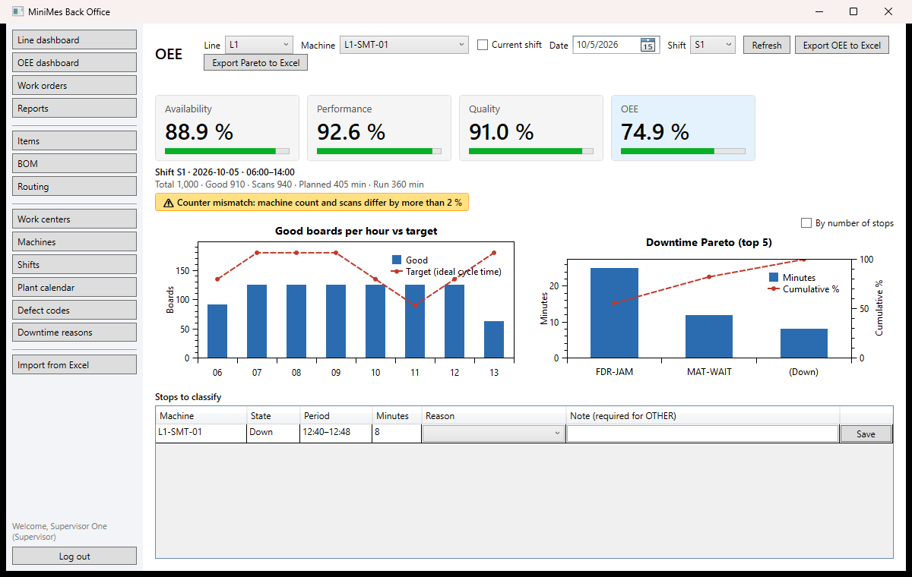

Demo trực tiếp trên ca đang chạy: `docker stop mes-simulator` (hai simulator cùng đóng `L1-SMT-01` sẽ đá nhau) → `dotnet run --project src/MiniMes.MachineSimulator -- --config src/MiniMes.MachineSimulator/sim-oee-demo.json` (chỉ `L1-SMT-01`, cycle 30 s = cycle time của routing, không tự Down, không NG) → gõ `down L1-SMT-01 300` → sau 5 phút, đoạn Down nằm trong *Stops to classify*: chọn `PM` thì Planned giảm đúng 300 s và A tăng; chọn `FDR-JAM` thì A giữ nguyên mức đã mất. Cần một WO có bo đang chờ ở SMT và đã qua FAI (simulator bỏ qua WO đang chờ FAI).

## Material & traceability (M6, đang làm)

Bảng dữ liệu và ràng buộc: [docs/erd-material.md](docs/erd-material.md). 1 reel = 1 lot; `SerialComponents` ghi "serial dùng lot nào" lúc scan OK (bước 5).

**Nhập lot** (BackOffice, menu **Receiving**, role `Warehouse`/`Admin`): chọn NVL quản lý theo lot, nhập supplier lot, số lượng mỗi reel, số reel và hạn dùng → N lot `L-yyMMdd-######` (SQL `SEQUENCE`), một nhãn ZPL mỗi reel (Code128 của mã lot, mã hàng, supplier lot, số lượng, hạn dùng dạng `03 SEP 2028`). Lot mới ở trạng thái `PendingIqc` (chưa qua kiểm tra đầu vào thì không nạp lên máy được); NVL có `SkipIqc` (túi đóng gói) vào thẳng `Available`. Hạn dùng là ngày theo giờ nhà máy: lot bị chặn từ phút đầu của ngày đó.

| Endpoint | Nội dung |
| --- | --- |
| `POST /api/material/lots` | Nhập N reel một lần giao (Warehouse, Admin); trả các lot + ZPL |
| `GET /api/material/lots?itemId&status&search&page` | Danh sách lot, mới nhất trước (mọi role) |
| `GET /api/material/lots/{id}/label` / `label/preview` | In lại nhãn (ZPL) / xem trước PNG qua Labelary |

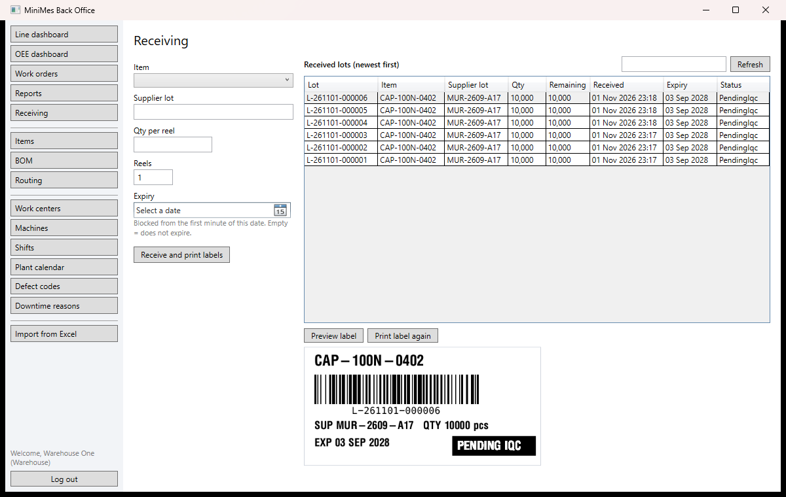

**IQC** (BackOffice, menu **IQC**, role `QC`/`Admin`): danh sách giao hàng đang chờ kiểm, gom theo (mã hàng, supplier lot). Chọn một dòng, nhập số mẫu, số lỗi, **Pass** hoặc **Fail** (Fail cần mã lỗi nhóm `Incoming`, có hỏi xác nhận vì chỉ NCR ở M7 mới đảo lại được). Một kết quả đổi trạng thái **mọi reel** đang chờ của supplier lot đó trong một transaction và ghi một `IqcRecord`; hai người bấm cùng lúc thì một người nhận 422. Reel nhận thêm sau lần kiểm là lần giao mới, chờ kiểm riêng.

| Endpoint | Nội dung |
| --- | --- |
| `GET /api/material/iqc/pending` | Supplier lot đang chờ IQC (mọi role) |
| `POST /api/material/iqc` | Ghi kết quả (QC, Admin); 404 supplier lot không có, 422 không còn reel chờ |
| `GET /api/material/iqc/records?take=` | Kết quả gần nhất |

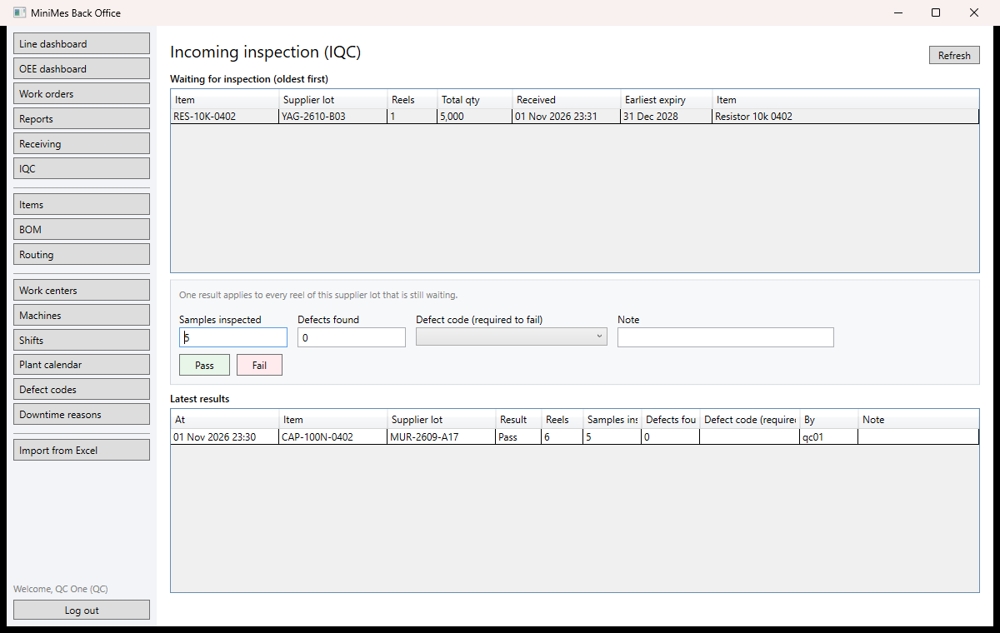

**Nạp vật tư** (Kiosk, nút **Material** trên màn scan): checklist vật tư mà WO đang mở cần ở trạm và reel đang nạp. Scan nhãn reel → **xanh** (nạp, reel cũ cùng item tự tháo), **vàng** (còn reel cũ hơn có hàng: nạp reel đó, hoặc chọn lý do rồi supervisor quẹt thẻ), **đỏ** (sai item, item của bước khác, Hold, chưa qua IQC, hết hàng, hết hạn: không có nút cho qua). Mọi lần thử nạp được ghi `MaterialVerificationLogs`. Tháo reel: nhập số còn lại thực tế (0 = hết, lot thành `Consumed`).

| Endpoint | Nội dung |
| --- | --- |
| `GET /api/stations/{id}/material-loads` | Checklist của trạm |
| `POST /api/stations/{id}/material-loads` `{ lotNo, slotNo?, supervisorBadge?, overrideReason? }` | Nạp; 200 + `outcome` (Accepted/Warning/Rejected) + `code`; 422 trạm chưa mở WO; 409 hai kiosk nạp cùng item cùng lúc |
| `POST /api/stations/{id}/material-loads/{loadId}/unload` `{ remainingQty? }` | Tháo reel |

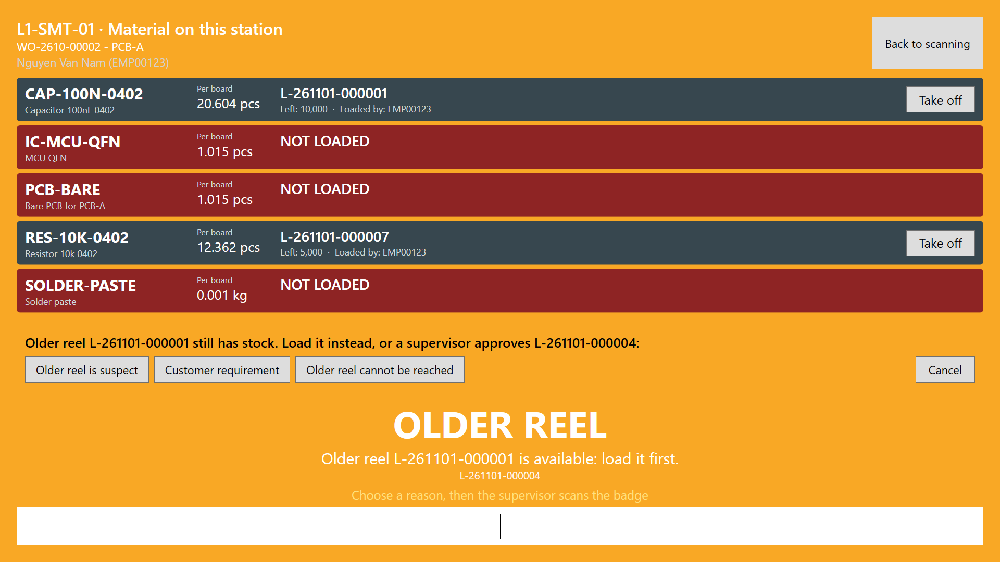

**Tiêu hao khi scan OK**: mỗi scan OK ở bước có vật tư quản lý theo lot ghi `SerialComponents` (board dùng lot nào) và trừ số lý thuyết của lot, trong **cùng transaction** với lần scan. Trạm chưa nạp đủ reel, hoặc reel đang nạp bị Hold/hết hạn → scan bị chặn `MaterialNotLoaded` (kể cả scan của máy qua MQTT). Tắt bằng `Material__EnforceLoadedMaterial=false` khi muốn chạy demo M3–M5 mà không nạp reel.

**Dữ liệu truy xuất mẫu** (Development, tự seed khi khởi động, spec M6 mục 3): WO `WO-TRACE` đã đóng, 200 board `TRACE-0001`…`TRACE-0200` ở `L1-SMT-01`. Tụ `CAP-100NF`: board 1–120 từ `L-CAP-A`, 121–200 từ `L-CAP-B` (tách từ reel `L-CAP-P`); cả hai reel gốc thuộc supplier lot `SUP-S1`. Điện trở `RES-100K`: cả 200 board từ `L-RES-A` (`SUP-R1`).

**Truy xuất** (BackOffice, menu **Traceability**, role `QC`/`Supervisor`/`Admin`): *Serial (backward)* → cây board → lot đã dùng (trạm, giờ, operator, người nạp reel) → lot cha, mở nhánh nào tải nhánh đó. *Lot* hoặc *Supplier lot + mã hàng (forward)* → mọi board đã dùng, nhóm theo vị trí hiện tại, **Export Excel**, **Hold lot** (lot đó, các reel cùng lô giao hàng và lot tách ra từ chúng; chỉ M7 mới gỡ được). Thử với dữ liệu mẫu: `TRACE-0150`, `L-CAP-B`, `SUP-S1` + `CAP-100NF`.

| Endpoint | Nội dung |
| --- | --- |
| `GET /api/trace/forward?lotNo=` hoặc `?supplierLot=&itemCode=` | Board đã dùng lot, đếm theo vị trí |
| `GET /api/trace/forward.xlsx?…` | Cùng kết quả, file Excel (giờ nhà máy) |
| `GET /api/trace/backward?serialNo=` | Lịch sử vật tư của một board (phẳng) |
| `GET /api/trace/nodes/{serial\|lot}/{key}/children` | Một cấp của cây (lazy-load) |
| `POST /api/trace/hold-lot` `{ lotNo }` | Hold lot, lô giao hàng và lot con |

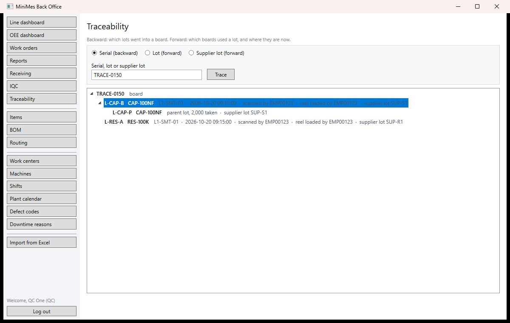
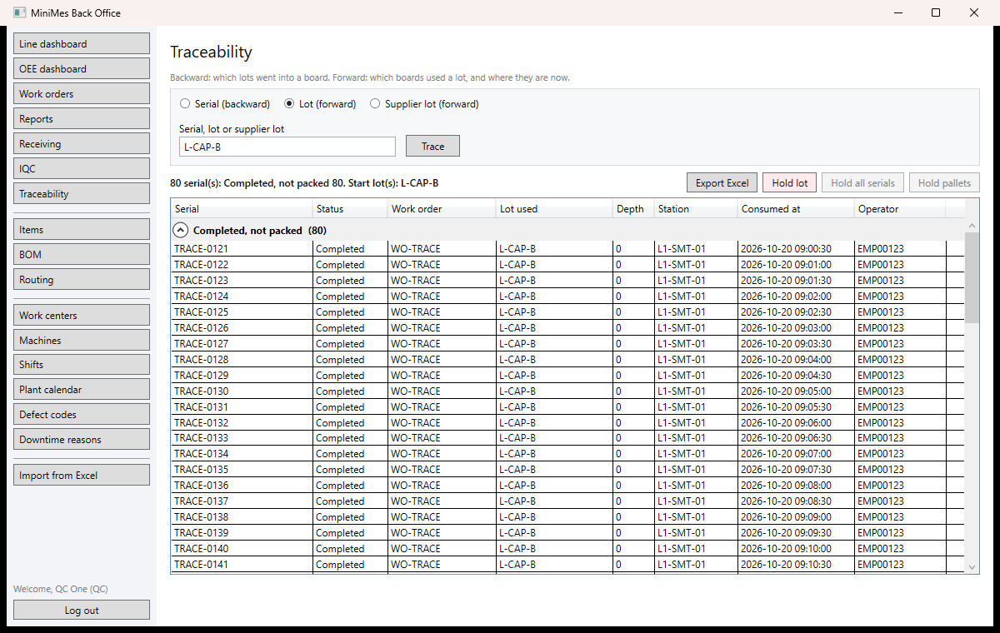

## Edge Gateway (M4b)

Máy không nói MQTT thì đi qua **edge gateway** (`MiniMes.EdgeGateway`, .NET Worker): đọc PLC, chuẩn hóa sang đúng hợp đồng MQTT của M4, đệm vào SQLite khi mất mạng. MES không biết máy nói giao thức gì ([ADR-009](ARCHITECTURE.md#adr-009-edge-gateway-tự-viết-opc-ua-subscription-modbus-polling-outbox-sqlite-luôn-bật)).

```
 MachineSimulator                              MiniMes.EdgeGateway                                   Broker / MES
 lò reflow  L1-REFLOW-01  ──OPC UA subscription──▶ OpcUaDriver ─┐
 (opc.tcp://…:4840, ns=2;s=Reflow.PeakTemp …)                   ├▶ Channel ─▶ Normalizer ─▶ outbox SQLite ─▶ Forwarder ─QoS 1─▶ Mosquitto ─▶ MqttIngestService
 máy dán keo L1-GLUE-01 ◀──Modbus FC03 mỗi 1 s──── ModbusDriver ┘   (msgId = hash nội dung)  (xóa sau PUBACK)            (M4, chỉ thêm nhánh _sys)
 (5020, HR0-1 bộ đếm CDAB, HR2 state, HR3 alarm)   HealthPublisher: heartbeat máy · status máy online/offline · status gateway + LWT
```

**Chạy trên máy dev** (thêm vào phần M4): `dotnet run --project src/MiniMes.EdgeGateway` đọc `gateway.tags.json` (GW01: lò OPC UA + máy dán keo Modbus). Lệnh simulator thêm: `drift L1-REFLOW-01 0.3` (nhiệt độ trôi 0,3 °C/phút, `off` để tắt), `sensor L1-REFLOW-01 bad|good`, `opcua stop|start`, `modbus stop|start`.

**Chạy bằng Docker** (simulator + gateway trong container, API vẫn chạy trên máy):

```bash
docker compose --profile plant up -d --build     # sqlserver, mosquitto, simulator, gateway
docker attach mes-simulator                       # gõ lệnh simulator; thoát: Ctrl+P rồi Ctrl+Q (Ctrl+C sẽ dừng nó)
docker compose --profile plant down               # volume gateway-data (outbox), gateway-pki (chứng chỉ) được giữ
```

Profile `plant` tách riêng để `docker compose up -d` quen thuộc không đụng simulator chạy bằng `dotnet run` (trùng cổng 4840/5020 và MQTT client id). Trong container, cấu hình ghi đè bằng biến môi trường (`mqtt__host=mosquitto`, `devices__0__endpoint=opc.tcp://simulator:4840`…).

**Xem node bằng UaExpert** (Unified Automation, miễn phí, cần đăng ký): *Server → Add* → *Custom Discovery* → `opc.tcp://localhost:4840` → chọn endpoint *None – None* (dev) → *Connect*; nếu UaExpert báo hostname khác (`simulator` khi chạy Docker) thì chọn dùng hostname của URL discovery. Trong *Address Space*: `Objects/Reflow/PeakTemp`, `Counter`, `State` (`ns=2`); kéo `PeakTemp` sang *Data Access View* để thấy subscription, gõ `drift L1-REFLOW-01 1` ở simulator và nhìn giá trị tăng. Không có UaExpert: `dotnet run docs/learning/labs/opcua-lab.cs -- opc.tcp://localhost:4840 0.5 20 urn:minimes:simulator:reflow Reflow.PeakTemp Reflow.Counter Reflow.State`.

**Chạy như Windows Service** (PC công nghiệp trong tủ điện; PowerShell admin; gateway có `AddWindowsService`):

```powershell
dotnet publish src/MiniMes.EdgeGateway -c Release -o C:\MiniMes\Gateway
sc.exe create MiniMesGateway binPath= "C:\MiniMes\Gateway\MiniMes.EdgeGateway.exe" start= auto
sc.exe failure MiniMesGateway reset= 86400 actions= restart/5000/restart/5000/restart/30000   # tự khởi động lại khi chết
sc.exe start MiniMesGateway
sc.exe stop MiniMesGateway; sc.exe delete MiniMesGateway                                        # gỡ
```

Service chạy ở môi trường Production: **không** tự chấp nhận chứng chỉ OPC UA lạ. Chứng chỉ của PLC nằm ở `pki\rejected`, người vận hành chuyển sang `pki\trusted` (production nên dùng `SignAndEncrypt`).

Số đo (máy dev, 28/10/2026; DoD M4b):

| Đo gì | Kết quả | Yêu cầu |
| --- | --- | --- |
| `opcua stop` → ô lò Offline (3 lần) | 4,1–4,6 s, không Andon | ≤ 5 s, không Andon |
| Kill gateway → thẻ gateway đỏ (LWT) / 2 máy của nó Offline | 0 s / ~28–30 s; `L1-SMT-01` (MQTT trực tiếp) không đổi | |
| Dừng Mosquitto 87 s → gửi bù | 66 message trong 2,9 s; `SUM(Delta)` khớp simulator; 0 reset giả; mỗi count đúng giờ máy | không mất, không trùng |
| Kill gateway khi 16 dòng đang chờ → chạy lại | gửi tiếp 47 message trong 2,1 s, 0 msgId trùng ở MES | không trùng |
| Deadband 0,5 °C (lò, 15 s) | 13 → 8 notification | |
| `wordOrder: ABCD` (cố tình sai) | bộ đếm 100.000 đọc thành 2.258.632.705 ([incidents](docs/incidents.md)) | |

Test tự động: `tests/MiniMes.IntegrationTests/Gateway/GatewayEndToEndTests.cs` chạy Mosquitto thật (Testcontainers) + OPC UA server và Modbus slave của simulator + host gateway thật trong một process: đúng topic/schema (đọc bằng chính `MachineMessageReader` của MES), dừng broker 20 giây không mất message và đúng thứ tự (đã thử đột biến: bỏ outbox thì test đỏ), tắt Modbus slave → `status = offline`.

Điểm đáng nói khi phỏng vấn: vì sao có gateway (MES chỉ hiểu một hợp đồng; thêm S7/MC Protocol = thêm một driver), subscription vs polling, outbox luôn bật + xóa sau PUBACK + `msgId` cố định (ít nhất một lần + idempotent), Offline ≠ Down ≠ gateway chết, sự cố "2 tỷ sản phẩm" do thứ tự word Modbus. Ghi chú học từng bước: [`docs/learning/M4b-*`](docs/learning/).

## Performance

Scan qua API, SQL Server 2022 trong Docker, `ScanLogs` **10 triệu dòng**, 8 luồng song song, máy i5-12400F / 16 GB / SSD. Chi tiết, plan và cách chạy lại ở [`docs/perf.md`](docs/perf.md).

| | p50 | p95 | p99 |
| --- | ---: | ---: | ---: |
| Index `(SerialNo, ScannedAt)` theo spec | 17,9 ms | **24,8 ms** | 31,4 ms |
| Không index | 1.396 ms | 1.708 ms | 1.786 ms |

- Câu "scan gần nhất của serial" giảm từ 128.519 xuống 12 logical reads (145 ms → 0,028 ms).
- Thêm `INCLUDE` chỉ bớt thêm 14 µs mà index to hơn 20 %, nên không dùng.
- Tham số `nvarchar` gặp cột `varchar` làm SQL Server bỏ index (`CONVERT_IMPLICIT`): 147 ms dù có index.
- Chạy đo còn tìm ra một race condition mà test đồng thời bỏ sót (ở `incidents.md`).

Truy xuất (M6), `SerialComponents` **5 triệu dòng**:

| | Kết quả |
| --- | ---: |
| Xuôi một supplier lot (12.500 serial), qua API | 87–120 ms |
| Ngược một serial, qua API | 3–5 ms |
| Ngược một serial, tham số `varchar` / `nvarchar` (SQL) | 0,65 / 82,6 ms |
| Scan SMT có ghi tiêu hao, p95 (1 / 8 luồng) | 26,8 / 76,1 ms (không ghi: 19,2 / 32,5) |

- Bẫy `nvarchar` của M3 lặp lại trong SQL viết tay của truy xuất; đã sửa và có test chặn.
- Index phủ đủ cột bớt 1/3 logical reads nhưng không nhanh hơn, mà index to hơn 76 %: giữ index theo spec.

## Chạy test

```bash
dotnet test tests/MiniMes.UnitTests          # nhanh, không cần Docker: Domain, ViewModel, ApiClient, luật kiến trúc
dotnet test tests/MiniMes.IntegrationTests   # cần Docker: Testcontainers bật SQL Server (+ Mosquitto cho test MQTT và gateway), test xong tự xóa
```

Integration test chạy API ở môi trường `Testing`: tự `MigrateAsync()` + seed trên DB mới, secret lấy từ biến môi trường (không đọc user-secrets). Docker không chạy thì test **fail**, không bị bỏ qua. CI (GitHub Actions) chạy cả hai, cộng build 2 app WPF trên Windows.

## Audit trail

Mọi thay đổi trên bảng master (Site/Area/Line/Station, User, Role, Item, BOM, Routing và các danh mục M1) tự ghi vào `AuditLog` qua `AuditSaveChangesInterceptor`, cùng transaction với dữ liệu: ai, lúc nào (UTC), giá trị cũ → mới. Admin xem bằng `GET /api/audit-logs?tableName=Stations&recordKey=1`.

`AuditLog` chỉ được INSERT: trigger `TR_AuditLog_BlockModify` chặn UPDATE/DELETE, kể cả với `sa`. Ở môi trường thật, ứng dụng dùng tài khoản riêng (không phải sysadmin) và thêm:

```sql
DENY UPDATE, DELETE ON dbo.AuditLog TO [minimes_app];
```

Giới hạn: db_owner/sysadmin vẫn có thể `DISABLE TRIGGER` hoặc `TRUNCATE`; muốn chặn cả họ cần tách quyền DBA, SQL Server Audit hoặc Ledger table. Chi tiết: [`ARCHITECTURE.md`](ARCHITECTURE.md).

## Gặp lỗi khi chạy

| Triệu chứng | Nguyên nhân thường gặp |
| --- | --- |
| Container `mes-sqlserver` thoát ngay | Mật khẩu SA yếu: xem `docker compose logs sqlserver` |
| `Login failed for user 'sa'` dù mật khẩu đúng | Một SQL Server khác đang chiếm cổng 1433: dùng `MSSQL_PORT=14333` (bước 1, 3). Chi tiết ở [`docs/incidents.md`](docs/incidents.md) |
| API báo `ConnectionStrings:Default is not configured` hoặc `Jwt:Key must be...` | Chưa làm bước 3 (user-secrets chỉ được đọc ở môi trường `Development`) |
| `docker compose up` báo container name đã tồn tại | Một bản clone khác của repo đang chạy: `docker compose down` ở thư mục đó trước |
| Đổi `MSSQL_SA_PASSWORD` trong `.env` rồi `Login failed` | Mật khẩu SA được lưu vào volume ở lần chạy **đầu tiên**; sửa `.env` sau đó không có tác dụng. Dùng lại mật khẩu cũ, hoặc `docker compose down -v` (**xóa toàn bộ dữ liệu DB**) rồi chạy lại từ bước 2 |
| `dotnet ef` báo `NETSDK1004 ... project.assets.json not found` | Chưa build/restore: chạy `dotnet build` trước (bước 4) |
| Hai bản clone trên cùng máy "đụng" cấu hình | User-secrets gắn theo `UserSecretsId` trong `.csproj`, nên mọi bản clone trên một máy dùng chung connection string và `Jwt:Key` |
| App WPF: "Cannot reach server" | API chưa chạy, hoặc `ApiBaseUrl` trong `appsettings.json` sai cổng |

## Cấu trúc repo

```
src/MiniMes.Domain          entity, quy tắc nghiệp vụ (không phụ thuộc EF/ASP.NET)
src/MiniMes.Application     use case (MediatR + FluentValidation), IAppDbContext, ICurrentUser
src/MiniMes.Infrastructure  EF Core, migration, audit interceptor, JWT, seeder
src/MiniMes.Api             Controller, middleware (CorrelationId, ProblemDetails), auth
src/MiniMes.Contracts       DTO dùng chung API ↔ WPF
src/MiniMes.Client.Core     ApiClient, ViewModel dùng chung, Strings.resx
src/MiniMes.BackOffice.Wpf  app văn phòng
src/MiniMes.Kiosk.Wpf       app trạm
src/MiniMes.MachineSimulator giả lập máy: MQTT, OPC UA server (lò reflow), Modbus slave (máy dán keo), vai trạm scan
src/MiniMes.EdgeGateway     edge gateway: OPC UA + Modbus → MQTT, outbox SQLite (Worker Service / Windows Service)
docker/                     mosquitto.conf, Dockerfile của simulator và gateway
tests/                      unit test, integration test (Testcontainers)
spec/                       spec dự án và từng module
scripts/                    seed 10 triệu ScanLog / 5 triệu SerialComponent, đo SQL các phương án index, benchmark API scan (docs/perf.md)
docs/                       ERD master data, SOP mẫu, file import mẫu, perf.md, incidents.md (lỗi đáng nhớ và bài học)
```
