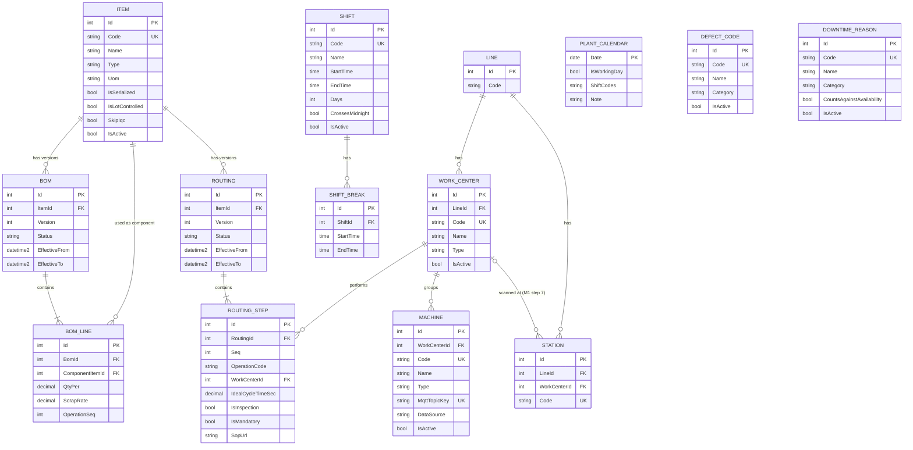

# ERD và dữ liệu mẫu — Module 1 (Master Data)

Bản đồ dữ liệu của M1, viết **trước** khi code (M1 bước 1). Mọi bước sau đối chiếu với file này: bảng/cột ở bước 2, đáp án explode ở bước 6, dữ liệu seed ở bước 9. Nguồn: [`spec/module-01-master-data.md`](../spec/module-01-master-data.md) mục 1.2, 1.4 và `spec/spec.md` mục "Entity chính" của M1.

## 1. ERD

Bảng của M0 (`Lines`, `Stations`) vẽ để thấy chỗ nối; `Item` là trung tâm.



## 2. Bảng và cột

Quy ước chung (từ M0): bảng master kế thừa `AuditableEntity` (`CreatedAt` UTC, `CreatedBy`) và gắn `IAudited` (mọi thay đổi vào `AuditLog`); không xóa cứng (`IsActive = false`, BOM/Routing hết hiệu lực bằng `EffectiveTo`); FK tới `Item` và `WorkCenter` dùng `OnDelete(Restrict)`. Bảng con (`BomLines`, `RoutingSteps`, `ShiftBreaks`) gắn `IAudited` nhưng không có `CreatedAt/By` riêng (đi theo bảng cha).

| Bảng | Cột (kiểu SQL) | Ràng buộc / quy tắc (số = quy tắc ở spec mục 1.4) |
| --- | --- | --- |
| `Items` | `Code` nvarchar(50), `Name` nvarchar(200), `Type` nvarchar(20) (`Raw`/`Semi`/`Finished`), `Uom` nvarchar(10), `IsSerialized` bit, `IsLotControlled` bit, `SkipIqc` bit, `IsActive` bit | `Code` unique, không phân biệt hoa/thường (collation CI), chỉ `A–Z 0–9 - _ .` (1). Cờ theo Type: Raw = lot, không serial; Finished = serial, không lot; Semi = cả hai false. `SkipIqc` chỉ cho Raw (18) |
| `Boms` | `ItemId` FK, `Version` int, `Status` nvarchar(20) (`Draft`/`Approved`), `EffectiveFrom` datetime2 null, `EffectiveTo` datetime2 null | Unique `(ItemId, Version)`, Version tăng dần (2). Hiệu lực nửa mở `[From, To)`, mỗi Item tối đa 1 bản Approved hiệu lực tại một thời điểm (5). Approved thì khóa (6) |
| `BomLines` | `BomId` FK (cascade), `ComponentItemId` FK, `QtyPer` decimal(18,6), `ScrapRate` decimal(9,6), `OperationSeq` int | `QtyPer > 0`; check `0 <= ScrapRate < 1` (lưu phân số: 2% = 0.02); unique `(BomId, ComponentItemId)`, không tự tham chiếu Item cha (4); không vòng (3, DFS) |
| `Routings` | `ItemId` FK, `Version` int, `Status`, `EffectiveFrom`, `EffectiveTo` | Như `Boms` (cùng cơ chế version, spec mục 1.2.6) |
| `RoutingSteps` | `RoutingId` FK (cascade), `Seq` int, `OperationCode` nvarchar(20), `WorkCenterId` FK, `IdealCycleTimeSec` decimal(9,3), `IsInspection` bit, `IsMandatory` bit, `SopUrl` nvarchar(500) null | Unique `(RoutingId, Seq)`; ≥ 1 bước; `IdealCycleTimeSec > 0` (8) |
| `WorkCenters` | `LineId` FK, `Code` nvarchar(50), `Name`, `Type` nvarchar(20), `IsActive` | `Code` unique |
| `Machines` | `WorkCenterId` FK, `Code` nvarchar(50), `Name`, `Type` nvarchar(50), `MqttTopicKey` nvarchar(50), `DataSource` nvarchar(10) (`Mqtt`/`OpcUa`/`Modbus`), `IsActive` | `Code` unique; `MqttTopicKey` unique, không chứa `/ + #` hay khoảng trắng (10). Line suy ra qua WorkCenter |
| `Shifts` | `Code` nvarchar(10), `Name`, `StartTime` time, `EndTime` time, `Days` int (`[Flags]` T2…CN), `CrossesMidnight` bit, `IsActive` | `Code` unique; `Start != End` (11). `CrossesMidnight` suy ra từ giờ (`End <= Start`), vẫn lưu để truy vấn |
| `ShiftBreaks` | `ShiftId` FK (cascade), `StartTime` time, `EndTime` time | Nằm trong ca (kể cả qua nửa đêm), không chồng nhau, tổng < độ dài ca (11) |
| `PlantCalendar` | `Date` date (PK), `IsWorkingDay` bit, `ShiftCodes` nvarchar(50) null, `Note` nvarchar(200) null | Chỉ lưu ngoại lệ, mỗi ngày tối đa 1 dòng (17) |
| `DefectCodes` | `Code` nvarchar(20), `Name`, `Category` nvarchar(50), `IsActive` | `Code` unique |
| `DowntimeReasons` | `Code` nvarchar(20), `Name`, `Category` nvarchar(20) (`Planned`/`Unplanned`), `CountsAgainstAvailability` bit, `IsActive` | `Unplanned` thì luôn `CountsAgainstAvailability = true` (12) |
| `Stations` (M0, sửa) | thêm `WorkCenterId` int null FK | Nullable: trạm Repair không thuộc bước routing nào |

### Đối chiếu với spec "Entity chính" của M1

| Entity (spec.md) | Cột spec yêu cầu | Có trong ERD |
| --- | --- | --- |
| `Item` | Code, Name, Type, UoM, IsSerialized, IsLotControlled, IsActive (+ **[v2]** SkipIqc) | ✓ |
| `Bom` | ItemId, Version, EffectiveFrom, EffectiveTo, Status | ✓ |
| `BomLine` | BomId, ComponentItemId, QtyPer, ScrapRate, OperationSeq | ✓ |
| `Routing` | ItemId, Version, Status | ✓ (+ EffectiveFrom/To, xem quyết định 2) |
| `RoutingStep` | RoutingId, Seq, OperationCode, WorkCenterId, IdealCycleTimeSec, IsInspection, IsMandatory (+ **[v2]** SopUrl) | ✓ |
| `WorkCenter` / `Machine` | Code, LineId, Type; Machine có MqttTopicKey (+ **[v2]** DataSource) | ✓ (Machine lấy Line qua WorkCenter, xem quyết định 3) |
| `Shift` / `ShiftBreak` | StartTime, EndTime, Days, CrossesMidnight | ✓ |
| `DefectCode` | Code, Name, Category | ✓ |
| `DowntimeReason` | Code, Name, Category, CountsAgainstAvailability | ✓ |
| **[v2]** `PlantCalendar` | Date, IsWorkingDay, ShiftCodes, Note | ✓ |

## 3. Dữ liệu mẫu (seed, bước 9)

### Items

| Code | Name | Type | Uom | IsSerialized | IsLotControlled | SkipIqc |
| --- | --- | --- | --- | --- | --- | --- |
| `PCB-A` | Controller board A | Finished | pcs | ✓ | | |
| `PCBA-SMT` | PCB-A after SMT | Semi | pcs | | | |
| `PCB-BARE` | Bare PCB for PCB-A | Raw | pcs | | ✓ | |
| `RES-10K-0402` | Resistor 10k 0402 | Raw | pcs | | ✓ | |
| `CAP-100N-0402` | Capacitor 100nF 0402 | Raw | pcs | | ✓ | |
| `IC-MCU-QFN` | MCU QFN | Raw | pcs | | ✓ | |
| `SOLDER-PASTE` | Solder paste | Raw | kg | | ✓ | |
| `CONN-USBC` | USB-C connector | Raw | pcs | | ✓ | |
| `SHIELD-CAN` | EMI shield can | Raw | pcs | | ✓ | |
| `PACK-BAG` | ESD packing bag | Raw | pcs | | ✓ | ✓ |

### BOM (v1, Approved, hiệu lực từ ngày seed)

```
PCB-A (Finished)
├─ PCBA-SMT       x1        scrap 1%    Seq 20   (Semi, có BOM riêng)
│   ├─ PCB-BARE       x1        scrap 0,5%   Seq 10
│   ├─ RES-10K-0402   x12       scrap 2%     Seq 10
│   ├─ CAP-100N-0402  x20       scrap 2%     Seq 10
│   ├─ IC-MCU-QFN     x1        scrap 0,5%   Seq 10
│   └─ SOLDER-PASTE   x0,0006   scrap 5%     Seq 10   (kg)
├─ CONN-USBC      x1        scrap 0,5%  Seq 20
├─ SHIELD-CAN     x1        scrap 0,5%  Seq 20
└─ PACK-BAG       x1        scrap 0%    Seq 40
```

`OperationSeq` của BOM `PCBA-SMT` dùng số Seq của routing `PCB-A` (MVP chỉ có 1 routing; spec mục 1.2.4).

### Routing `PCB-A` (v1, Approved)

| Seq | OperationCode | WorkCenter | IdealCycleTimeSec | IsInspection | IsMandatory | SopUrl |
| --- | --- | --- | --- | --- | --- | --- |
| 10 | SMT | `WC-SMT` | 30 | | ✓ | `/sop/PCB-A/SMT-v1.pdf` |
| 20 | ASSY | `WC-ASSY` | 60 | | ✓ | `/sop/PCB-A/ASSY-v1.pdf` |
| 30 | TEST | `WC-TEST` | 45 | ✓ | ✓ | `/sop/PCB-A/TEST-v1.pdf` |
| 40 | PACK | `WC-PACK` | 20 | | ✓ | `/sop/PCB-A/PACK-v1.pdf` |

### Work Center, Machine, Station (Line 1)

| WorkCenter | Machine (DataSource) | Station (M0) nối vào |
| --- | --- | --- |
| `WC-SMT` | `L1-SMT-01` (Mqtt), `L1-REFLOW-01` (OpcUa) | `L1-SMT-01` |
| `WC-ASSY` | `L1-GLUE-01` (Modbus) | `L1-ASM-01` |
| `WC-TEST` | `L1-TEST-01` (Mqtt) | `L1-TEST-01` |
| `WC-PACK` | — | `L1-PACK-01` |
| — | — | `L1-REPAIR` (`WorkCenterId = null`) |

`MqttTopicKey` = `Code` của máy. Lưu ý: máy `L1-SMT-01`/`L1-TEST-01` và trạm `L1-SMT-01`/`L1-TEST-01` trùng mã nhưng là hai thứ khác nhau (máy gửi dữ liệu MQTT; trạm là chỗ operator scan), nằm ở hai bảng khác nhau. Line 2 chưa có Work Center ở M1 (seed chỉ Line 1 theo spec bước 9).

### Shift

| Code | Giờ | Ngày | Nghỉ | Thời gian kế hoạch |
| --- | --- | --- | --- | --- |
| `S1` | 06:00–14:00 | T2–T7 | 10:00–10:15, 11:30–12:15 | 480 − 60 = **420** phút |
| `S2` | 14:00–22:00 | T2–T7 | 18:00–18:45, 20:00–20:15 | **420** phút |
| `S3` | 22:00–06:00 (qua nửa đêm) | T2–T6 | 01:00–01:45, 03:30–03:45 | **420** phút |

`PlantCalendar`: các ngày lễ VN của năm hiện tại (`IsWorkingDay = false`) + 1 Chủ nhật tăng ca (`IsWorkingDay = true`, `ShiftCodes = S1`).

### DefectCode, DowntimeReason

Theo spec mục 1.2.10 (6 mã mỗi loại, seed bổ sung lên 8–10): `SLD-BRG`, `SLD-OPN`, `CMP-MIS`, `CMP-POL`, `FUN-NOPWR`, `COS-SCR`; `PM`, `NOPLAN`, `CHG-MODEL` (Planned), `MCH-FAULT`, `MAT-WAIT`, `FDR-JAM` (Unplanned).

## 4. Đáp án explode: 200 × `PCB-A`

Công thức mỗi dòng: `nhu cầu con = nhu cầu cha × QtyPer × (1 + ScrapRate)`. Cộng dồn theo NVL ở lá rồi mới làm tròn; `pcs` làm tròn **lên**. Đã tính lại bằng code (số thập phân chính xác) khớp bảng của spec.

| NVL | Phép tính | Giá trị chính xác | Kết quả |
| --- | --- | --- | --- |
| (`PCBA-SMT`, trung gian) | 200 × 1 × 1,01 | 202 | — |
| `PCB-BARE` | 202 × 1 × 1,005 | 203,01 | **204** |
| `RES-10K-0402` | 202 × 12 × 1,02 | 2472,48 | **2473** |
| `CAP-100N-0402` | 202 × 20 × 1,02 | 4120,8 | **4121** |
| `IC-MCU-QFN` | 202 × 1 × 1,005 | 203,01 | **204** |
| `SOLDER-PASTE` | 202 × 0,0006 × 1,05 | 0,12726 kg | **0,127 kg** (xem câu hỏi mở) |
| `CONN-USBC` | 200 × 1 × 1,005 | 201 | **201** |
| `SHIELD-CAN` | 200 × 1 × 1,005 | 201 | **201** |
| `PACK-BAG` | 200 × 1 × 1 | 200 | **200** |

Bẫy cần test: quên scrap ở cấp giữa thì điện trở ra 2448 (thiếu 25); làm tròn ở cấp giữa thì sai số tích lũy.

## 5. Quyết định

1. **`Station.WorkCenterId`** (spec mục 1.2.8): làm ở **M1 bước 7**, cột nullable. Route check ở M3 cần biết trạm làm công đoạn nào; trạm Repair nằm ngoài routing nên để null.
2. **Routing có `EffectiveFrom/EffectiveTo`** như BOM. `spec.md` chỉ liệt kê `ItemId, Version, Status`, nhưng spec M1 mục 1.2.6 nói "Routing cũng có version theo cùng cơ chế" và bước 5 nói "tương tự cho Routing".
3. **Machine không có cột `LineId`** riêng: Line suy ra qua `WorkCenter.LineId` (một nguồn sự thật, tránh hai cột lệch nhau).
4. **`Category` của DefectCode là chuỗi** (danh mục mở: Solder, Component, Functional, Cosmetic…); `Category` của DowntimeReason là enum `Planned`/`Unplanned` (công thức OEE ở M5 dựa vào nó).
5. **Mã Item** dùng `A–Z 0–9 - _ .` (spec 1.4 quy tắc 1), khác mã Site/Line/Station của M0 (`A–Z 0–9 -`, vì mã M0 nằm trong topic MQTT).

### Câu hỏi mở (chốt trước bước 6)

- **Làm tròn NVL đơn vị liên tục (`kg`):** giá trị chính xác là 0,12726 kg, spec ghi 0,127 kg. Spec chỉ nói "giữ thập phân". Đề xuất: API trả **giá trị chính xác** (không làm tròn, để không cấp thiếu), WPF hiển thị 3 chữ số thập phân; test DoD so `Math.Round(x, 3) == 0.127`.
