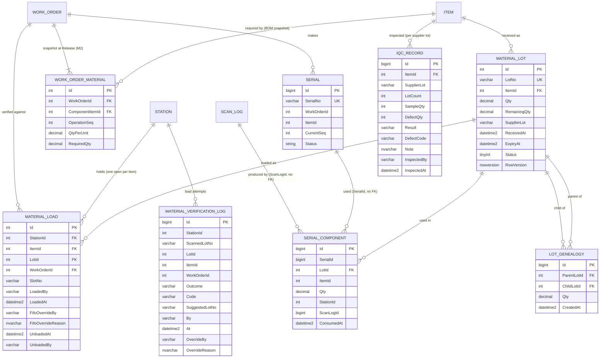

# ERD — Module 6 (Material & Traceability)

Bản đồ dữ liệu của M6, viết ở bước 1. Nguồn: [`spec/module-06-material-traceability.md`](../spec/module-06-material-traceability.md) mục 2.1, 2.3 và quy tắc R1–R18.

**Khác snippet SQL của spec (user duyệt 01/11/2026):** `MaterialLot` có khóa `Id int` + `LotNo` unique (không dùng `LotNo` làm PK); các bảng cạnh tham chiếu `LotId int` và `SerialId bigint` thay cho chuỗi `LotNo`/`SerialNo`. Cùng kiểu với phần còn lại của dự án (Item, Serial, ScanLog), và bảng lớn `SerialComponents` (~100 triệu dòng sau 5 năm, spec 2.3) mỗi dòng nhẹ hơn khoảng 40 byte. Truy vấn truy xuất join `MaterialLots`/`Serials` một lần ở cuối để lấy mã in ra.

## 1. ERD

Bảng của M1/M2/M3 vẽ để thấy chỗ nối.



`WorkOrderMaterial` đã có `OperationSeq` và `QtyPerUnit` từ M2 (spec M6 bước 1 việc (3) không cần làm thêm): cho biết vật tư tiêu thụ ở bước nào, mỗi bo bao nhiêu.

## 2. Ràng buộc ở tầng DB

| Quy tắc | Cách DB ép |
| --- | --- |
| R1 `LotNo` duy nhất | Unique `IX_MaterialLots_LotNo` |
| R6 một lot đang nạp mỗi (trạm, item) | Filtered unique `UX_MaterialLoads_ActivePerStationItem (StationId, ItemId) WHERE UnloadedAt IS NULL` |
| R9 không ghi tiêu hao hai lần | Unique `UX_SerialComponents_SerialStationItemLot (SerialId, StationId, ItemId, LotId)` |
| R10 tồn lý thuyết không âm, không vượt số nhận | `CK_MaterialLots_Qty`: `Qty > 0 AND RemainingQty BETWEEN 0 AND Qty` |
| R11, R16 hồ sơ insert-only | Trigger `INSTEAD OF UPDATE, DELETE` trên `SerialComponents`, `LotGenealogy`, `MaterialVerificationLogs`, `IqcRecords` (như `ScanLogs`, ADR-004) |
| R12 không có vòng | `CK_LotGenealogy_NotSelf` chặn cạnh tự trỏ; vòng dài hơn do use case ghi cạnh chặn, CTE có giới hạn độ sâu |

`SerialComponents` không có FK tới `Serials`/`Stations`/`ScanLogs` (giống `ScanLogs`): đây là lệnh INSERT nóng nhất của hệ thống, và hồ sơ phải còn nguyên dù master data đổi. FK tới `MaterialLots` vẫn giữ: một dòng tiêu hao trỏ vào lot không tồn tại là truy xuất hỏng.

## 3. Index theo đường truy cập (spec 2.3)

| Truy vấn | Index |
| --- | --- |
| Xuôi: lot → serial | `IX_SerialComponents_LotId INCLUDE (SerialId)` |
| Ngược: serial → lot | `UX_SerialComponents_SerialStationItemLot` (bắt đầu bằng `SerialId`) |
| Đệ quy xuôi / ngược | `IX_LotGenealogy_ParentLotId_ChildLotId` (unique) / `IX_LotGenealogy_ChildLotId INCLUDE (ParentLotId, Qty)` |
| Bắt đầu từ supplier lot, IQC | `IX_MaterialLots_SupplierLot_ItemId` |
| Lot đang nạp (mỗi scan OK) | `UX_MaterialLoads_ActivePerStationItem INCLUDE (LotId)` |
| Ai nạp lot này | `IX_MaterialLoads_LotId_LoadedAt` |
| Ứng viên FIFO | `IX_MaterialLots_ItemId_Status_ReceivedAt INCLUDE (RemainingQty, ExpiryAt)` |

## 4. Trạng thái lot

`Status` lưu số (`tinyint`) vì bước 5 trừ tồn bằng một câu `UPDATE` có so sánh trạng thái:
`0 Available`, `1 Hold`, `2 Consumed`, `3 PendingIqc` **[v2]**, `4 IqcRejected` **[v2]**.

```
nhập kho ──▶ PendingIqc ──IQC đạt──▶ Available ──hết số dư──▶ Consumed
   │ (SkipIqc)    └──IQC không đạt──▶ IqcRejected (chỉ NCR M7 mới đổi)
   └────────────────────────────────▶ Available ◀──▶ Hold (M7 / "Hold lot")
```
