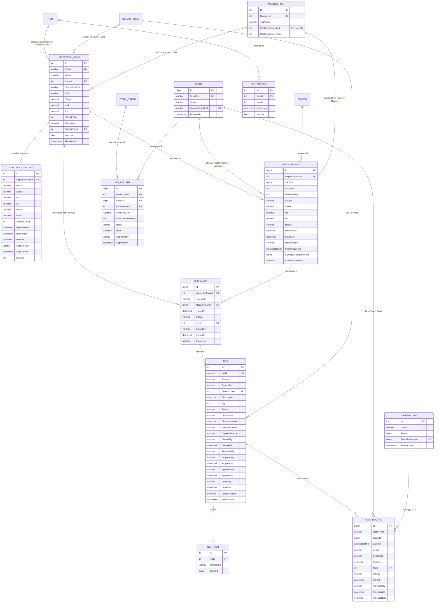

# ERD — Module 7 (Quality: Inspection, SPC, NCR, FAI, Hold)

Bản đồ dữ liệu của M7, viết ở bước 1. Nguồn: [`spec/module-07-quality.md`](../spec/module-07-quality.md) mục 1.2, 1.4 (Q1–Q20), 2.3, 2.3b, 2.5, 2.5b, 2.6.

**Ba quyết định khi vẽ (user duyệt 03/11/2026), khác chữ của spec:**

1. **Khóa là `Id`**, như M6 và M3b. `HoldRecord` và `NcrItem` dùng `TargetType` + `TargetId bigint` thay cho `TargetKey` (mã). `Measurement` dùng `SerialId` thay cho `SerialNo`. Câu Hold set-based join thẳng theo Id với `SerialComponents` (M6) và `CartonSerials` (M3b), vì hai bảng đó cũng dùng Id. Màn hình join ra mã để hiển thị.
2. **Plan ổn định + snapshot giới hạn trên số đo** (thay cho "version mới" của Q15):
   - `InspectionPlan` là một đặc tính cố định (`3V3_RAIL`).
   - Mỗi `Measurement` chụp lại `Usl`/`Lsl` dùng lúc đo, cùng với `Result`. Kết quả lịch sử vì vậy không đổi khi spec đổi; đây là ý của Q15.
   - Đổi USL/LSL đi qua audit (M0, `IAudited`): ai đổi, lúc nào, giá trị cũ.
   - `MachineTag.SpcCharacteristicId` (M4) và `ControlLimitSet` trỏ ổn định vào plan. Giới hạn kiểm soát thuộc về quy trình, không thuộc về spec, nên không bị chép theo mỗi lần đổi spec.
3. **Plan gắn công đoạn bằng `ItemId` + `OperationCode`** (`PCB-A` + `TEST`), không bằng `RoutingStepId`:
   - Routing (M1) có version, còn WO chạy theo snapshot `WorkOrderOperation` (M2). Mã công đoạn thì không đổi qua các version.
   - Plan của máy (`REFLOW_PEAK_TEMP`) không có item hay công đoạn; nó được nối qua `MachineTag`.

## 1. Ôn nghiệp vụ: tính lại tay ví dụ 10 điểm (spec 1.2)

Dữ liệu rail 3V3 trên 10 board: `3,32 3,36 3,28 3,33 3,31 3,37 3,27 3,32 3,35 3,29`; LSL = 3,135, USL = 3,465.

| Đại lượng | Công thức | Spec | Tính lại |
| --- | --- | --- | --- |
| mean | Σx / n | 3,320 | 3,3200 |
| Σ(x − mean)² | | 0,0102 | 0,010200 |
| σ mẫu | √(Σ / (n − 1)) | 0,03367 | 0,03367 (chia n: 0,03194, lệch ~5 %) |
| UCL / LCL | mean ± 3σ | 3,421 / 3,219 | 3,4210 / 3,2190 |
| Cp | (USL − LSL) / 6σ | 1,634 | 1,634 |
| Cpu / Cpl | (USL − mean) / 3σ, (mean − LSL) / 3σ | 1,436 / 1,832 | 1,436 / 1,832 |
| Cpk | min(Cpu, Cpl) | 1,436 | 1,436 |
| MR | \|xᵢ − xᵢ₋₁\| | 0,04 0,08 0,05 0,02 0,06 0,10 0,05 0,03 0,06 | giống |
| MR̄ | ΣMR / 9 | 0,0544 | 0,0544 |
| UCL_MR | 3,267 × MR̄ | 0,178 | 0,1779 |

Mọi số khớp với spec. Có một quan sát cho mục 4 (σ within và σ overall):
- Ước lượng σ của I chart theo cách giáo trình, `MR̄ / 1,128 = 0,0483`, **lớn hơn** σ mẫu 0,0337.
- Lý do: 10 điểm này đổi chiều lên xuống liên tục, nên các điểm liên tiếp chênh nhau nhiều.
- MVP dùng σ mẫu, như spec chọn. Cùng một dữ liệu, giới hạn kiểm soát có thể khác nhau tùy cách ước lượng σ, nên báo cáo phải ghi rõ đã dùng cách nào.

### USL ≠ UCL: giải thích bằng 3,44 V

Baseline của rail 3V3: mean 3,302, σ 0,040, nên UCL = 3,422 và LCL = 3,182. Spec của khách: 3,135–3,465.

Một board đo được **3,440 V**:
- So với **USL 3,465** (do khách định): board **đạt**. Nó dùng được và được giao.
- So với **UCL 3,422** (quy trình tự tính từ chính nó): điểm này **vượt**, z = (3,440 − 3,302) / 0,040 = 3,45. Quy trình hôm nay đang làm khác mọi khi.

Board không hỏng, nhưng quy trình có nguyên nhân bất thường cần tìm trước khi ra board hỏng. Vì vậy M7 có hai cơ chế độc lập:
- **Vượt USL/LSL** thì board NG (Q1).
- **Vượt UCL/LCL hay có hình dạng lạ** thì tạo `SpcAlert`, không NG board nào (Q6).

Tình huống ngược còn nguy hiểm hơn: nếu σ = 0,070 thì UCL = 3,512, nằm **ngoài** USL. Chart trông "sạch" mà khoảng 1,8 % board vẫn ngoài spec. Phát hiện chuyện này là việc của Cpk, không phải của control chart.

Kiểm lại z của các ví dụ rule (baseline 3,302 / 0,040):
- WE1: 3,430 → z = +3,20.
- WE2: 3,390 / 3,310 / 3,400 → z = +2,20 / +0,20 / +2,45.
- Run 7: 3,318 … 3,316 → z từ +0,18 đến +0,70, tất cả trên đường tâm.

## 2. ERD

Bảng của M1–M6 và M3b chỉ vẽ phần nối.



## 3. Bảng mới

| Bảng | Vai trò | Ghi chú |
| --- | --- | --- |
| `InspectionPlans` | Đặc tính cần đo: ở đâu, so với giới hạn nào, NG bằng mã lỗi nào | Master data, `IAudited` (đổi USL/LSL có vết). `Usl`/`Lsl` nullable cho đặc tính một phía (độ phẳng chỉ có USL). `ItemId`/`OperationCode` null với plan của máy. Không xóa cứng: `IsActive = false` |
| `ControlLimitSets` | Baseline Phase I: mean, σ, UCL/LCL, MR̄, UCL_MR | Q3: cố định; chỉ thay khi QC tính lại có lý do (dòng mới, dòng cũ `IsActive = false`, giữ làm lịch sử). σ > 0 bằng CHECK (z không được chia 0) |
| `Measurements` | Từng số đo, insert-only (Q16) | `Usl`/`Lsl` chụp lúc đo (quyết định 2). `Source`: số đo tay, từ trạm (`SerialId`, `StationId`) hay từ máy (`MachineTagId`, `SourceTs`, không serial, Q18). Sửa số sai bằng một dòng hiệu chỉnh (`CorrectsMeasurementId` + lý do), không UPDATE. `ClientRequestId` chống ghi đôi khi trạm gửi lại |
| `SpcAlerts` | Một lần rule vi phạm, gắn với điểm đo gây ra | Dedupe Q5 bằng filtered unique. Đóng khi NCR từ nó đóng, hoặc QC đánh dấu đã xử lý (ghi `CloseNote`) |
| `Ncrs` | Hồ sơ không phù hợp: cái gì, bao nhiêu, ai đề xuất, ai duyệt | `NcrNo` từ SEQUENCE `NcrSeq` dạng `NCR-000001` (6 chữ số, không reset, như lot/thùng). `IAudited` + `RowVersion`. `Description` thêm ở bước 2: mô tả bằng lời người phát hiện, mã lỗi không đủ |
| `NcrItems` | Đối tượng của NCR (serial hoặc lot) | RTV chỉ khi mọi target là lot (Q13) |
| `HoldRecords` | Mỗi dòng một target bị giữ; nguồn lịch sử của Hold | Ghi set-based (`INSERT … SELECT`). `BatchId` gom một lần Hold hàng loạt. `Scope`/`ScopeRef` nói đã chọn bằng gì (lot `L-…`, pallet `P…`, máy + khoảng thời gian…) để audit đọc được. Chỉ UPDATE 3 cột release; không DELETE |
| `FaiTemplates` | Phiếu FAI của một item (mục tự động + mục tay) | `ItemsJson` = `[{ code, text, kind: Auto/Manual }]`; có version, một bản active mỗi item |
| `FaiRecords` | Kết quả FAI của một WO, insert-only | Q17: Pass chỉ khi `AutoChecksPassed` |

## 4. Bảng có sẵn được sửa

| Bảng | Thêm / đổi | Vì sao |
| --- | --- | --- |
| `Serials` (M2) | `StatusBeforeHold varchar(20) NULL` | Release khôi phục đúng trạng thái cũ (`Completed` không thành `Created`), mục 2.6 điểm 2 |
| `MaterialLots` (M6) | `StatusBeforeHold tinyint NULL`; enum thêm `5 Scrapped`, `6 Returned` | Hiệu ứng disposition Scrap / RTV lên lot (spec 2.5). Giá trị mới thêm vào cuối, số cũ không đổi |
| `MachineTags` (M4) | FK `SpcCharacteristicId → InspectionPlans.Id` | Cột đã có từ M4, chưa có FK ("no FK until M7") |
| `WorkOrders` (M2) | Không đổi: đã có `FaiStatus`, `FaiSerialNo` | FAI của M7 gọi `wo.RecordFaiResult` và thay endpoint tạm của M3 |

## 5. Ràng buộc và index (bước 2 sẽ làm)

| Quy tắc / truy vấn | Cách DB ép hoặc phục vụ |
| --- | --- |
| Mã plan duy nhất | Unique `InspectionPlans (Code)` |
| Trạm tìm plan của bước (item của WO + mã công đoạn) | `InspectionPlans (ItemId, OperationCode) WHERE IsActive = 1` (một bước có thể đo nhiều đặc tính) |
| Một baseline active mỗi plan (Q3) | Filtered unique `ControlLimitSets (InspectionPlanId) WHERE IsActive = 1`; CHECK `Sigma > 0` |
| N điểm gần nhất của plan (chart, rule engine) | `Measurements (InspectionPlanId, MeasuredAt DESC) INCLUDE (Value, SerialId, Result)` |
| Số đo của một serial (FAI, truy xuất) | `Measurements (SerialId) WHERE SerialId IS NOT NULL` |
| Mẫu máy không ghi đôi (2.3b) | Filtered unique `Measurements (MachineTagId, SourceTs) WHERE MachineTagId IS NOT NULL` |
| Trạm gửi lại không ghi đôi | Filtered unique `Measurements (ClientRequestId, InspectionPlanId) WHERE ClientRequestId IS NOT NULL` (bước 5: một request mang nhiều đặc tính) |
| Đúng một nguồn cho số đo | CHECK: `Source = 'Machine'` thì có `MachineTagId`, không `SerialId`; ngược lại có `SerialId` |
| Q16 số đo insert-only | Trigger `INSTEAD OF UPDATE, DELETE` (như `ScanLogs`, ADR-004); `FaiRecords` cũng vậy |
| Q5 một alert mở mỗi (plan, rule) | Filtered unique `SpcAlerts (InspectionPlanId, RuleCode) WHERE Status = 'Open'` |
| Q8 đếm Hold active của một target | `HoldRecords (TargetType, TargetId) WHERE ReleasedAt IS NULL` |
| Release cả một lần Hold | `HoldRecords (BatchId)` |
| NCR theo trạng thái (danh sách) | `Ncrs (Status, CreatedAt)` |
| Một FAI template active mỗi item | Filtered unique `FaiTemplates (ItemId) WHERE IsActive = 1`; unique `(ItemId, Version)` |

Kiểu số: `decimal(18,6)` cho `Value`, `Usl`, `Lsl`, `Target` và các giới hạn đã lưu. So spec bằng `decimal` (Q2), còn thống kê tính bằng `double` trong `SpcCalculator`. Mọi thời điểm là UTC `datetime2`.

## 6. Enum

Lưu dạng chuỗi (dễ đọc trong SSMS, filtered index viết bằng chữ), trừ `MaterialLotStatus` vẫn là số như M6.

| Enum | Giá trị |
| --- | --- |
| `MeasurementSource` | `Manual`, `Station`, `Machine` |
| `MeasureResult` | `Ok`, `Ng` |
| `SpcRuleCode` | `WE1`, `WE2`, `WE3` (tùy chọn, tắt mặc định), `WE4` (run 7), `OutOfSpec` (mẫu máy vượt USL/LSL, Q18), `DataGap` (3 chu kỳ không có mẫu, 2.3b) |
| `SpcAlertStatus` | `Open`, `Closed` |
| `NcrSource` | `SpcAlert`, `Inspection`, `ScanNg`, `Traceability`, `Customer`, `Manual` |
| `NcrStatus` | `Open`, `UnderReview`, `Dispositioned`, `Closed`, `Cancelled` |
| `NcrDisposition` | `UseAsIs`, `Rework`, `Scrap`, `ReturnToVendor` |
| `HoldTargetType` | `Serial`, `Lot` (thùng, pallet được mở rộng thành serial, Q19) |
| `HoldScope` | `Lot`, `Serials`, `Carton`, `Pallet`, `MachineWindow` |
| `FaiCheckKind` | `Auto`, `Manual` |
| `FaiAutoCheck` | `BomMatch`, `TestPassed`, `MeasurementsInSpec` |
| `FaiResult` | `Pass`, `Fail` |
| `MaterialLotStatus` (M6, thêm) | `5 Scrapped`, `6 Returned` |

## 7. Vòng đời

```
NCR      Open ──StartReview──▶ UnderReview ──Approve (người khác người đề xuất, Q11)──▶ Dispositioned ──Close (không còn Hold, Q12)──▶ Closed
           │                    │  ▲ Propose / RejectProposal (không đổi trạng thái)
           └────────────────────┴──▶ Cancelled (chưa Dispositioned; Hold liên quan phải thả)

Hold     Serial: <trạng thái> ──Hold──▶ Hold (StatusBeforeHold = trạng thái cũ) ──Release cuối cùng──▶ <trạng thái cũ>
         (Hold chồng nhau: còn HoldRecord active nào thì vẫn Hold, Q8; Scrapped không Hold, Q10)

SpcAlert Open ──NCR đóng / QC đánh dấu đã xử lý──▶ Closed     (trong lúc Open: vi phạm cùng rule không tạo alert mới, Q5)

FAI      WO.FaiStatus Pending ──FaiRecord Pass (QC, tự động xanh, Q17)──▶ Passed
                         └──Fail──▶ serial mẫu NG (M3), WO vẫn Pending, board kế tiếp thành mẫu mới
```

**Các điểm thực thi Hold đã có sẵn**, M7 không phải sửa (Q7):
- Route check của M3 chặn serial `Hold` (`SerialHold`).
- Kiểm nạp vật tư của M6 chặn lot `Hold` (`LotOnHold`).
- Gate tiêu hao của M6 chặn scan khi reel đang nạp bị `Hold`.
- Palletize và ship của M3b chặn thùng/pallet có serial `Hold`.

M7 chỉ cần đổi `Status` ở **một nơi** (nguồn sự thật), rồi ghi `HoldRecord`.
