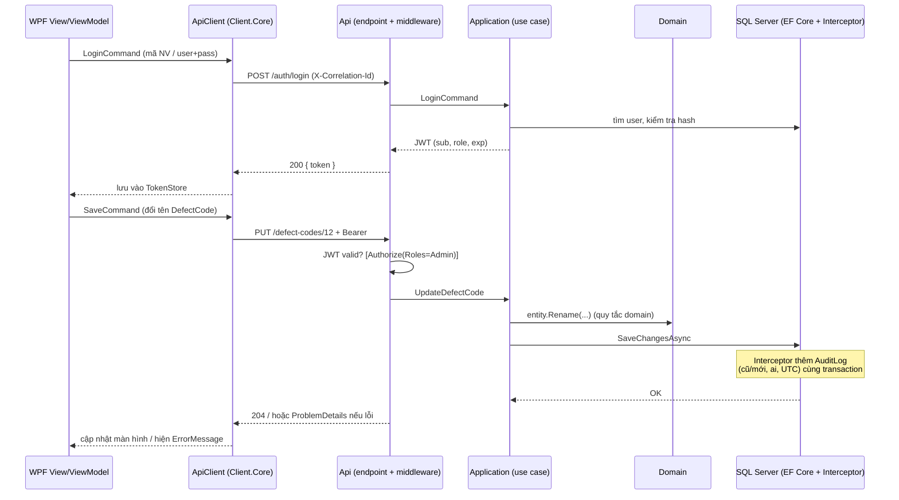

# Module 0 — Nền tảng kỹ thuật (Foundation)

> Module 0 không làm nghiệp vụ sản xuất trực tiếp. Nó dựng "bộ khung" để 10 module sau cắm vào: solution Clean Architecture, SQL Server + Mosquitto chạy bằng Docker Compose, logging, xử lý lỗi, đăng nhập theo role, audit trail, cấu hình Site/Line/Station, CI và khung client WPF.
> Sau khi xong bạn có: clone repo → `docker compose up` → chạy API → Swagger mở được → app WPF Back-office login được bằng user seed.
> Thời lượng ước tính: 2–2,5 tuần (~25 giờ, khoảng 13–15 buổi 1,5–2 giờ). Phần WPF/MVVM chiếm nhiều thời gian nhất vì bạn chưa dùng.
> Module tiên quyết: không có. Cần sẵn **.NET 10 SDK**, Docker Desktop (bật WSL2), công cụ `dotnet-ef` 10.x, và IDE hỗ trợ .NET 10: Visual Studio 2026 (workload .NET desktop; VS 2022 không hỗ trợ chính thức .NET 10), Rider bản mới, hoặc VS Code + C# Dev Kit. Công cụ xem SQL: SSMS hoặc extension MSSQL của VS Code.
>
> **Cập nhật theo [spec-v2](spec-v2.md):** thêm cấp `Area` (ISA-95) giữa Site và Line; `AuditLog` bị chặn UPDATE/DELETE bằng trigger ở DB; kịch bản demo 13 bước. Các chỗ đổi được đánh dấu **[v2]**.
>
> **Quyết định kỹ thuật chốt 10/2026** (đánh dấu **[chốt 10/2026]**): **.NET 10 (LTS)** thay .NET 8, vì .NET 8 và .NET 9 cùng hết hỗ trợ ngày 10/11/2026; tên project `MiniMes.*`; API dùng **Controller**; CI bằng **GitHub Actions**; audit bản ghi Added/Deleted lưu **một dòng JSON**; ánh xạ lỗi `DomainException` → 422, `ConflictException` → 409; seed thêm trạm Repair (10 station).

---

## 1. Kiến thức nghiệp vụ MES

### 1.1 Bức tranh tổng thể

**Nhà máy điện tử vận hành bằng những hệ thống nào?** Tiêu chuẩn ISA-95 chia phần mềm/thiết bị của một nhà máy thành các tầng (level):

```
Level 4  ERP (SAP, Oracle...)     Kế hoạch kinh doanh: đơn hàng, mua hàng, tài chính, tồn kho tổng
            ▲  ▼  lệnh sản xuất xuống / sản lượng, tiêu hao báo lên
Level 3  MES                      Điều hành sản xuất: WO, truy xuất, chất lượng, OEE, Andon   <== dự án này
            ▲  ▼  công thức, lệnh chạy / dữ liệu máy, kết quả
Level 2  SCADA / HMI / PLC        Giám sát và điều khiển máy theo thời gian thực
Level 1  Cảm biến, bộ điều khiển  Đọc tín hiệu, chạy động cơ
Level 0  Quá trình vật lý         Máy gắp linh kiện, lò reflow, đầu test
```

Nói ngắn: **ERP biết "cần làm gì, bao nhiêu, bán cho ai"; PLC biết "máy đang quay hay dừng"; MES nằm giữa và trả lời "đang làm gì, ở đâu, ai làm, đạt hay không, dùng vật tư nào".**

**Vì sao nhà máy cần MES mà ERP không thay được?**

- ERP ghi nhận theo đơn vị ngày/ca và theo WO ("WO-001 làm xong 200 cái"). ERP không biết serial nào đang nằm ở trạm nào lúc 10:15.
- Khách hàng (Apple, Samsung, hãng ô tô...) yêu cầu truy xuất: "serial X dùng reel linh kiện nào, máy nào gắp, ai vận hành, test lúc mấy giờ". Không có MES thì trả lời bằng cách lục sổ giấy và file Excel, mất vài ngày.
- Quản lý xưởng cần số liệu trong ca, không phải cuối tháng: máy nào đang dừng, OEE ca này bao nhiêu, WO trễ bao nhiêu.
- Poka-yoke bằng phần mềm: không cho công nhân bỏ qua công đoạn, nạp nhầm linh kiện, cho hàng đang Hold đi tiếp.

**Module 0 nằm ở đâu?** Nó không phải một chức năng mà là **lớp nền dưới mọi chức năng**. Người dùng không "dùng" Module 0, nhưng họ dùng ngay hai thứ của nó: màn hình Login và (gián tiếp) audit trail. Người dùng thật của Module 0 là chính bạn và các module sau: mỗi module đều cần "ai đang gọi API này?", "ghi log thế nào?", "lỗi trả về dạng gì?", "máy khác dựng lại hệ thống được không?".

### 1.2 Khái niệm & thuật ngữ

**MES (Manufacturing Execution System)**: phần mềm điều hành sản xuất ở Level 3. Ví dụ ở xưởng điện tử: WO-2026-0001 làm 200 bo `PCB-A` trên Line 1; MES sinh 200 serial, chỉ cho phép bo đi SMT → Assembly → Test → Pack theo đúng thứ tự, ghi mọi lần scan.

**Sáu vai trò người dùng** (đúng như spec):

| Vai trò | Làm gì trong ngày | Dùng app nào | Ví dụ quyền |
| --- | --- | --- | --- |
| **Planner** | Tạo WO, chia line, ca, release WO; theo dõi tiến độ | BackOffice | Tạo/release WO; không được scan sản xuất |
| **Operator** | Đứng trạm, scan serial, nạp reel, bấm Andon | Kiosk | Scan, nạp vật tư, gọi Andon; không sửa master data |
| **Supervisor** | Quản lý 1 line/ca: xem dashboard, xác nhận Andon, chọn lý do dừng, override FIFO, đóng WO thủ công | BackOffice + Kiosk | Ack/Resolve Andon, override có ghi audit |
| **QC** | Kiểm tra chất lượng, nhập đo lường, xử lý NCR, Hold/Release lot và serial | BackOffice | Hold/Release, tạo NCR |
| **Maintenance** | Sửa máy khi hỏng, bảo trì định kỳ | BackOffice | Xem/cập nhật lệnh bảo trì, đóng Andon "hỏng máy" |
| **Admin** | Quản lý user, role, master data, cấu hình Site/Line/Station | BackOffice | Toàn quyền quản trị; xem AuditLog |

Một người có thể có nhiều role (supervisor kiêm QC), nên trong token JWT `role` là một danh sách.

**Phân quyền (authorization)**: kiểm tra "người này được làm hành động này không". Khác với **xác thực (authentication)** = "người này là ai". Ở kiosk, operator không gõ mật khẩu: họ quẹt thẻ nhân viên, đầu đọc gõ ra chuỗi `EMP00123` + Enter. Đây là kiểu "định danh nhanh" chấp nhận được ở xưởng vì tốc độ quan trọng hơn bảo mật mật khẩu; đổi lại quyền của tài khoản operator phải hẹp.

**Audit trail**: bảng ghi lại **ai đã đổi gì, lúc nào, giá trị cũ và mới**. Ví dụ dòng `AuditLog`:

```
Table=WorkOrder  Key=1042  Column=Status  Old=Draft  New=Released
By=planner01  At=2026-10-01T01:23:45Z
```

Khác với log kỹ thuật (Serilog): log kỹ thuật dành cho dev tìm lỗi, có thể xóa sau 30 ngày; audit trail là **bằng chứng nghiệp vụ**, giữ nhiều năm, không được sửa hay xóa.

**Mô hình Site / Line / Station**:

- **Site**: một nhà máy (ví dụ `VN-BN01` — nhà máy Bắc Ninh).
- **Line**: dây chuyền sản xuất trong nhà máy (`L1`, `L2`). Một WO chạy trên một line.
- **Station**: một vị trí làm việc trên line, nơi operator đứng hoặc máy đặt: `L1-SMT-01`, `L1-ASM-01`, `L1-TEST-01`, `L1-PACK-01`. Scan serial luôn xảy ra "tại một station".
- Quan hệ: `Site 1—n Area 1—n Line 1—n Station` (**[v2]** thêm `Area`). Ở M1, `Machine` gắn vào `Line` (và Work Center); mã máy trong topic MQTT ở M4 (`minimes/{site}/{area}/{line}/{machine}/...`) dùng chính mã Site/Line này, nên đặt mã ổn định, không có khoảng trắng.

Số liệu demo: 1 site, 1 area, 2 line, mỗi line 4 station theo routing (SMT, Assembly, Test, Pack) và 1 station Repair ngoài routing (`L1-REPAIR`, dùng ở M3) → 1 Site + 1 Area + 2 Line + 10 Station. **[chốt 10/2026]**

**[v2] Vì sao có `Area`.** Mô hình thiết bị của ISA-95 là Enterprise → Site → **Area** → Line → Work Cell. Topic MQTT của M4 (Unified Namespace) đi theo đúng các cấp này: `minimes/{site}/{area}/{line}/{machine}/...`. Ở demo chỉ có 1 area (`SMT-ASSY`, khu SMT và lắp ráp), nhưng có bảng ngay từ M0 thì thêm area thứ hai (ví dụ khu đúc nhựa) không phải đổi topic hay đổi schema.

**Kịch bản demo 13 bước của toàn dự án** (theo [spec-v2](spec-v2.md) mục B2; đọc kỹ, mọi module phục vụ nó):

1. Admin import Excel danh sách Item/BOM/Routing của model `PCB-A`. *(M1)*
2. Planner tạo WO 200 pcs cho Line 1 → Release → sinh 200 serial, in nhãn ZPL. *(M2)*
3. Kho nhập 3 reel → lot `PendingIqc` → QC làm IQC đạt → `Available`. *(M6)*
4. Operator nạp reel lên máy SMT; MES kiểm tra đúng vật tư và FIFO. *(M6)*
5. FAI: serial đầu tiên đi hết các bước → QC duyệt → line mới được chạy hàng loạt. *(M2, M3, M7)*
6. Simulator chạy: máy SMT gửi qua MQTT, lò reflow là OPC UA server, máy dán keo dùng Modbus TCP (gateway đọc rồi đẩy lên MQTT); trạm Test gửi OK/NG qua API. *(M4, M4b)*
7. Operator scan tay trên kiosk, xem SOP; 1 con NG → Repair → Test lại → OK. *(M3)*
8. Ngắt mạng gateway–broker 60 giây → gateway đệm → có mạng lại thì gửi bù, không mất bộ đếm. *(M4b)*
9. Máy Down → Andon → quá 3 phút chưa Ack thì leo thang → chọn lý do dừng. *(M4, M5)*
10. Nhiệt độ reflow trôi → SPC báo vi phạm → QC tạo NCR, Hold các serial qua lò trong khoảng thời gian đó. *(M7)*
11. Trạm Pack: scan serial vào thùng (10 pcs/thùng) → in nhãn thùng → gom thùng thành pallet. *(M3b)*
12. QC phát hiện reel lỗi → truy xuất xuôi: serial → thùng → pallet bị ảnh hưởng → Hold. *(M6, M7)*
13. WO Completed → báo cáo sản lượng/FPY/OEE theo WO, xuất Excel. *(M2, M3, M5)*

Module 0 phục vụ **mọi bước** theo kiểu nền: mọi bước cần login (role đúng), bước 1/2/13 cần audit (master data, trạng thái WO), bước 6/8 cần Docker chạy Mosquitto, mọi màn hình cần khung WPF + `.resx`.

### 1.3 Một ngày ở xưởng

Câu chuyện dưới đây là ví dụ để bạn thấy phân quyền và audit "cắn" vào đâu (số liệu minh họa).

**07:45** — Chị Hoa (Planner) đăng nhập BackOffice bằng `planner01` + mật khẩu. Token JWT có role `Planner`. Chị tạo WO 200 bo `PCB-A` cho Line 1 và release. Hệ thống ghi 2 dòng `AuditLog`: WO tạo mới, `Status: Draft → Released`.

**07:58** — Anh Nam (Operator) ra trạm `L1-TEST-01`, quẹt thẻ `EMP00123`. Kiosk gọi API đăng nhập bằng mã nhân viên, nhận token role `Operator`, có gắn `StationId`. Anh thử mở màn hình "Create Work Order" trên kiosk: API trả `403 Forbidden` vì Operator không có quyền. Kiosk chỉ hiển thị chức năng của operator nên thực tế anh không thấy nút này, nhưng **API vẫn phải chặn** vì ai đó có thể gọi thẳng API bằng Postman.

**09:30** — Anh Tuấn (Supervisor) thấy Test station báo NG nhiều. Anh sửa `DefectCode` "C12 — Solder bridge" đổi tên thành "C12 — Solder short". `AuditLog` ghi: `Table=DefectCode, Column=Name, Old="Solder bridge", New="Solder short", By=sup_tuan`. (Trong bản đầy đủ, chỉ Admin sửa master; ví dụ này minh họa audit, không phải quyền.)

**14:10** — Sáng hôm sau khách hàng gửi email: serial `PCBA0000137` bị lỗi ngoài thị trường, hỏi "ai đã test và release lô này, và có ai chỉnh sửa cấu hình test giữa chừng không?". Chị Lan (QC) mở AuditLog lọc theo WO và thời gian, thấy ngay: WO release lúc nào bởi ai, `IdealCycleTime` của bước Test có bị sửa không. Nếu không có audit trail, câu trả lời là "chúng tôi không biết", và nhiều hợp đồng sẽ bị phạt hoặc mất khách.

**Cuối tháng** — Đoàn audit của khách đến nhà máy (thường gọi là *customer audit*, hoặc audit IATF 16949 nếu làm hàng ô tô). Họ hỏi: "cho tôi xem ai có quyền sửa BOM, và lịch sử sửa BOM tháng trước". Bạn mở màn hình phân quyền + AuditLog và trả lời trong vài phút.

### 1.4 Quy tắc nghiệp vụ & lý do tồn tại

| Quy tắc | Lý do |
| --- | --- |
| Mọi API (trừ login, health) yêu cầu token hợp lệ | Không có "ẩn danh" trong nhà máy; mọi thao tác phải gắn được với người |
| Quyền kiểm tra **ở API**, không chỉ ẩn nút ở UI | UI chỉ là gợi ý; ai cũng gọi được API trực tiếp |
| Operator đăng nhập bằng mã nhân viên, token gắn với station, sống ngắn (ví dụ 12 giờ, hết ca) | Tốc độ ở trạm; giảm rủi ro thẻ bị mượn dùng lâu dài |
| Mỗi bảng giao dịch có `CreatedAt`, `CreatedBy` (spec mục 2) | Biết ai tạo bản ghi này |
| `AuditLog` cho bảng master và trạng thái WO; **chỉ insert, không update/delete** | Bằng chứng không được sửa; nếu sửa được thì không còn là bằng chứng |
| Giá trị cũ/mới lưu theo từng cột đổi | Truy vấn "ai đổi cột X" nhanh; không phải diff cả bản ghi |
| Thời gian lưu UTC (`datetime2`), hiển thị theo giờ nhà máy | Ca đêm qua 0h, nhà máy nhiều múi giờ, giờ mùa hè không gây lệch |
| Không xóa cứng master đã được tham chiếu → `IsActive=false` (chi tiết M1) | Giữ được lịch sử và audit |
| Dựng lại hệ thống trên máy khác chỉ bằng `docker compose up` + README | Khi máy chủ hỏng hoặc dev mới vào, mất vài phút thay vì vài ngày |

### 1.5 Sai lầm/sự cố thường gặp ngoài đời

1. **Dùng chung một tài khoản cho cả ca** ("operator1" cho 6 người). Audit ghi được "operator1 làm" nhưng không biết là ai. Khi khách audit thì không có giá trị. Cách khắc phục: mỗi người một thẻ/mã.
2. **Audit chỉ ở tầng UI** (form ghi log). Ai chạy script SQL trực tiếp, hoặc job nền đổi dữ liệu, thì không có dấu vết. Vì vậy dự án ghi audit ở tầng persistence (interceptor EF Core) để mọi đường ghi đều được bắt.
3. **Cho client nối thẳng SQL Server bằng một tài khoản `sa` hay `mes_app` chung**: nhiều MES cũ ở VN làm vậy. Hệ quả: chuỗi kết nối nằm trong máy trạm, không phân quyền theo người, cập nhật client phải cài lại từng máy. Dự án dùng WPF → API để tránh.
4. **Lưu giờ địa phương**: ca đêm 22:00–06:00 bị chia thành hai "ngày", báo cáo sản lượng sai. (Chi tiết ngày sản xuất ở M5.)
5. **Xóa audit/log để "dọn DB"**: mất khả năng truy vết. Nên archive thay vì xóa.
6. **Môi trường không dựng lại được**: chỉ một máy dev có DB đúng phiên bản, "chạy trên máy tôi được". CI + Docker Compose sinh ra để chặn điều này.
7. **Secret trong repo**: connection string và JWT key commit lên GitHub. Dùng user-secrets ở dev và biến môi trường ở CI/production.

### 1.6 Bảng thuật ngữ

| English | Tiếng Việt | 日本語 | Giải thích ngắn |
| --- | --- | --- | --- |
| MES (Manufacturing Execution System) | Hệ thống điều hành sản xuất | 製造実行システム | Phần mềm Level 3 điều hành xưởng theo thời gian thực |
| ERP | Hoạch định nguồn lực doanh nghiệp | 基幹システム | Level 4: đơn hàng, mua hàng, tài chính |
| ISA-95 | Chuẩn ISA-95 | ISA-95 | Chuẩn chia các tầng hệ thống nhà máy và giao diện giữa ERP–MES |
| Site | Nhà máy / địa điểm | 工場・拠点 | Đơn vị cao nhất trong cấu hình nhà máy |
| Line | Dây chuyền | ライン | Tập hợp các trạm sản xuất một sản phẩm |
| Station | Trạm / vị trí làm việc | ステーション・工程設備 | Nơi scan và ghi nhận công đoạn |
| Authentication | Xác thực | 認証 | Người này là ai |
| Authorization | Phân quyền | 認可・権限管理 | Người này được làm gì |
| Role | Vai trò | ロール・役割 | Nhóm quyền gán cho người dùng |
| Audit trail | Dấu vết kiểm toán | 監査証跡 | Ghi ai đổi gì, khi nào, cũ/mới |
| Traceability | Truy xuất nguồn gốc | トレーサビリティ | Truy ngược/xuôi sản phẩm–vật tư |
| Operator | Công nhân vận hành | オペレーター | Người đứng trạm |
| Supervisor | Giám sát chuyền | 班長・監督者 | Quản lý line/ca |
| Planner | Nhân viên kế hoạch | 生産計画担当 | Tạo và release WO |
| QC | Kiểm soát chất lượng | 品質管理 | Kiểm tra, xử lý lỗi, Hold |
| Customer audit | Đợt đánh giá của khách hàng | 顧客監査 | Khách đến kiểm tra quy trình và hồ sơ |

---

## 2. Kiến thức lập trình

Bạn đã biết C#, ASP.NET Core Web API, EF Core, SQL Server cơ bản, nên các mục dưới chỉ đi sâu phần **mới** với bạn: Clean Architecture, Docker, cấu hình/secret, Serilog, ProblemDetails, JWT theo role, interceptor audit, Testcontainers, GitHub Actions, và WPF + MVVM từ gốc.

### 2.1 Clean Architecture & modular monolith

**Nó là gì.** Cách chia solution thành các project theo *hướng phụ thuộc*: code nghiệp vụ ở giữa, không biết gì về DB, web hay UI; mọi thứ bên ngoài phụ thuộc vào nó, không ngược lại.

**Vấn đề nó giải quyết.** Cách "ngây thơ" (quen thuộc từ WebForms/SIer): controller gọi thẳng `DbContext`, quy tắc nghiệp vụ nằm rải rác trong code-behind hoặc stored procedure. Hậu quả: muốn unit test quy tắc route check phải dựng cả DB; đổi từ SQL Server sang thứ khác phải sửa mọi nơi; module này chọc bảng của module kia nên sửa một chỗ vỡ ba chỗ. Đây đúng là chuyện bạn đã gặp ở kiến trúc Facade → Business → DAO nhưng ở đó các tầng thường vẫn biết nhau theo chiều xuống dưới cùng tới DB.

**Khái niệm cốt lõi.**

- **Quy tắc phụ thuộc**: mũi tên chỉ đi vào trong.

```
Api ───────────────► Application ───► Domain
 │                       ▲               ▲
 └──► Infrastructure ────┘───────────────┘      (Infrastructure cài đặt các interface Application khai báo)
 Contracts: DTO thuần, ai cũng tham chiếu được (kể cả WPF), không tham chiếu ai.

 Client.Core ──► Contracts            BackOffice.Wpf, Kiosk.Wpf ──► Client.Core
 (WPF không tham chiếu Domain/Application/Infrastructure → về mặt biên dịch không có cách nào nối thẳng DB)
```

| Project | Chứa | Không được chứa |
| --- | --- | --- |
| `MiniMes.Domain` | Entity, value object, quy tắc, state machine | EF Core, HTTP, Serilog |
| `MiniMes.Application` | Use case, interface (`IAppDbContext`, `ICurrentUser`), validation. "Bây giờ" lấy từ `TimeProvider` có sẵn của .NET, không tự viết `IClock` | Chi tiết SQL, ASP.NET |
| `MiniMes.Infrastructure` | `DbContext`, migration, interceptor, MQTT, SignalR, job nền | Quy tắc nghiệp vụ |
| `MiniMes.Api` | Endpoint, auth, DI, middleware | Logic nghiệp vụ |
| `MiniMes.Contracts` | DTO chung giữa API và WPF | Entity |
| `MiniMes.Client.Core` | ApiClient, token, ViewModel dùng chung, `Strings.resx` (`net10.0` thuần) | Type WPF; tham chiếu Domain/Application/Infrastructure |
| `MiniMes.BackOffice.Wpf`, `MiniMes.Kiosk.Wpf` | View (XAML), Generic Host (`net10.0-windows`) | Truy cập DB; tham chiếu gì ngoài Client.Core |

- **Modular monolith**: chỉ **một** process/deploy, nhưng bên trong chia theo module (MasterData, Planning, Execution, Machine, Oee, Material, Quality) bằng **feature folder** trong từng layer, ví dụ `Application/Planning/ReleaseWorkOrder/`. Module không truy cập bảng của module khác trực tiếp; cần thì gọi qua interface hoặc nhận domain event (M6). Vì sao không microservice: một người tự học, một DB, không cần scale độc lập; khi nào cần tách thì ranh giới module đã sẵn.
- `CreatedAt/CreatedBy` để trong một base class ở Domain (`AuditableEntity`) để interceptor (mục 2.7) điền.
- **[chốt 10/2026]** **API dùng Controller** cho cả dự án: `Api/Controllers/XxxController.cs`, `[ApiController]`, `[Authorize(Roles = "...")]`, controller mỏng (từ M1: nhận HTTP → `ISender.Send` → trả HTTP). Không trộn với Minimal API; mọi module viết endpoint theo cùng kiểu.
- **[chốt 10/2026]** **.NET 10 (LTS, hỗ trợ đến 11/2028)**: `net10.0` cho backend và Client.Core, `net10.0-windows` cho 2 app WPF. `global.json` ghim SDK để máy có nhiều SDK vẫn build cùng một bản.

**Snippet.** File `.csproj` của Domain (yêu cầu spec: bật `Nullable`, `TreatWarningsAsErrors`) và một dòng tham chiếu:

```xml
<!-- src/MiniMes.Domain/MiniMes.Domain.csproj -->
<Project Sdk="Microsoft.NET.Sdk">
  <PropertyGroup>
    <TargetFramework>net10.0</TargetFramework>
    <Nullable>enable</Nullable>
    <ImplicitUsings>enable</ImplicitUsings>
    <!-- Cảnh báo là lỗi: buộc xử lý null-safety ngay từ Domain -->
    <TreatWarningsAsErrors>true</TreatWarningsAsErrors>
  </PropertyGroup>
  <!-- Domain KHÔNG có ProjectReference/PackageReference nào -->
</Project>
```

```bash
# Ghim SDK + tạo solution + tham chiếu theo đúng chiều phụ thuộc
dotnet new globaljson --sdk-version 10.0.100 --roll-forward latestFeature
dotnet new sln -n MiniMes                          # SDK 10 tạo MiniMes.slnx (định dạng XML mới)
dotnet new classlib -n MiniMes.Domain -o src/MiniMes.Domain
dotnet new classlib -n MiniMes.Contracts -o src/MiniMes.Contracts
dotnet new classlib -n MiniMes.Application -o src/MiniMes.Application
dotnet new classlib -n MiniMes.Infrastructure -o src/MiniMes.Infrastructure
dotnet new webapi --use-controllers -n MiniMes.Api -o src/MiniMes.Api
dotnet add src/MiniMes.Application reference src/MiniMes.Domain src/MiniMes.Contracts
dotnet add src/MiniMes.Infrastructure reference src/MiniMes.Application
dotnet add src/MiniMes.Api reference src/MiniMes.Application src/MiniMes.Infrastructure
```

**Bẫy.** (1) Để `DbSet<>` hay attribute `[Table]` của EF trong Domain, làm Domain phụ thuộc EF. (2) Tạo project `Common`/`Shared` chứa mọi thứ, biến thành bãi rác ai cũng phụ thuộc. (3) Chia layer quá sớm thành 20 project; M0 tạo đúng 8 project src (5 backend ở bước 1, 3 client ở bước 10) + 2 test; M4 thêm `MachineSimulator`, M4b thêm `EdgeGateway`. (4) Hiểu nhầm "modular" là mỗi module một solution; ở đây chỉ là thư mục và quy ước. (5) **[chốt 10/2026]** `.slnx` cần IDE mới (Visual Studio 2026, Rider bản mới, C# Dev Kit); IDE cũ không mở được thì tạo bằng `dotnet new sln --format sln`.

### 2.2 Docker và Docker Compose

**Nó là gì.** Docker chạy phần mềm trong **container**: một môi trường cô lập, đóng gói sẵn hệ điều hành mỏng + phần mềm + cấu hình. **Image** là bản đóng gói (như file cài đặt), **container** là một lần chạy của image. **Docker Compose** mô tả nhiều container trong một file YAML và bật/tắt cùng lúc bằng `docker compose up` / `down`.

**Vấn đề nó giải quyết.** Cách ngây thơ: cài SQL Server Developer và Mosquitto lên máy, mỗi người một phiên bản, một mật khẩu, quên cấu hình gì thì lần sau dựng lại không nổi. Với Compose, toàn bộ hạ tầng nằm trong một file được commit vào repo.

**Khái niệm cốt lõi.**

- `image`: dùng image có sẵn (`mcr.microsoft.com/mssql/server:2022-latest`, `eclipse-mosquitto:2`).
- `ports "1433:1433"`: mở cổng container ra máy bạn (trái = cổng máy host, phải = cổng trong container).
- `volumes`: nơi lưu dữ liệu ngoài vòng đời container; không có volume thì `down` là mất DB.
- `environment` / `.env`: truyền cấu hình và mật khẩu, không hard-code trong YAML.
- `healthcheck`: lệnh Docker chạy định kỳ để biết dịch vụ đã **sẵn sàng nhận kết nối** chưa (container "Up" chưa có nghĩa SQL Server đã nhận login). `depends_on` với `condition: service_healthy` dùng nó để sắp thứ tự khởi động.

**Snippet.**

```yaml
# docker-compose.yml (đặt ở gốc repo)
services:
  sqlserver:
    image: mcr.microsoft.com/mssql/server:2022-latest
    environment:
      ACCEPT_EULA: "Y"
      MSSQL_SA_PASSWORD: ${MSSQL_SA_PASSWORD}   # lấy từ file .env (không commit)
    ports: ["1433:1433"]
    volumes: ["mssql-data:/var/opt/mssql"]
    healthcheck:
      # Đường dẫn công cụ sqlcmd phụ thuộc phiên bản image: kiểm tra lại nếu lỗi
      test: ["CMD-SHELL", "/opt/mssql-tools18/bin/sqlcmd -C -S localhost -U sa -P \"$$MSSQL_SA_PASSWORD\" -Q \"SELECT 1\" || exit 1"]
      interval: 10s
      timeout: 5s
      retries: 10
      start_period: 20s
  mosquitto:
    image: eclipse-mosquitto:2
    ports: ["1883:1883"]
    volumes: ["./docker/mosquitto.conf:/mosquitto/config/mosquitto.conf:ro"]
    healthcheck:
      test: ["CMD-SHELL", "mosquitto_sub -t '$$SYS/#' -C 1 -i healthcheck -W 3 || exit 1"]
      interval: 10s
      timeout: 5s
      retries: 5
volumes:
  mssql-data:
```

```
# docker/mosquitto.conf  (Mosquitto 2.x mặc định KHÔNG cho kết nối từ ngoài nếu thiếu listener)
listener 1883
allow_anonymous true      # chỉ cho môi trường dev
persistence true
persistence_location /mosquitto/data/
```

**Bẫy.** (1) Mật khẩu SA không đủ mạnh (cần chữ hoa, thường, số, ký tự đặc biệt, ≥ 8 ký tự) làm container SQL Server tự thoát, nhìn `docker compose logs sqlserver` mới thấy. (2) Quên volume → mất dữ liệu khi `down -v`. (3) Chạy API trong lúc SQL Server chưa healthy → lỗi kết nối lần đầu; hãy để EF/migration retry hoặc đợi healthcheck. (4) Mosquitto 2.x không listener → API/Simulator kết nối bị từ chối. (5) Máy Apple Silicon có thể cần chỉ định platform cho image SQL Server; kiểm tra tài liệu image. (MQTT là gì và topic, QoS: xem Module 4.)

### 2.3 Cấu hình và user-secrets

**Nó là gì.** ASP.NET Core đọc cấu hình từ nhiều nguồn xếp chồng: `appsettings.json` → `appsettings.{Environment}.json` → **user-secrets** (chỉ Development) → **biến môi trường** → tham số dòng lệnh; nguồn sau ghi đè nguồn trước.

**Vấn đề nó giải quyết.** Cách ngây thơ: viết connection string và JWT key thẳng vào `appsettings.json` rồi commit lên GitHub. Bot quét secret sẽ thấy trong vài phút.

**Khái niệm cốt lõi.**

- `appsettings.json` chứa giá trị **không bí mật** (mức log, tên topic).
- User-secrets lưu ngoài thư mục repo (trong thư mục profile của user OS), gắn theo `UserSecretsId` trong `.csproj` của Api.
- Biến môi trường dùng dấu `__` thay `:` để biểu diễn cấp: `ConnectionStrings__Default`, `Jwt__Key`. Đây là cách CI/Docker/production truyền secret.
- **Options pattern**: bind một section vào class có kiểu (`JwtOptions`) và inject `IOptions<JwtOptions>`, thay vì đọc chuỗi rải rác.

**Snippet.**

```bash
# Chạy trong thư mục src/MiniMes.Api (một lần)
dotnet user-secrets init
dotnet user-secrets set "ConnectionStrings:Default" "Server=localhost,1433;Database=MiniMes;User Id=sa;Password=<mật khẩu trong .env>;TrustServerCertificate=True"
dotnet user-secrets set "Jwt:Key" "<chuỗi ngẫu nhiên tối thiểu 32 ký tự>"
```

```csharp
// Application hoặc Api: options có kiểu
public sealed class JwtOptions
{
    public const string SectionName = "Jwt";
    public string Issuer { get; init; } = "MiniMes";
    public string Audience { get; init; } = "MiniMes.Clients";
    public string Key { get; init; } = default!;      // lấy từ secret, không có mặc định
    public int OperatorTokenHours { get; init; } = 12;
    public int UserTokenMinutes { get; init; } = 60;
}

// Program.cs: bind + kiểm tra khi khởi động (Key thiếu thì app không chạy)
builder.Services.AddOptions<JwtOptions>()
    .Bind(builder.Configuration.GetSection(JwtOptions.SectionName))
    .Validate(o => !string.IsNullOrWhiteSpace(o.Key) && o.Key.Length >= 32, "Jwt:Key must be >= 32 chars")
    .ValidateOnStart();
```

**Bẫy.** (1) User-secrets chỉ được nạp khi môi trường là `Development` — chạy `Production` thì không đọc. (2) Connection string của SQL Server trong Docker thường cần `TrustServerCertificate=True` ở dev vì cert tự ký (Microsoft.Data.SqlClient mặc định mã hóa). (3) Quên `.env` trong `.gitignore`. (4) Đặt `Jwt:Key` ngắn: HMAC-SHA256 cần khóa đủ dài, thư viện sẽ ném lỗi.

### 2.4 Serilog và CorrelationId

**Nó là gì.** Serilog là thư viện **structured logging**: log là sự kiện có thuộc tính, không phải chuỗi thuần. **CorrelationId** là mã gắn vào mọi dòng log của **một** request để lần theo toàn bộ đường đi.

**Vấn đề nó giải quyết.** Cách ngây thơ: `Console.WriteLine($"Scan {serial} failed")`. Không lọc được theo serial, không biết dòng nào thuộc request nào khi 8 trạm scan cùng lúc. Ở xưởng, câu hỏi thường là "lúc 10:15 trạm Test scan serial X lỗi gì?" — cần lọc theo thuộc tính.

**Khái niệm cốt lõi.**

- Message template: `Log.Information("Scan {SerialNo} at {StationId} => {Result}", serial, stationId, result)`. `{SerialNo}` thành thuộc tính có thể truy vấn (không nối chuỗi bằng `$""`).
- **Sink**: nơi ghi log (console, file...). **Enricher**: tự thêm thuộc tính (máy, thread, CorrelationId).
- `LogContext.PushProperty("CorrelationId", id)`: mọi log trong `using` scope đều mang thuộc tính này (cần `Enrich.FromLogContext()`).
- Đọc header `X-Correlation-Id` từ client nếu có (WPF sẽ gửi), không có thì sinh mới, và trả lại trong response header. Sau này Simulator/WPF gửi cùng id để nối log hai phía.

**Snippet** (gói `Serilog.AspNetCore`, `Serilog.Sinks.File`; console sink đi kèm Serilog.AspNetCore):

```csharp
// Program.cs
builder.Host.UseSerilog((ctx, services, cfg) => cfg
    .ReadFrom.Configuration(ctx.Configuration)       // mức log lấy từ appsettings
    .Enrich.FromLogContext()
    .WriteTo.Console(outputTemplate:
        "[{Timestamp:HH:mm:ss} {Level:u3}] {CorrelationId} {Message:lj}{NewLine}{Exception}")
    .WriteTo.File("logs/minimes-.log", rollingInterval: RollingInterval.Day, retainedFileCountLimit: 30));

// Middleware gắn CorrelationId cho mỗi request
app.Use(async (ctx, next) =>
{
    var id = ctx.Request.Headers["X-Correlation-Id"].FirstOrDefault() ?? Guid.NewGuid().ToString("N");
    ctx.Response.Headers["X-Correlation-Id"] = id;
    using (Serilog.Context.LogContext.PushProperty("CorrelationId", id))
    {
        await next();
    }
});
app.UseSerilogRequestLogging();   // 1 dòng log gọn cho mỗi request (method, path, status, ms)
```

**Bẫy.** (1) Dùng `$"..."` trong message thay vì template: mất thuộc tính có cấu trúc. (2) Đặt middleware CorrelationId **sau** middleware xử lý lỗi nên dòng log lỗi không có id: đặt nó gần đầu pipeline. (3) Log dữ liệu nhạy cảm (mật khẩu, token). (4) Log mọi scan ở mức Information với hàng triệu dòng: chọn mức và sampling hợp lý; dữ liệu nghiệp vụ đã có trong `ScanLog`, đừng nhân đôi vào file log.

### 2.5 ProblemDetails và exception handling tập trung

**Nó là gì.** `ProblemDetails` là định dạng JSON chuẩn (RFC 7807/9457) cho lỗi HTTP: `type`, `title`, `status`, `detail`, `instance` cùng các trường mở rộng. Exception handling tập trung nghĩa là **một chỗ duy nhất** biến exception thành response, thay vì `try/catch` ở từng endpoint.

**Vấn đề nó giải quyết.** Cách ngây thơ: mỗi endpoint tự `try/catch` và trả chuỗi lỗi mỗi kiểu một khác; client WPF phải đoán format. Với ProblemDetails, `ApiClient` (mục 2.9) chỉ cần một đoạn code đọc lỗi.

**Khái niệm cốt lõi.**

- **[chốt 10/2026]** Ánh xạ dùng cho cả dự án: lỗi validation (`ValidationException`, FluentValidation ở M1) → **400** kèm danh sách lỗi; không tìm thấy → **404**; trùng mã hoặc xung đột concurrency (`ConflictException`, M1/M2) → **409**; vi phạm quy tắc nghiệp vụ (`DomainException`, ví dụ "WO ở trạng thái Draft không thể Complete") → **422**; còn lại → **500** với thông điệp chung, **không lộ stack trace**. Client WPF dựa vào mã: 409 = "dữ liệu đã đổi, tải lại rồi thử lại", 422 = "thao tác không hợp lệ ở trạng thái hiện tại". (Scan bị chặn ở M3 không phải exception: trả 200 kèm `reasonCode`.)
- Từ .NET 8 có `IExceptionHandler` (dùng tiếp ở .NET 10): đăng ký bằng `AddExceptionHandler<T>()`, kích hoạt bằng `UseExceptionHandler()`. (Cách cũ tự viết middleware `try/catch` quanh `next()` vẫn dùng được và là đáp án cho câu "middleware xử lý exception" của spec; chọn một cách, không dùng cả hai.)
- Luôn kèm `traceId`/`correlationId` trong response để người dùng đọc số cho IT tra log.

**Snippet.**

```csharp
// Domain/Common/DomainException.cs — đặt ở Domain vì entity tự ném khi vi phạm quy tắc
public class DomainException(string message) : Exception(message);

// Api/Middleware/GlobalExceptionHandler.cs
public sealed class GlobalExceptionHandler(ILogger<GlobalExceptionHandler> logger) : IExceptionHandler
{
    public async ValueTask<bool> TryHandleAsync(HttpContext ctx, Exception ex, CancellationToken ct)
    {
        var (status, title) = ex switch
        {
            DomainException => (StatusCodes.Status422UnprocessableEntity, "Business rule violated"),
            // M1 thêm: ValidationException => 400, ConflictException => 409
            KeyNotFoundException => (StatusCodes.Status404NotFound, "Not found"),
            _ => (StatusCodes.Status500InternalServerError, "Unexpected error")
        };
        if (status == 500) logger.LogError(ex, "Unhandled exception");   // chỉ lỗi 500 mới log ở mức Error
        var problem = new ProblemDetails
        {
            Status = status, Title = title,
            // 500: giấu chi tiết; nghiệp vụ: trả message để hiển thị cho người dùng
            Detail = status == 500 ? "An unexpected error occurred." : ex.Message
        };
        problem.Extensions["correlationId"] = ctx.Response.Headers["X-Correlation-Id"].ToString();
        ctx.Response.StatusCode = status;
        await ctx.Response.WriteAsJsonAsync(problem, ct);
        return true;   // true = đã xử lý xong, dừng pipeline
    }
}

// Program.cs
builder.Services.AddProblemDetails();
builder.Services.AddExceptionHandler<GlobalExceptionHandler>();
app.UseExceptionHandler();
```

**Bẫy.** (1) Trả `ex.Message` của lỗi 500 ra ngoài có thể lộ tên bảng/SQL. (2) Dùng exception cho luồng thường (scan sai bước là tình huống *bình thường* ở M3, trả kết quả có cấu trúc thay vì ném exception). (3) Không đăng ký `UseExceptionHandler()` trước các middleware khác nên lỗi phía sau không được bắt.

### 2.5b OpenAPI và Swagger UI ở .NET 10 **[chốt 10/2026]**

**Nó là gì.** OpenAPI là file JSON mô tả mọi endpoint (đường dẫn, tham số, kiểu dữ liệu, cách xác thực). Swagger UI là trang web đọc file đó và cho bạn gọi thử API.

**Khác với .NET 8.** Từ .NET 9, template `webapi` không cài Swashbuckle nữa. ASP.NET Core tự sinh tài liệu bằng gói `Microsoft.AspNetCore.OpenApi` (`AddOpenApi()` + `MapOpenApi()` → `/openapi/v1.json`) nhưng không kèm giao diện. Dự án dùng gói `Swashbuckle.AspNetCore.SwaggerUI` **chỉ để hiển thị** file đó, nên mọi chỗ trong tài liệu ghi "mở Swagger" vẫn đúng (`/swagger`).

**Snippet.**

```csharp
// Program.cs
builder.Services.AddOpenApi(o => o.AddDocumentTransformer<BearerSecuritySchemeTransformer>()); // khai báo Bearer → UI có nút Authorize

if (app.Environment.IsDevelopment())
{
    app.MapOpenApi();                                                                  // /openapi/v1.json
    app.UseSwaggerUI(o => o.SwaggerEndpoint("/openapi/v1.json", "MiniMes API"));       // /swagger
}
```

`BearerSecuritySchemeTransformer` (`Api/OpenApi/`) là class nhỏ cài `IOpenApiDocumentTransformer`, thêm security scheme `Bearer` (kiểu HTTP, scheme `bearer`, format `JWT`) vào `document.Components` và yêu cầu nó cho mọi operation.

**Bẫy.** (1) .NET 10 dùng Microsoft.OpenApi 2.x (OpenAPI 3.1), tên kiểu khác các ví dụ cũ trên mạng viết cho 1.x: đối chiếu trang "Customize OpenAPI documents" trên Microsoft Learn khi viết transformer. (2) Ví dụ dùng `AddSwaggerGen()` là bộ sinh tài liệu của Swashbuckle bản đầy đủ; đừng chạy hai bộ sinh tài liệu song song. (3) Chỉ bật ở Development. (4) Phương án khác là Scalar (`Scalar.AspNetCore`), giao diện mới hơn; dự án giữ Swagger UI vì tài liệu và tin tuyển dụng vẫn gọi là "Swagger".

### 2.6 JWT và phân quyền theo role

**Nó là gì.** JWT (JSON Web Token) là chuỗi 3 phần `header.payload.signature`; server ký bằng khóa bí mật khi login, client gửi lại ở header `Authorization: Bearer <token>`, server kiểm tra chữ ký mà không cần tra DB. Payload chứa **claims**: `sub` (mã user), `role`, `station`, hạn dùng `exp`.

**Vấn đề nó giải quyết.** Cách ngây thơ (WebForms): Session + cookie, gắn với server và trình duyệt. Client WPF không có cookie tự nhiên, và nếu sau này scale thêm instance thì session phải chia sẻ. Token tự chứa thông tin, gửi lên là biết ai và role gì.

**Khái niệm cốt lõi.**

- Hai kiểu login: **User** (mã + mật khẩu, băm bằng `PasswordHasher` — chỉ lưu hash, không lưu mật khẩu) cho BackOffice; **Operator** (chỉ mã nhân viên từ thẻ) cho Kiosk. **[chốt 10/2026]** Request operator gửi kèm `stationCode`, lấy từ `appsettings.json` của máy kiosk (mỗi máy kiosk cấu hình trạm của nó, operator không chọn); API kiểm tra station tồn tại và đang active rồi đưa claim `station` vào token.
- `[Authorize(Roles = "Planner,Admin")]` = một trong hai role. Chính sách (policy) đặt tên gọn hơn khi quy tắc phức tạp.
- Token **không thể thu hồi** trước hạn nếu không có danh sách chặn: vì vậy để hạn ngắn (60 phút cho user, hết ca cho operator).
- `ICurrentUser` (interface ở Application, cài ở Api từ `HttpContext.User`) để interceptor audit và use case biết "ai" mà không phụ thuộc HTTP.

**Snippet** (gói `Microsoft.AspNetCore.Authentication.JwtBearer`, `System.IdentityModel.Tokens.Jwt`):

```csharp
// Tạo token khi login thành công
public string CreateToken(AppUser user, IEnumerable<string> roles, TimeSpan lifetime)
{
    var claims = new List<Claim> { new("sub", user.EmployeeCode), new("name", user.FullName) };
    claims.AddRange(roles.Select(r => new Claim("role", r)));           // 1 người có thể nhiều role
    var key = new SymmetricSecurityKey(Encoding.UTF8.GetBytes(_opt.Key));
    var jwt = new JwtSecurityToken(_opt.Issuer, _opt.Audience, claims,
        expires: DateTime.UtcNow.Add(lifetime),                            // luôn UTC
        signingCredentials: new SigningCredentials(key, SecurityAlgorithms.HmacSha256));
    return new JwtSecurityTokenHandler().WriteToken(jwt);
}

// Program.cs: đọc token
builder.Services.AddAuthentication(JwtBearerDefaults.AuthenticationScheme)
    .AddJwtBearer(o =>
    {
        o.MapInboundClaims = false;      // giữ nguyên tên claim "role", "sub" (xem ghi chú bẫy)
        o.TokenValidationParameters = new TokenValidationParameters
        {
            ValidIssuer = jwtOpt.Issuer, ValidAudience = jwtOpt.Audience,
            IssuerSigningKey = new SymmetricSecurityKey(Encoding.UTF8.GetBytes(jwtOpt.Key)),
            RoleClaimType = "role", NameClaimType = "name",
            ClockSkew = TimeSpan.FromMinutes(1)
        };
    });
builder.Services.AddAuthorization();
app.UseAuthentication();   // phải đứng TRƯỚC UseAuthorization
app.UseAuthorization();
```

**Bẫy.** (1) Tên claim bị **ánh xạ tự động** (`role` ↔ `ClaimTypes.Role`) tùy phiên bản/handler, gây lỗi "có token mà `[Authorize(Roles=...)]` luôn 403". Hãy test bằng một endpoint in ra `User.Claims` và `User.IsInRole("Planner")`; cách `MapInboundClaims = false` + `RoleClaimType = "role"` ở trên là cách tôi dùng, nhưng kiểm tra lại với phiên bản gói bạn cài. (2) Quên `UseAuthentication()` hoặc đặt sai thứ tự. (3) Lưu khóa JWT trong code. (4) Nhét quá nhiều dữ liệu vào token (token lớn, dữ liệu cũ khi đổi role). (5) Mã nhân viên đoán được + không hạn chế thì ai gõ `EMP00001` cũng vào: ở MVP chấp nhận, nhưng kiosk chỉ cấp quyền Operator; ghi vào ARCHITECTURE.md như rủi ro đã biết. (6) `JwtSecurityTokenHandler` (gói `System.IdentityModel.Tokens.Jwt`) vẫn tạo token được; từ .NET 8 middleware JwtBearer đọc token bằng `JsonWebTokenHandler` (gói `Microsoft.IdentityModel.JsonWebTokens`), có thể dùng luôn nó để tạo token qua `CreateToken(SecurityTokenDescriptor)`. Chọn một cách, đối chiếu tài liệu đúng phiên bản gói đã cài.

### 2.7 EF Core interceptor cho audit trail

**Nó là gì.** Interceptor là "điểm móc" của EF Core: bạn chèn code chạy **ngay trước/sau** khi EF gửi lệnh xuống DB. `SaveChangesInterceptor` móc vào `SaveChanges`/`SaveChangesAsync`. Ở đó bạn xem `ChangeTracker` (EF đang theo dõi thực thể nào Added/Modified/Deleted, cột nào đổi, giá trị cũ/mới) và thêm dòng `AuditLog`.

**Vấn đề nó giải quyết.** Cách ngây thơ: mỗi use case tự gọi `_audit.Write(...)` sau khi sửa dữ liệu. Sẽ có ngày ai đó quên (đúng lúc cần bằng chứng nhất), và job nền đổi dữ liệu không qua use case thì không có dấu vết. Đặt ở interceptor → **mọi** đường `SaveChanges` đều được bắt, một chỗ duy nhất.

**Khái niệm cốt lõi.**

- Chỉ audit các entity đánh dấu bằng interface `IAudited` (bảng master, `WorkOrder`), không audit bảng log lớn (`ScanLog`, `MachineEvent`) vì đã insert-only và rất nhiều dòng; cũng **không audit chính `AuditLog`**.
- Với mỗi `EntityEntry` ở trạng thái Modified, duyệt `entry.Properties` lấy cột có `IsModified`, ghi `OriginalValue` và `CurrentValue` (mỗi cột một dòng).
- **[chốt 10/2026]** **Added** và **Deleted** ghi **một dòng** với `ColumnName = "*"`: Added có `NewValue` là JSON mọi cột, Deleted có `OldValue` là JSON mọi cột (`System.Text.Json`). Thực tế dự án không xóa cứng master (chỉ `IsActive=false`, tức là Modified), nên Deleted hiếm khi xảy ra.
- **[chốt 10/2026]** **Added và transaction.** Khóa identity chỉ có **sau** khi lưu. Cách đã chốt: trong `SavingChanges`, nếu chưa có transaction (`Database.CurrentTransaction is null`) thì interceptor tự mở và nhớ các entry Added; trong `SavedChanges` (lúc này đã có Id) thêm dòng `AuditLog` cho chúng, gọi `SaveChanges` lần hai rồi commit; `SaveChangesFailed` thì rollback. Hai lần lưu nằm trong cùng một transaction nên vẫn giữ quy tắc "dữ liệu và audit cùng thành công hoặc cùng thất bại". Nếu use case đã tự mở transaction (M2 release WO) thì interceptor dùng lại transaction đó và **không** commit thay.
- "Ai" lấy từ `ICurrentUser`; "lúc nào" lấy từ `TimeProvider` (UTC).
- Cũng trong interceptor này điền `CreatedAt`/`CreatedBy` cho thực thể Added kế thừa `AuditableEntity`.
- **[v2] `AuditLog` không sửa được ở mức DB** — không chỉ "code không có API sửa/xóa". Hai lớp bảo vệ:
  1. **Trigger** `INSTEAD OF UPDATE, DELETE` trên `AuditLog`: mọi lệnh sửa/xóa (kể cả từ SSMS bằng tài khoản `sa`) bị chặn và trả lỗi. Đây là lớp chính, hoạt động ngay cả ở môi trường dev (nơi bạn đăng nhập bằng `sa`, mà `sa` bỏ qua mọi `DENY`).
  2. **`DENY UPDATE, DELETE ON dbo.AuditLog`** cho tài khoản ứng dụng ở môi trường thật (tài khoản ứng dụng không phải sysadmin). Ghi trong README.

  Trigger tạo bằng migration (`migrationBuilder.Sql(...)`) để dựng lại DB là có ngay:

  ```sql
  CREATE TRIGGER dbo.TR_AuditLog_BlockModify ON dbo.AuditLog
  INSTEAD OF UPDATE, DELETE
  AS
  BEGIN
      SET NOCOUNT ON;
      THROW 51000, 'AuditLog is append-only. UPDATE/DELETE is not allowed.', 1;
  END;
  ```

  Giới hạn cần nói thật khi phỏng vấn: người có quyền `ALTER` bảng (db_owner, sysadmin) vẫn có thể `DISABLE TRIGGER` hoặc `TRUNCATE` (TRUNCATE không kích hoạt trigger DELETE). Muốn chặn cả họ thì cần thêm: tách quyền DBA và quyền ứng dụng, bật SQL Server Audit để ghi lại chính các lệnh `DISABLE TRIGGER`/`TRUNCATE`, hoặc dùng **Ledger table** (SQL Server 2022, append-only ledger chống giả mạo bằng hash). MVP dùng trigger + DENY là đủ và giải thích được.

**Snippet** (rút gọn: phần Modified; Added/Deleted làm tương tự ở bước thực hành):

```csharp
public sealed class AuditSaveChangesInterceptor(ICurrentUser user, TimeProvider clock) : SaveChangesInterceptor
{
    public override ValueTask<InterceptionResult<int>> SavingChangesAsync(
        DbContextEventData eventData, InterceptionResult<int> result, CancellationToken ct = default)
    {
        var db = eventData.Context;
        if (db is null) return base.SavingChangesAsync(eventData, result, ct);

        var now = clock.GetUtcNow().UtcDateTime;
        var logs = new List<AuditLog>();
        foreach (var e in db.ChangeTracker.Entries<IAudited>().Where(x => x.State == EntityState.Modified))
        {
            var key = string.Join(",", e.Properties.Where(p => p.Metadata.IsPrimaryKey()).Select(p => p.CurrentValue));
            foreach (var p in e.Properties.Where(p => p.IsModified))   // chỉ cột thực sự đổi
            {
                if (Equals(p.OriginalValue, p.CurrentValue)) continue;
                logs.Add(new AuditLog
                {
                    TableName = e.Metadata.GetTableName()!, RecordKey = key,
                    ColumnName = p.Metadata.Name,
                    OldValue = p.OriginalValue?.ToString(), NewValue = p.CurrentValue?.ToString(),
                    ChangedBy = user.EmployeeCode ?? "system", ChangedAt = now
                });
            }
        }
        db.Set<AuditLog>().AddRange(logs);   // cùng transaction với thay đổi gốc: cùng thành công hoặc cùng thất bại
        return base.SavingChangesAsync(eventData, result, ct);
    }
}
// Đăng ký: options.UseSqlServer(cs).AddInterceptors(sp.GetRequiredService<AuditSaveChangesInterceptor>());
```

**Bẫy.** (1) Duyệt `ChangeTracker.Entries()` trong khi đang `AddRange` vào chính nó → sửa collection khi lặp: gom vào `List` trước (đã làm ở trên) rồi mới thêm. (2) Quên ghi đè cả bản đồng bộ `SavingChanges` nếu code có chỗ gọi `SaveChanges()` đồng bộ. (3) `ExecuteUpdate`/`ExecuteDelete` (EF Core 7+) và `SqlBulkCopy` **bỏ qua ChangeTracker** nên không được audit; chỉ dùng chúng cho bảng không cần audit. (4) Ghi `ToString()` cho cột lớn/binary làm bảng phình. (5) Không ai xem `AuditLog` nên không index: thêm index `(TableName, RecordKey)` và `(ChangedAt)`. (6) **[chốt 10/2026]** Lần `SaveChanges` thứ hai trong `SavedChanges` lại đi qua chính interceptor: dùng cờ để không xử lý đệ quy và không mở/commit transaction hai lần. (7) **[chốt 10/2026]** Không bật `EnableRetryOnFailure` cho `UseSqlServer` khi interceptor tự mở transaction: execution strategy có retry từ chối transaction do người dùng mở. Nếu cần retry thì bọc cả thao tác trong `Database.CreateExecutionStrategy().ExecuteAsync(...)`.

### 2.8 xUnit và Testcontainers

**Nó là gì.** xUnit là framework test cho .NET. **Testcontainers** là thư viện khởi động **container Docker thật** ngay trong test (SQL Server, sau này Mosquitto ở M4), test xong tự xóa.

**Vấn đề nó giải quyết.** Cách ngây thơ cho test tích hợp: dùng EF InMemory hoặc SQLite. Chúng không có `SEQUENCE`, `UPDLOCK`, `rowversion`, unique index và hành vi transaction của SQL Server, nên test xanh nhưng production đỏ (M2 sẽ cần đúng những thứ đó). Test dựa trên DB dev dùng chung thì kết quả phụ thuộc dữ liệu người khác để lại.

**Khái niệm cốt lõi.**

- **Unit test** (`MiniMes.UnitTests`): nhanh, không I/O; test domain thuần (state machine, route check). **Integration test** (`MiniMes.IntegrationTests`): có DB thật, chậm hơn, chạy ở job CI riêng.
- `IAsyncLifetime`: xUnit gọi `InitializeAsync` trước và `DisposeAsync` sau; dùng để start/stop container.
- `IClassFixture<T>`: một fixture chia sẻ cho mọi test trong một class; `ICollectionFixture` chia sẻ giữa nhiều class. Khởi động container SQL Server mất 10–30 giây nên **dùng chung một container** cho cả bộ test.
- `WebApplicationFactory<Program>` (gói `Microsoft.AspNetCore.Mvc.Testing`) chạy API in-memory và cho `HttpClient` gọi vào; cần `public partial class Program { }` ở cuối `Program.cs`.
- Gói: `Testcontainers.MsSql`. Lấy chuỗi kết nối bằng `GetConnectionString()`.
- **[chốt 10/2026]** Môi trường `Testing`: user-secrets không nạp, nên `ApiFactory` truyền `ConnectionStrings__Default` và `Jwt__Key` bằng biến môi trường. Khi chạy ở `Testing`, `Program.cs` tự gọi `Database.MigrateAsync()` rồi chạy seeder (DB trong container luôn mới). Ở `Development` vẫn chạy tay `dotnet ef database update` như README; seeder chạy khi API khởi động. Hai môi trường dùng chung một bộ migration.

**Snippet** (xUnit 2.x; ở xUnit 3 chữ ký `IAsyncLifetime` khác, kiểm tra tài liệu):

```csharp
public sealed class SqlServerFixture : IAsyncLifetime
{
    private readonly MsSqlContainer _db = new MsSqlBuilder().Build();   // image mặc định của thư viện, có thể .WithImage(...)
    public string ConnectionString => _db.GetConnectionString();

    public Task InitializeAsync() => _db.StartAsync();                  // bật container
    public Task DisposeAsync() => _db.DisposeAsync().AsTask();          // xóa container
}

public sealed class ApiFactory(SqlServerFixture sql) : WebApplicationFactory<Program>
{
    protected override void ConfigureWebHost(IWebHostBuilder builder)
    {
        // Ghi đè chuỗi kết nối bằng biến môi trường trước khi host được dựng (đáng tin hơn sửa config sau khi Program.cs đã đọc)
        Environment.SetEnvironmentVariable("ConnectionStrings__Default", sql.ConnectionString);
        Environment.SetEnvironmentVariable("Jwt__Key", "integration-test-key-at-least-32-chars!");  // Testing không đọc user-secrets
        builder.UseEnvironment("Testing");                                                       // Program.cs: Testing → MigrateAsync + seed
    }
}

public class AuditTests(SqlServerFixture sql) : IClassFixture<SqlServerFixture>
{
    [Fact]
    public async Task Sua_ten_DefectCode_ghi_AuditLog()
    {
        using var factory = new ApiFactory(sql);
        var client = factory.CreateClient();
        // 1) login lấy token  2) PUT đổi tên  3) query AuditLog => có 1 dòng Old/New đúng
    }
}
```

**Bẫy.** (1) Máy không chạy Docker → test tích hợp fail; hãy để lỗi rõ ràng, đừng bỏ qua âm thầm. (2) Mỗi test tự bật một container → chạy hàng chục phút. (3) Test phụ thuộc thứ tự chạy vì dữ liệu chung; dọn dữ liệu hoặc dùng dữ liệu có khóa riêng mỗi test. (4) Migration chạy khi khởi động API (test) khác với chạy tay ở dev: thống nhất một cách và ghi README. (5) Đặt `Program` không public làm `WebApplicationFactory<Program>` không biên dịch được.

### 2.9 GitHub Actions (CI)

**Nó là gì.** CI (Continuous Integration) tự động **build và test** mỗi lần push/PR trên máy chủ sạch. GitHub Actions định nghĩa nó bằng YAML trong `.github/workflows/`.

**Vấn đề nó giải quyết.** "Chạy trên máy tôi được" vì máy dev có sẵn thứ không ghi lại ở đâu. Máy CI sạch buộc mọi thứ phải dựng được từ repo. Với portfolio, badge xanh và log CI cũng là bằng chứng bạn làm việc theo quy trình.

**Khái niệm cốt lõi.** `on` (khi nào chạy), `jobs` (nhóm bước chạy trên một máy ảo), `steps`, `uses` (dùng action có sẵn) và `run` (lệnh shell). Runner `ubuntu-latest` có sẵn Docker nên Testcontainers chạy được. Hai job: `unit` (nhanh, mọi PR) và `integration` (chậm, cần Docker).

**[chốt 10/2026]** Repo được đẩy lên **GitHub** (công khai được cho nhà tuyển dụng xem). Branch chính của repo là `main`. `setup-dotnet` đọc phiên bản SDK từ `global.json`, nên CI và máy dev luôn cùng một SDK.

**Snippet.**

```yaml
# .github/workflows/ci.yml
name: ci
on:
  push: { branches: [main] }
  pull_request:
jobs:
  unit:
    runs-on: ubuntu-latest
    steps:
      - uses: actions/checkout@v4
      - uses: actions/setup-dotnet@v4
        with: { global-json-file: global.json }   # cùng SDK 10 với máy dev
      - run: dotnet build src/MiniMes.Api -c Release          # build backend theo project, không build WPF trên Linux
      - run: dotnet test tests/MiniMes.UnitTests -c Release
  integration:
    runs-on: ubuntu-latest
    needs: unit                      # unit xanh mới chạy tiếp, tiết kiệm thời gian
    steps:
      - uses: actions/checkout@v4
      - uses: actions/setup-dotnet@v4
        with: { global-json-file: global.json }
      - run: dotnet test tests/MiniMes.IntegrationTests -c Release   # Testcontainers dùng Docker của runner
```

**Bẫy.** (1) WPF chỉ build trên Windows: `dotnet build MiniMes.slnx` trên `ubuntu-latest` sẽ fail khi có project WPF (`net10.0-windows`). Cách xử lý: job build/test backend chạy trên Linux với từng project cụ thể (không build cả solution), job build WPF riêng trên `windows-latest` (hoặc bỏ qua ở MVP). (2) Secret đưa vào repo; dùng GitHub Secrets/biến môi trường. (3) Không cache NuGet nên chậm; có thể thêm cache sau. (4) Phiên bản action (`@v4`) thay đổi theo thời gian: kiểm tra trang GitHub của action.

### 2.10 WPF từ gốc: XAML, binding, DataContext

**Nó là gì.** WPF (Windows Presentation Foundation) là framework UI desktop của .NET chỉ chạy trên Windows. Giao diện viết bằng **XAML** (XML mô tả cây control), logic viết bằng C#. Khác WinForms (bạn kéo control rồi viết event handler đọc/ghi `textBox.Text`), WPF khuyến khích **data binding**: control tự đọc/ghi thuộc tính của một object.

**Vấn đề nó giải quyết.** Cách ngây thơ (kiểu WebForms/WinForms code-behind): `btnLogin_Click` đọc `txtUser.Text`, gọi API, rồi gán `lblError.Text = ...`. Logic dính chặt vào control nên không test được và mỗi màn hình là một đống event handler. Binding tách "cái gì hiển thị" (dữ liệu) khỏi "hiển thị thế nào" (XAML).

**Khái niệm cốt lõi.**

- **Cây control**: `Window` → `Grid`/`StackPanel` (bố cục) → `TextBox`, `Button`... Bố cục dùng `Grid` với hàng/cột (`RowDefinitions`), `StackPanel` xếp dọc/ngang.
- **DataContext**: object "nguồn dữ liệu" của một control và mọi control con. `{Binding UserName}` nghĩa là "lấy thuộc tính `UserName` của DataContext hiện tại".
- **Binding mode**: `OneWay` (nguồn → UI), `TwoWay` (hai chiều; mặc định của `TextBox.Text`), `UpdateSourceTrigger=PropertyChanged` (cập nhật nguồn mỗi lần gõ, thay vì chỉ khi mất focus).
- **`INotifyPropertyChanged`**: để UI biết thuộc tính đổi, object nguồn phải phát sự kiện `PropertyChanged`. Không có nó, gán `UserName = "abc"` trong code sẽ không hiện lên màn hình.
- **Thread UI**: chỉ thread UI được sửa control; `await` trong handler ở thread UI sẽ quay về thread UI sau khi xong, nên đừng dùng `.Result`/`.Wait()` (gây treo cứng, deadlock). Phần Dispatcher chi tiết ở M4 (SignalR).

**Snippet** — màn hình Login tối giản:

```xml
<!-- MiniMes.Client.Core hoặc mỗi app: Views/LoginView.xaml (UserControl) -->
<UserControl x:Class="MiniMes.BackOffice.Wpf.Views.LoginView"
             xmlns="http://schemas.microsoft.com/winfx/2006/xaml/presentation"
             xmlns:x="http://schemas.microsoft.com/winfx/2006/xaml">
  <StackPanel Width="320" VerticalAlignment="Center" Margin="16">
    <TextBlock Text="Sign in" FontSize="24" Margin="0,0,0,12"/>
    <!-- TwoWay + PropertyChanged: gõ đến đâu ViewModel.EmployeeCode cập nhật đến đó -->
    <TextBox Text="{Binding EmployeeCode, UpdateSourceTrigger=PropertyChanged}" Margin="0,0,0,8"/>
    <!-- Button gắn vào ICommand của ViewModel, không có event Click -->
    <Button Content="Login" Command="{Binding LoginCommand}" Padding="8"/>
    <!-- Hiện lỗi; ẩn khi chuỗi rỗng dùng converter (M1) hoặc để trống -->
    <TextBlock Text="{Binding ErrorMessage}" Foreground="Red" Margin="0,8,0,0"/>
  </StackPanel>
</UserControl>
```

**Bẫy.** (1) Binding sai tên thuộc tính **không báo lỗi khi build**; chỉ có cảnh báo trong cửa sổ Output/Debug (`System.Windows.Data Error: 40`). Khi UI trống, mở Output trước tiên. (2) Quên đặt `DataContext` → mọi binding im lặng không làm gì. (3) `PasswordBox.Password` **không** bind được (không phải dependency property vì lý do bảo mật); xử lý ở bước thực hành. (4) Gọi API đồng bộ trên thread UI làm cửa sổ "Not Responding".

### 2.11 MVVM và CommunityToolkit.Mvvm (cơ bản)

**Nó là gì.** MVVM là mẫu chia code UI thành ba phần: **View** (XAML, chỉ hiển thị), **ViewModel** (trạng thái màn hình + lệnh, không biết control nào tồn tại), **Model** (dữ liệu/dịch vụ). View bind vào ViewModel; ViewModel không tham chiếu View. `CommunityToolkit.Mvvm` là thư viện của Microsoft giảm code lặp bằng **source generator**.

**Vấn đề nó giải quyết.** ViewModel là một class C# thuần: bạn unit test được "bấm Login với mã sai thì `ErrorMessage` thành ..." mà không cần mở cửa sổ. Không MVVM, logic nằm trong code-behind và chỉ test bằng cách bấm tay.

**Khái niệm cốt lõi (chỉ mức cơ bản; ICommand/RelayCommand chi tiết ở Module 1).**

- `ObservableObject`: lớp cơ sở đã cài `INotifyPropertyChanged`.
- `[ObservableProperty]` đặt trên **field** `_employeeCode` → thư viện sinh thuộc tính `EmployeeCode` có phát `PropertyChanged`. Lớp phải `partial`.
- `[RelayCommand]` đặt trên **method** `LoginAsync` → sinh thuộc tính `LoginCommand` (`ICommand`) để View bind. Method `async Task` được bọc thành lệnh bất đồng bộ.
- Quy ước: mỗi View một ViewModel; ViewModel nhận dịch vụ (`IAuthService`) qua constructor (DI, mục 2.12).

**Snippet.**

```csharp
public partial class LoginViewModel(IAuthService auth, INavigation nav) : ObservableObject
{
    [ObservableProperty] private string _employeeCode = "";   // sinh ra thuộc tính EmployeeCode
    [ObservableProperty] private string _errorMessage = "";   // sinh ra thuộc tính ErrorMessage

    [RelayCommand]                                             // sinh ra LoginCommand
    private async Task LoginAsync()
    {
        ErrorMessage = "";
        try
        {
            await auth.LoginAsync(EmployeeCode);               // ApiClient gọi POST /auth/login
            nav.ShowMain();
        }
        catch (ApiException ex)                                // ProblemDetails -> thông báo tiếng Anh
        {
            ErrorMessage = ex.Message;
        }
    }
}
```

**Bẫy.** (1) Quên `partial` → không sinh code, lỗi khó hiểu. (2) Đặt tên field sai quy ước (`_employeeCode` → `EmployeeCode`; `employeeCode` cũng được nhưng đừng trộn). (3) Cho ViewModel tham chiếu `Window`/`MessageBox` trực tiếp → mất khả năng test; tách qua interface (`INavigation`, `IDialogService`). (4) Nuốt exception trong `async void`: dùng lệnh async của toolkit thay vì tự viết `async void`.

### 2.12 DI trong WPF bằng Generic Host

**Nó là gì.** `Microsoft.Extensions.Hosting` (Generic Host) là bộ khung mà ASP.NET Core cũng dùng: DI container, cấu hình (`appsettings.json`), logging, vòng đời start/stop. WPF không có sẵn nên ta tự dựng host trong `App.xaml.cs`.

**Vấn đề nó giải quyết.** Cách ngây thơ: `new ApiClient(...)` rải rác, biến `static` giữ token. Khó test, khó thay thế. DI cho phép khai báo dịch vụ một lần và inject vào ViewModel; cùng một code đăng ký dùng chung cho hai app WPF (`AddMiniMesClientCore()` extension).

**Khái niệm cốt lõi.**

- Đổi App: bỏ `StartupUri` trong `App.xaml`; tự tạo và hiện `MainWindow` từ container.
- **Lifetime**: `Singleton` (một cho cả app: `ApiClient`/token store), `Transient` (mỗi lần xin một cái mới: ViewModel màn hình), `Scoped` ít dùng trong WPF.
- Cấu hình `ApiBaseUrl` đọc từ `appsettings.json` của app WPF (nhớ đặt "Copy to output directory").
- `IHttpClientFactory` (`AddHttpClient`) quản lý vòng đời `HttpClient` đúng cách và cho phép gắn `DelegatingHandler` chèn JWT.

**Snippet.**

```csharp
public partial class App : Application
{
    private readonly IHost _host = Host.CreateDefaultBuilder()
        .ConfigureServices((ctx, services) =>
        {
            services.AddMiniMesClientCore(ctx.Configuration);   // extension trong Client.Core: ApiClient, TokenStore, AuthHandler
            services.AddTransient<LoginViewModel>();
            services.AddTransient<MainViewModel>();
            services.AddSingleton<MainWindow>();
        })
        .Build();

    protected override async void OnStartup(StartupEventArgs e)
    {
        await _host.StartAsync();
        var window = _host.Services.GetRequiredService<MainWindow>();
        window.DataContext = _host.Services.GetRequiredService<MainViewModel>();   // gắn ViewModel vào View
        window.Show();
        base.OnStartup(e);
    }

    protected override async void OnExit(ExitEventArgs e)
    {
        await _host.StopAsync();
        _host.Dispose();
        base.OnExit(e);
    }
}
```

**Bẫy.** (1) Quên xóa `StartupUri` → hai cửa sổ hiện. (2) Đăng ký ViewModel `Singleton` làm dữ liệu cũ dính lại khi mở lại màn hình. (3) Service locator (`_host.Services.GetService` rải khắp nơi) thay vì constructor injection. (4) Project WPF phải nhắm `net10.0-windows` và `UseWPF`; `Client.Core` nên là `net10.0` thuần nếu muốn test trên Linux CI (chỉ dùng `.resx`, `HttpClient`, `SignalR.Client`, không dùng type WPF).

### 2.13 File .resx và ApiClient có gắn JWT

**`.resx`.** Là file XML chứa cặp key/value chuỗi UI, .NET biên dịch thành resource và sinh class truy cập. Vì sao từ đầu: spec chốt UI tiếng Anh nhưng muốn thêm tiếng Việt/Nhật sau mà không sửa code. Cách ngây thơ là gõ `Content="Login"` rải rác trong XAML: đổi ngôn ngữ = sửa hàng trăm file.

- Đặt `Strings.resx` trong `MiniMes.Client.Core/Resources/`, **Access Modifier = Public** (trong trình soạn resx của Visual Studio) để sinh `Strings.Designer.cs` với thuộc tính static (`Strings.Login_Title`).
- Trong XAML: `Text="{x:Static res:Strings.Login_Title}"` với `xmlns:res="clr-namespace:MiniMes.Client.Core.Resources;assembly=MiniMes.Client.Core"`.
- Thêm ngôn ngữ = thêm `Strings.vi.resx`; runtime chọn theo `CultureInfo.CurrentUICulture`. `Strings.resx` là bản gốc (English, làm fallback).
- Quy ước key: `Screen_Element` (`Login_Title`, `Common_Save`, `Error_Network`). Thông báo lỗi ghép từ ProblemDetails cũng lấy từ resx.
- Bẫy: `x:Static` chỉ đọc **một lần** lúc load, đổi `CurrentUICulture` giữa chừng không tự cập nhật UI (chấp nhận ở MVP: đổi ngôn ngữ = khởi động lại).

**`ApiClient` gắn JWT + đọc ProblemDetails** (chỉ nhắc phần đáng chú ý; bạn đã biết `HttpClient`):

```csharp
// Client.Core: handler chèn token vào mọi request
public sealed class AuthHandler(ITokenStore tokens) : DelegatingHandler
{
    protected override Task<HttpResponseMessage> SendAsync(HttpRequestMessage req, CancellationToken ct)
    {
        if (tokens.AccessToken is { } t)
            req.Headers.Authorization = new AuthenticationHeaderValue("Bearer", t);
        req.Headers.TryAddWithoutValidation("X-Correlation-Id", Guid.NewGuid().ToString("N"));   // nối log 2 phía
        return base.SendAsync(req, ct);
    }
}

// Đọc lỗi: 401 -> yêu cầu login lại; còn lại lấy Title/Detail của ProblemDetails
public async Task<T> SendAsync<T>(HttpRequestMessage req, CancellationToken ct = default)
{
    using var res = await _http.SendAsync(req, ct);           // dùng HttpClient của IHttpClientFactory
    if (res.IsSuccessStatusCode) return (await res.Content.ReadFromJsonAsync<T>(cancellationToken: ct))!;
    var pd = await res.Content.ReadFromJsonAsync<ProblemDto>(cancellationToken: ct);   // DTO tự khai báo trong Contracts
    throw new ApiException(res.StatusCode, pd?.Detail ?? Strings.Error_Unexpected);
}
```

Đăng ký: `services.AddHttpClient<ApiClient>(c => c.BaseAddress = new Uri(baseUrl)).AddHttpMessageHandler<AuthHandler>();`. Lỗi mạng (`HttpRequestException`) khác với lỗi HTTP: bắt riêng và trả thông báo "Cannot reach server" (M3 sẽ mở rộng thành banner Offline).

### 2.14 Sơ đồ luồng dữ liệu của Module 0

Hai luồng đại diện: **login** và **một thao tác ghi có audit** (ví dụ Admin đổi tên `DefectCode`, hoặc Planner đổi trạng thái WO ở M2).



Dạng ASCII cho người không render được Mermaid:

```
WPF View ──bind──► ViewModel ──► ApiClient(+JWT, CorrelationId) ──HTTP──► Api
                                                                          │ Serilog (CorrelationId)
                                                                          │ UseExceptionHandler -> ProblemDetails
                                                                          │ Authentication -> Authorization(role)
                                                                          ▼
                                                                    Application (use case)
                                                                          ▼
                                                                       Domain (rule)
                                                                          ▼
                                                        Infrastructure: EF Core + AuditSaveChangesInterceptor
                                                                          ▼
                                                        SQL Server (docker)  [AuditLog insert-only]
 (MQTT/SignalR: chưa dùng ở M0; Mosquitto chỉ được dựng sẵn và kiểm tra healthy)
```

---

## 3. Kế hoạch thực hiện

Tổng ước lượng ~25 giờ, tức khoảng 13–15 buổi 1,5–2 giờ (2–2,5 tuần ở nhịp 10 giờ/tuần). Bảng ước lượng của spec ghi M0 + M1 gộp 2 tuần vì tính cho người đã quen stack; bạn đang học Docker, Serilog, interceptor và WPF từ đầu nên M0 dài hơn là bình thường. Đừng đánh bóng: mục tiêu là "khung chạy được", các module sau sẽ dùng và hoàn thiện dần.

Lưu ý: MediatR/CQRS **chưa** dùng ở M0 (dạy ở M1). Ở M0, endpoint gọi trực tiếp một service nhỏ ở Application hoặc handler thường; M1 sẽ chuyển sang MediatR theo một pattern duy nhất.

Thực thể tối thiểu của M0 (đủ để các module sau tham chiếu):

| Entity | Cột | Ghi chú |
| --- | --- | --- |
| `Site` | Id, Code (unique), Name, IsActive | ví dụ `VN-BN01` |
| `Area` **[v2]** | Id, SiteId, Code (unique `(SiteId, Code)`), Name, IsActive | `SMT-ASSY`; cấp ISA-95 nằm giữa Site và Line, dùng trong topic UNS (M4) |
| `Line` | Id, AreaId, Code (unique `(AreaId, Code)`), Name, IsActive | `L1`, `L2` |
| `Station` | Id, LineId, Code (unique toàn hệ thống), Name, Type, IsActive | Type: `Smt/Assembly/Test/Repair/Pack`; mã `L1-SMT-01`, `L1-REPAIR`. Máy reflow (OPC UA) và máy dán keo (Modbus) của spec v2 là **Machine** thuộc trạm SMT/Assembly (tạo ở M1), không phải station riêng |
| `AppUser` | Id, EmployeeCode (unique), FullName, PasswordHash (null với operator), IsActive | mật khẩu chỉ lưu hash |
| `UserRole` | UserId, Role | `Planner/Operator/Supervisor/QC/Maintenance/Admin` |
| `AuditLog` | Id (bigint), TableName, RecordKey, ColumnName, OldValue, NewValue, ChangedBy, ChangedAt | insert-only; Added/Deleted: `ColumnName = "*"`, giá trị là JSON |

**[chốt 10/2026]** Site/Area/Line/Station có `IsActive` (không xóa cứng), kế thừa `AuditableEntity` (`CreatedAt`, `CreatedBy`) và là `IAudited`. Seed: mỗi line 4 trạm theo routing (SMT, Assembly, Test, Pack) + 1 trạm Repair ngoài routing (`L1-REPAIR`, `L2-REPAIR`, M3 dùng) → **10 station**.

- [x] **Bước 1 — Dựng solution và quy ước**
  - Mục tiêu: có khung Clean Architecture đúng chiều phụ thuộc, build sạch.
  - Việc cần làm: **[chốt 10/2026]** xóa khung cũ tạo trước khi chốt spec (`OpenMESSystem.sln`, `src/OpenMES.*`, `tests/OpenMES.Domain.Tests`, `command/init.txt`); tạo `global.json` (SDK 10), `MiniMes.slnx`, 5 project backend `src` (Domain, Contracts, Application, Infrastructure, Api dạng controller; WPF tạo ở bước 10, Simulator ở M4, EdgeGateway ở M4b) và 2 project test; thiết lập tham chiếu như mục 2.1; `Directory.Build.props` đặt chung `Nullable`, `ImplicitUsings`; `TreatWarningsAsErrors` cho Domain; `.gitignore` thêm `logs/`; unit test kiểm tra chiều phụ thuộc bằng cách **đọc `ProjectReference`/`PackageReference` trong các `.csproj`** (không dùng `Assembly.GetReferencedAssemblies()`: trình biên dịch bỏ tham chiếu không được dùng trong code, nên tham chiếu sai vẫn lọt khi project chưa có code); từ bước 10 thêm luật Client.Core chỉ tham chiếu Contracts. Repo đã có git, không cần `git init`.
  - Phiếu giao việc chi tiết (lệnh, luật, nghiệm thu): [tasks/M0-S01-solution-setup.md](tasks/M0-S01-solution-setup.md).
  - File/class: `global.json`, `MiniMes.slnx`, `Directory.Build.props`, `src/MiniMes.*/*.csproj`, `tests/MiniMes.UnitTests/Architecture/DependencyTests.cs`, `tests/MiniMes.IntegrationTests`.
  - Kiểm tra: `dotnet --version` trong thư mục repo ra `10.0.x`; `dotnet build` xanh, 0 warning; thử thêm `using Microsoft.EntityFrameworkCore;` vào Domain phải **không** dùng được (chưa có package) — chứng tỏ Domain sạch; `DependencyTests` xanh, cố ý thêm tham chiếu sai thì đỏ; tìm trong repo không còn chữ `OpenMES`.
  - Ước lượng: 1,5 giờ.

- [x] **Bước 2 — Docker Compose: SQL Server + Mosquitto**
  - Mục tiêu: `docker compose up` bật hai dịch vụ, cả hai `healthy`.
  - Việc cần làm: viết lại `docker-compose.yml` theo mục 2.2 (**[chốt 10/2026]** bỏ RabbitMQ của khung cũ — chỉ thêm khi làm M8; chuyển `mosquitto.conf` vào `docker/`; biến môi trường `MSSQL_SA_PASSWORD`), `.env.example` (không commit `.env`); thêm healthcheck cho cả hai; thử tắt/bật; dùng SSMS hoặc extension MSSQL của VS Code kết nối `localhost,1433`.
  - File: `docker-compose.yml`, `docker/mosquitto.conf`, `.env.example`.
  - Kiểm tra: `docker compose ps` hiện `healthy` cho cả hai; kết nối SQL bằng công cụ GUI thành công; `mosquitto_sub`/MQTT Explorer (nếu có) kết nối được cổng 1883.
  - Ước lượng: 1,5 giờ.

- [x] **Bước 3 — EF Core, migration, Site/Area/Line/Station**
  - Mục tiêu: DB có bảng tạo bằng migration, đặt trong Infrastructure.
  - Việc cần làm: cài tool `dotnet tool install --global dotnet-ef` (bản 10.x, cùng major với EF Core); `AppDbContext` (Infrastructure); entity `Site/Area/Line/Station` (Domain) và configuration (unique index `Site.Code`, `(Area.SiteId, Area.Code)`, `(Line.AreaId, Line.Code)`, `Station.Code`); `UseSqlServer(cs, o => o.UseCompatibilityLevel(160))` cho khớp SQL Server 2022 trong Docker, để EF không sinh cú pháp của bản SQL Server mới hơn; `user-secrets` cho connection string; `dotnet ef migrations add Init` với `--project src/MiniMes.Infrastructure --startup-project src/MiniMes.Api`; script cập nhật DB ghi vào README; seeder Development tạo 1 site, 1 area, 2 line, 10 station.
  - File: `Infrastructure/Persistence/AppDbContext.cs`, `Infrastructure/Persistence/Configurations/*.cs`, `Infrastructure/Persistence/Migrations/*`, `Infrastructure/Persistence/DevSeeder.cs`.
  - Kiểm tra: `dotnet ef database update` chạy; `SELECT * FROM Station` ra 10 dòng; thêm station trùng `Code`, hoặc line trùng `(AreaId, Code)`, gây lỗi unique index.
  - Ước lượng: 2,5 giờ.
  - **Ghi chú khi làm (11/10/2026):** `dotnet-ef` cài dạng local tool (`dotnet-tools.json`, `dotnet tool restore`) thay vì global; `AuditableEntity` (`CreatedAt`/`CreatedBy`) tạo sớm ở bước này để khỏi phải thêm cột NOT NULL ở bước 6 (seeder điền, interceptor điền từ bước 6); bảng đặt tên số nhiều (`Sites`, `Stations`...); cổng SQL Server trên host cấu hình qua `MSSQL_PORT` (xem `docs/incidents.md`); test tự động cho unique index để Bước 8 (cần Testcontainers), bước này kiểm bằng SQL tay.

- [x] **Bước 4 — Serilog, CorrelationId, ProblemDetails**
  - Mục tiêu: log có cấu trúc + lỗi trả về đồng nhất.
  - Việc cần làm: cấu hình Serilog console + file (mục 2.4); middleware CorrelationId; `GlobalExceptionHandler` (mục 2.5); tạo endpoint thử ném `DomainException` và `Exception` thường; `AddProblemDetails()`; **[chốt 10/2026]** OpenAPI + Swagger UI (mục 2.5b); health check `AddHealthChecks()` + `MapHealthChecks("/health")` không cần token.
  - File: `Api/Program.cs`, `Api/Middleware/GlobalExceptionHandler.cs`, `Api/OpenApi/BearerSecuritySchemeTransformer.cs`, `Domain/Common/DomainException.cs`.
  - Kiểm tra: gọi endpoint lỗi → JSON ProblemDetails, có `correlationId`; `DomainException` → 422; file `logs/minimes-YYYYMMDD.log` có dòng cùng id; lỗi 500 **không** lộ stack trace; `/swagger` mở được; `/health` trả 200 khi không có token.
  - Ước lượng: 2 giờ.
  - **Ghi chú khi làm (11/10/2026):** `GlobalExceptionHandler` đọc CorrelationId từ `HttpContext.Items` vì `ExceptionHandlerMiddleware` xóa response header (xem `docs/incidents.md`); `DebugController` (`/api/debug/*`) chỉ là endpoint thử, chỉ chạy ở Development, xóa khi có endpoint thật; `/health` là liveness thuần (chưa kiểm tra DB); middleware chỉ nhận `X-Correlation-Id` dạng `[A-Za-z0-9_-]{1,64}` để tránh log injection; test tự động cho phần này để Bước 8 (cần `Mvc.Testing`).

- [x] **Bước 5 — Auth: JWT + role, login user và login operator**
  - Mục tiêu: đăng nhập và phân quyền theo role hoạt động ở API.
  - Việc cần làm: entity `AppUser`, `UserRole`; băm mật khẩu bằng `PasswordHasher<AppUser>` (gói `Microsoft.Extensions.Identity.Core`); seeder tạo user demo (`admin`, `planner01`, `sup01`, `qc01`, `mt01` có mật khẩu; `EMP00123` role Operator không mật khẩu); `POST /auth/login` (mã + mật khẩu) và `POST /auth/login-operator` (mã nhân viên + `stationCode` của kiosk, token có claim `station` và hạn theo `OperatorTokenHours`); `ICurrentUser`; endpoint thử `[Authorize(Roles="Admin")]` và `[Authorize(Roles="Planner,Admin")]`.
  - Lý do seeder thay vì `HasData`: hash có salt ngẫu nhiên mỗi lần, `HasData` sẽ tạo migration thay đổi liên tục.
  - File: `Domain/Users/AppUser.cs`, `Infrastructure/Auth/JwtTokenService.cs`, `Api/Controllers/AuthController.cs`, `Api/Auth/CurrentUser.cs`.
  - Kiểm tra (Swagger hoặc file `.http`): không token → 401; token Operator gọi endpoint Admin → 403; token Admin → 200; endpoint in `User.Claims` thấy đúng `sub` và `role` (kiểm tra bẫy ánh xạ claim ở mục 2.6). Nút Authorize trong Swagger (mục 2.5b) dán được Bearer token; login operator với `stationCode` không tồn tại → 400/404.
  - Ước lượng: 3 giờ.
  - **Ghi chú khi làm (11/10/2026):** route là `/api/auth/login` và `/api/auth/login-operator` (theo quy ước tiền tố `/api` của CLAUDE.md); tạo token bằng `JsonWebTokenHandler` (gói `Microsoft.IdentityModel.JsonWebTokens`), không dùng `System.IdentityModel.Tokens.Jwt`; **fallback policy** bắt buộc token cho mọi endpoint, chỉ `/api/auth/*`, `/health`, `/openapi` là `AllowAnonymous`; login operator chỉ nhận tài khoản **không có mật khẩu và có role Operator**, token kiosk chỉ mang role `Operator` (một tài khoản có mật khẩu như `admin` không thể vào bằng mã thẻ); bảng tên `Users`/`UserRoles`; mật khẩu demo `Demo@12345` (README); endpoint thử ở `DebugController` (`/api/debug/whoami`, `admin-only`, `planner-or-admin`). **Lưu ý Bước 6:** loại cột `PasswordHash` khỏi `AuditLog`.

- [x] **Bước 6 — Audit trail bằng interceptor**
  - Mục tiêu: sửa bảng master hoặc trạng thái WO tự sinh `AuditLog`.
  - Việc cần làm: `IAudited`, `AuditableEntity` (CreatedAt/CreatedBy), entity `AuditLog`, `AuditSaveChangesInterceptor` (mục 2.7) cho Modified/Deleted/Added (**[chốt 10/2026]** Added/Deleted một dòng JSON; Added ghi trong cùng transaction như mục 2.7); đăng ký interceptor; **[v2]** migration tạo trigger `TR_AuditLog_BlockModify` (mục 2.7) chặn UPDATE/DELETE `AuditLog`, cộng `DENY` cho tài khoản ứng dụng ở môi trường thật (ghi chú README); endpoint `GET /audit-logs` cho Admin có lọc theo bảng/khóa/thời gian và phân trang; index `(TableName, RecordKey)`.
  - File: `Infrastructure/Persistence/Interceptors/AuditSaveChangesInterceptor.cs`, `Domain/Common/IAudited.cs`, `Domain/Audit/AuditLog.cs`.
  - Kiểm tra: đổi tên một `Station` → có đúng 1 dòng audit (cột `Name`, cũ/mới đúng, `ChangedBy` = user trong token, `ChangedAt` UTC); sửa nhưng không đổi giá trị → không có dòng; tạo mới `Station` → có 1 dòng `ColumnName = "*"`, `RecordKey` là Id thật, `NewValue` là JSON; giả lập lỗi ở lần lưu thứ hai → Station mới cũng không còn (rollback cả hai); **[v2]** mở SSMS bằng `sa`, chạy `UPDATE dbo.AuditLog SET NewValue='x'` và `DELETE FROM dbo.AuditLog` → cả hai lỗi 51000, số dòng không đổi.
  - Ước lượng: 3,5 giờ.
  - **Ghi chú khi làm (11/10/2026):** `IAudited` gắn cho Site/Area/Line/Station và cả `AppUser`/`UserRole` (câu hỏi "ai được cấp quyền gì" của customer audit); cột có `[AuditIgnore]` (`PasswordHash`) vẫn ghi dòng thay đổi nhưng giá trị là `***`; interceptor đăng ký **Scoped** (giữ state của lần lưu hiện tại), cài cả bản sync và async, thêm `SaveChangesCanceled`; giá trị ghi theo `InvariantCulture`, ngày giờ ISO 8601; `CreatedAt`/`CreatedBy` do interceptor điền (seeder không tự điền nữa, `ChangedBy`/`CreatedBy` = `system` khi không có user HTTP); bảng tên `AuditLog` (số ít, khớp trigger); `GET /api/audit-logs` có lọc `tableName`, `recordKey`, `from`/`to` (UTC, `to` không bao gồm), phân trang tối đa 200; kiểm tra rename/create bằng endpoint tạm `PUT /api/debug/stations/{code}/name`, `POST /api/debug/stations` (xóa ở Bước 7); rollback kiểm bằng CHECK constraint tạm làm hỏng lần lưu thứ hai. **Chưa kiểm ở bước này, để Bước 8:** seeder trên DB trống ghi audit cho cả cây entity; che `PasswordHash` (chưa có endpoint đổi mật khẩu/tạo user).

- [x] **Bước 7 — API cấu hình nhà máy (Site/Area/Line/Station)**
  - Mục tiêu: có CRUD tối thiểu để các module sau tham chiếu.
  - Việc cần làm: `GET/POST/PUT` cho Site, Area, Line, Station (Admin được ghi; mọi role đã đăng nhập được đọc); không xóa cứng (chỉ `IsActive=false`); validate mã không có khoảng trắng (regex `^[A-Z0-9-]+$` hoặc quy ước tương tự — vì mã dùng trong topic MQTT ở M4); DTO đặt trong `Contracts`.
  - File: `Contracts/Factory/*Dto.cs`, `Application/Factory/*`, `Api/Controllers/{Sites,Areas,Lines,Stations}Controller.cs`.
  - Kiểm tra: Admin tạo được station mới, Operator gọi PUT bị 403; mã có khoảng trắng → 400; không có API DELETE; danh sách trả 1 site/1 area/2 line/10 station của seed.
  - Ước lượng: 1 giờ.
  - **Ghi chú khi làm (11/10/2026):** route `/api/sites|areas|lines|stations` (lọc `?siteId`, `?areaId`, `?lineId`); **`Code` không sửa được sau khi tạo** (nằm trong topic MQTT), PUT chỉ đổi `Name`, `IsActive` (Station thêm `Type`); mã sai định dạng → 400 bằng DataAnnotations ở Contracts, Domain (`FactoryRules`) kiểm lại cùng regex → 422 làm lưới an toàn, unit test giữ hai bản đồng bộ; trùng mã → 409 `ConflictException` (tạo ở bước này, `Domain/Common`), kiểm trước bằng `AnyAsync` và bắt cả vi phạm unique index (SQL 2601/2627) khi hai request chạy đua; quy tắc Domain: không thêm con vào cha đang inactive → 422; service đặt ở Infrastructure sau interface ở Application (M1 chuyển sang MediatR + `IAppDbContext`); 2 endpoint Station tạm của Bước 6 đã xóa khỏi `DebugController`.

- [ ] **Bước 8 — Unit test và integration test với Testcontainers**
  - Mục tiêu: có 2 lớp test chạy được cục bộ.
  - Việc cần làm: unit test cho logic thuần (ví dụ `JwtTokenService` tạo token có role đúng, hoặc hàm chuẩn hóa mã station); `SqlServerFixture` + `ApiFactory` (mục 2.8) cho integration test: (1) login Admin nhận token, (2) endpoint Admin từ chối Operator, (3) đổi tên Station sinh `AuditLog`, (4) lỗi trả `application/problem+json`, (5) **[v2]** `ExecuteSqlRaw("UPDATE dbo.AuditLog ...")` và `DELETE` ném `SqlException` số 51000; thêm `public partial class Program { }`; **[chốt 10/2026]** `Program.cs` ở môi trường `Testing` tự `MigrateAsync()` + seed (mục 2.8).
  - File: `tests/MiniMes.UnitTests/*`, `tests/MiniMes.IntegrationTests/SqlServerFixture.cs`, `ApiFactory.cs`, `AuditTests.cs`, `AuthTests.cs`.
  - Kiểm tra: `dotnet test` cho cả hai project xanh; tắt Docker rồi chạy integration test phải fail rõ ràng (để thấy phụ thuộc Docker).
  - Ước lượng: 3 giờ.

- [ ] **Bước 9 — GitHub Actions**
  - Mục tiêu: CI tự chạy khi push.
  - Việc cần làm: workflow `ci.yml` như mục 2.9 (job `unit` rồi `integration`, chạy khi push `main`, SDK lấy từ `global.json`); **[chốt 10/2026]** tạo repo GitHub và thêm remote (giữ remote Azure DevOps hiện tại hay không là tùy bạn), đẩy branch `main`; xem log lần chạy đầu; thêm badge vào README.
  - File: `.github/workflows/ci.yml`.
  - Kiểm tra: push → cả hai job xanh trên GitHub; cố tình làm hỏng một unit test → CI đỏ (rồi sửa lại).
  - Ước lượng: 1,5 giờ.

- [ ] **Bước 10 — Khung client WPF: Client.Core + Login**
  - Mục tiêu: mở app BackOffice, login được bằng user seed; Kiosk có khung host tương tự.
  - Việc cần làm: tạo `MiniMes.Client.Core` (`net10.0`): `ITokenStore`, `AuthHandler`, `ApiClient`, `ApiException`, `AddMiniMesClientCore()`, `Resources/Strings.resx` (English, Access Modifier Public); tạo `MiniMes.BackOffice.Wpf` và `MiniMes.Kiosk.Wpf` (`net10.0-windows`, `UseWPF`) dựng Generic Host trong `App.xaml.cs` (mục 2.12); **[chốt 10/2026]** ViewModel login đặt ở `Client.Core/ViewModels` (`UserLoginViewModel`, `OperatorLoginViewModel`, interface `INavigation`; CommunityToolkit.Mvvm không phụ thuộc WPF nên test được trên Linux), còn View viết riêng ở mỗi app vì hai màn hình khác nhau (có/không có mật khẩu) — không tạo thêm project thư viện WPF; `appsettings.json` của mỗi app có `ApiBaseUrl`, của Kiosk có thêm `StationCode`; BackOffice: user + mật khẩu (`PasswordBox`, xử lý bằng cách truyền `PasswordBox` qua `CommandParameter` hoặc đọc từ code-behind rồi gọi ViewModel), Kiosk: ô mã nhân viên + Enter; sau login hiện tên user và role.
  - File: `src/MiniMes.Client.Core/**` (gồm `ViewModels/UserLoginViewModel.cs`, `ViewModels/OperatorLoginViewModel.cs`), `src/MiniMes.BackOffice.Wpf/App.xaml(.cs)`, `Views/LoginView.xaml`, `src/MiniMes.Kiosk.Wpf/**`.
  - Kiểm tra: (1) API đang chạy, login đúng → vào màn hình chính hiện "Welcome, <tên> (Planner)"; (2) sai mật khẩu → dòng đỏ tiếng Anh lấy từ resx, không phải stack trace; (3) tắt API → hiện "Cannot reach server"; (4) tìm trong XAML không còn chuỗi UI hard-code.
  - Ước lượng: 5 giờ (chia 3 buổi: Client.Core; BackOffice login; Kiosk).

- [ ] **Bước 11 — README khung và tự nghiệm thu DoD**
  - Mục tiêu: người lạ clone về dựng được chỉ bằng README.
  - Việc cần làm: README có mục tiêu, sơ đồ kiến trúc (mục 2 của spec), yêu cầu cài đặt, cách chạy (`cp .env.example .env` → `docker compose up -d` → `dotnet ef database update` → `dotnet run --project src/MiniMes.Api` → mở Swagger → chạy WPF), tài khoản demo, kịch bản demo 13 bước của spec v2 mục B2 (danh sách, ghi "sẽ hoàn thiện theo từng module"); tạo `ARCHITECTURE.md` khung với 4 quyết định đầu (Clean Architecture modular monolith, WPF gọi API thay vì nối DB, audit ở interceptor, `AuditLog` chặn sửa bằng trigger).
  - Kiểm tra: xóa thư mục clone, clone lại vào thư mục mới trên cùng máy (hoặc máy khác) và làm theo README đến login được. Ghi lại mọi chỗ vấp và sửa README.
  - Ước lượng: 1 giờ.

### Nếu bị kẹt

| Triệu chứng | Kiểm tra theo thứ tự |
| --- | --- |
| Container SQL Server thoát ngay sau khi `up` | `docker compose logs sqlserver`: thường do mật khẩu SA không đủ mạnh hoặc chưa `ACCEPT_EULA=Y` |
| `dotnet ef` báo "Unable to create DbContext" | Có chỉ định `--startup-project src/MiniMes.Api` chưa? `Program.cs` đọc được connection string chưa (user-secrets chỉ nạp ở Development: đặt `ASPNETCORE_ENVIRONMENT=Development`)? |
| Kết nối SQL Server báo lỗi chứng chỉ | Thêm `TrustServerCertificate=True` vào connection string (chỉ dev) |
| Có token nhưng luôn 403 | Viết endpoint in `User.Claims`; so tên claim với `RoleClaimType`; xem lại `MapInboundClaims` (mục 2.6); kiểm tra thứ tự `UseAuthentication` trước `UseAuthorization` |
| Token báo hết hạn ngay | Dùng `DateTime.UtcNow` (không phải `Now`) khi tạo `expires`; đồng hồ máy đúng chưa |
| Audit không ghi | Interceptor đã `AddInterceptors` chưa? Entity có kế thừa `IAudited`? Đang dùng `ExecuteUpdate` (bỏ qua ChangeTracker)? |
| Audit lặp vô hạn hoặc lỗi "collection was modified" | Không thêm `AuditLog` khi đang duyệt `Entries()`; loại `AuditLog` khỏi phạm vi audit |
| Testcontainers không chạy | `docker ps` có chạy không? Trên Windows dùng Docker Desktop, bật WSL2; xem log Testcontainers trong output test |
| WPF cửa sổ trống, không có lỗi | Cửa sổ **Output → Debug** tìm `System.Windows.Data Error`; kiểm tra `DataContext` |
| WPF treo cứng khi login | Có `.Result`/`.Wait()` trên thread UI không? Thay bằng `await` |
| Hai cửa sổ hiện lên khi khởi động | Đã xóa `StartupUri` khỏi `App.xaml` chưa |
| `x:Static` báo không tìm thấy `Strings` | Access Modifier của resx phải là **Public**; kiểm tra `xmlns` có `assembly=`; build lại |
| CI Linux fail vì WPF | Không build cả solution trên Linux; build từng project backend (mục 2.9) |

---

## 4. Vì sao chọn giải pháp này

| Quyết định | Đã chọn | Phương án khác đã cân nhắc | Vì sao không chọn | Khi nào nên đổi |
| --- | --- | --- | --- | --- |
| Phiên bản .NET **[chốt 10/2026]** | .NET 10 (LTS, hỗ trợ đến 11/2028) | .NET 8 (spec gốc); .NET 9 | .NET 8 và .NET 9 cùng hết hỗ trợ ngày 10/11/2026; portfolio dùng bản đã hết hỗ trợ trông kém hơn và không còn bản vá bảo mật | Khi .NET LTS tiếp theo ra và các thư viện chính (EF Core, MQTTnet, OPC UA) đã hỗ trợ |
| Kiểu endpoint **[chốt 10/2026]** | Controller (`[ApiController]`) | Minimal API | Cả hai đều tốt; dự án cần **một** kiểu duy nhất. Controller quen thuộc với bạn, `[Authorize(Roles)]` và nhóm route rõ ràng, tài liệu M1–M2 viết theo kiểu này | Service nhỏ ít endpoint, cần khởi động nhanh/AOT → Minimal API |
| Kiến trúc backend | Clean Architecture, modular monolith, feature folder | N-tier kiểu SIer (Facade → Business → DAO); microservice; vertical slice thuần | N-tier: logic dễ dính DB, khó unit test. Microservice: quá nặng cho 1 người và 1 DB. Vertical slice thuần: hợp lý nhưng ít gặp tên gọi trong tin tuyển dụng hơn | Khi cần scale/deploy độc lập từng module, hoặc nhiều team → tách module thành service |
| Client ↔ DB | WPF gọi API, không nối thẳng SQL | Client WinForms/WPF nối thẳng SQL Server (kiểu MES in-house cũ) | Connection string nằm ở máy trạm, không phân quyền theo người, cập nhật phải cài lại từng máy, khó audit | Công cụ nội bộ một máy, không cần phân quyền/audit; hoặc report đọc-only qua tài khoản chỉ đọc |
| Xác thực | JWT tự cấp (user+mật khẩu; operator bằng mã thẻ) | ASP.NET Core Identity đầy đủ; Keycloak/Entra ID; Windows/AD | Identity đầy đủ có nhiều bảng và tính năng thừa ở MVP; SSO ngoài cần hạ tầng riêng | Nhà máy dùng AD/SSO sẵn → tích hợp OIDC; cần khóa tài khoản, MFA → Identity hoặc IdP ngoài |
| Audit | EF Core `SaveChangesInterceptor` → bảng `AuditLog` | Trigger SQL; Temporal Tables; CDC; ghi tay trong use case | Ghi tay dễ quên. Trigger tách khỏi ngữ cảnh "ai" (user ứng dụng, không phải login DB). Temporal/CDC ghi được thay đổi nhưng không biết người dùng ứng dụng nào | Cần bắt cả thay đổi từ script SQL ngoài ứng dụng → thêm trigger/temporal cho bảng quan trọng |
| Hạ tầng dev | Docker Compose (SQL Server + Mosquitto) | Cài trực tiếp; SQL LocalDB | Cài tay không tái lập được; LocalDB thiếu vài tính năng và không có Mosquitto | Máy không chạy được Docker (chính sách công ty) → hướng dẫn cài tay trong README |
| Test tích hợp | Testcontainers (SQL Server thật) | EF InMemory; SQLite; DB dev dùng chung | InMemory/SQLite không có `SEQUENCE`, `UPDLOCK`, `rowversion`, hành vi transaction thật; DB chung thì kết quả không lặp lại | Test rất nhiều, cần nhanh hơn → dùng chung một container, hoặc chỉ giữ integration cho các luồng quan trọng |
| Logging | Serilog + structured log + CorrelationId | `ILogger` mặc định + file; ELK/Seq | Mặc định thiếu sink/enrich tiện lợi; ELK nặng cho MVP (Seq là bổ sung nhẹ có thể thêm sau) | Nhiều dịch vụ, cần tìm log tập trung → Seq/ELK |
| Trả lỗi | `ProblemDetails` + `IExceptionHandler` | JSON lỗi tự định nghĩa; `try/catch` từng endpoint | Mỗi nơi một format, client phải đoán | Client bên thứ ba có chuẩn lỗi riêng → giữ tương thích |
| DI trong WPF | Generic Host (`Microsoft.Extensions.Hosting`) | Prism/Unity; `new` thủ công; service locator tĩnh | Dùng lại cùng khái niệm với ASP.NET Core, ít thư viện mới phải học | App WPF lớn cần region/module navigation phức tạp → Prism |
| MVVM | CommunityToolkit.Mvvm (source generator) | Prism; ReactiveUI; tự viết `INotifyPropertyChanged` | Prism/ReactiveUI có đường học dốc; tự viết nhiều code lặp | Cần reactive stream phức tạp trên UI → ReactiveUI |
| Chuỗi UI | `.resx` từ đầu | Hard-code; file JSON tự chế | Đổi ngôn ngữ sau này = sửa mọi màn hình; `.resx` có công cụ và cơ chế culture sẵn | Cần đổi ngôn ngữ khi đang chạy không restart → thêm lớp localization động |
| CI | GitHub Actions | Azure DevOps; Jenkins | Repo trên GitHub, cấu hình một file YAML, runner có sẵn Docker | Công ty dùng Azure DevOps/Jenkins nội bộ → viết lại pipeline (khái niệm giống nhau) |

**Client → API thay vì nối thẳng DB.** Ở nhiều nhà máy vừa và nhỏ ở VN, MES in-house cũ cho app WinForms kết nối thẳng SQL Server bằng một tài khoản dùng chung. Chạy được, nhưng: (1) ai cũng có thể mở SSMS bằng chuỗi kết nối lấy từ máy trạm và sửa dữ liệu, (2) không biết "ai" ghi vì DB chỉ thấy tài khoản chung, (3) đổi logic phải cài lại hàng chục máy. Dùng API, quyền và audit nằm ở một chỗ, client chỉ cần token. Câu trả lời phỏng vấn tốt là: "Tôi biết cả hai cách; tôi chọn API vì phân quyền theo người, audit tập trung, và triển khai cập nhật một nơi; đánh đổi là thêm một tầng, có độ trễ vài ms và phải xử lý mất kết nối, đó là lý do kiosk hiện banner Offline".

**Audit ở interceptor EF Core.** Ý chính là đặt việc ghi vết ở **điểm mà mọi lần ghi dữ liệu đều đi qua**, thay vì dựa vào việc từng developer nhớ gọi. Nó biết được "ai" (từ token) và ghi cùng transaction với thay đổi gốc, nên không có trường hợp dữ liệu đổi mà audit không có (hoặc ngược lại). Nhược điểm cần nói thật: thay đổi đi ngoài EF (script SQL, `SqlBulkCopy`, `ExecuteUpdate`) không được bắt; vì vậy chỉ audit các bảng master và trạng thái WO — nơi chỉ ghi qua ứng dụng — còn bảng log lớn đã insert-only sẵn.

**Clean Architecture modular monolith.** Điểm cần nói lại được: quy tắc nghiệp vụ (route check, state machine) nằm ở Domain, không phụ thuộc DB hay web, nên test bằng unit test nhanh; hạ tầng (EF, MQTT, SignalR) cắm vào từ ngoài. Chọn *monolith* vì một người, một DB, không có nhu cầu scale độc lập; chọn *modular* để ranh giới giữa Planning/Execution/Quality rõ ràng, nếu sau này cần tách thì tách được. Đừng nói "microservice tốt hơn": ở quy mô này nó tốn công mà không đem lại lợi ích.

---

## 5. Hoàn thành module

### 5.1 Definition of Done

Từ DoD của spec: *clone → `docker compose up` → chạy API → Swagger mở được; mở app WPF Back-office, login được với user seed.* Chi tiết hóa:

- [ ] Solution `MiniMes.slnx` có đủ project như spec mục 2 (Domain, Application, Infrastructure, Api, Contracts, Client.Core, Kiosk.Wpf, BackOffice.Wpf; MachineSimulator tạo ở M4, EdgeGateway tạo ở M4b), 2 project test; .NET 10 ghim bằng `global.json`; `Nullable` bật, `TreatWarningsAsErrors` cho Domain; test chiều phụ thuộc xanh.
- [ ] `docker compose up` bật SQL Server và Mosquitto, cả hai `healthy`; `.env` không nằm trong git.
- [ ] `dotnet ef database update` (lệnh ghi trong README) tạo đủ bảng; migration nằm ở Infrastructure.
- [ ] Connection string và `Jwt:Key` chỉ ở user-secrets/biến môi trường; không có secret nào trong git history.
- [ ] Log ra console và file, mỗi dòng có `CorrelationId`; lỗi trả `application/problem+json` có `correlationId`, lỗi 500 không lộ chi tiết.
- [ ] Login user (mã + mật khẩu) và login operator (mã nhân viên) trả JWT; 6 role hoạt động; 401/403 đúng ở endpoint mẫu.
- [ ] Sửa Site/Line/Station (hoặc entity master khác) sinh `AuditLog` đúng cũ/mới, đúng người, UTC; không có API sửa/xóa `AuditLog`; **[v2]** trigger chặn UPDATE/DELETE `AuditLog` kể cả khi dùng `sa`, có integration test chứng minh.
- [ ] Có dữ liệu seed: 1 site, 1 area, 2 line, 10 station (gồm 2 trạm Repair), user demo cho từng role.
- [ ] Unit test và integration test (Testcontainers) chạy xanh cục bộ và trên GitHub Actions.
- [ ] WPF BackOffice login được; Kiosk có khung host và ô nhập mã nhân viên; mọi chuỗi UI nằm trong `Strings.resx`; sai mật khẩu và mất API hiện thông báo tiếng Anh dễ hiểu.
- [ ] README khung (mục tiêu, kiến trúc, cách chạy, tài khoản demo, kịch bản 13 bước) và ARCHITECTURE.md khung; đã thử dựng lại từ clone sạch.

### 5.2 Tự kiểm tra

1. Nêu vị trí của MES trong ISA-95 và một việc MES làm mà ERP không làm được.
2. Vì sao kiểm tra quyền phải làm ở API mà không chỉ ẩn nút ở UI?
3. Audit trail khác log kỹ thuật (Serilog) ở điểm nào? Vì sao `AuditLog` phải insert-only?
4. Vẽ quy tắc phụ thuộc của Clean Architecture; Domain được tham chiếu tới project nào?
5. `docker compose up` xong mà API vẫn không kết nối được SQL Server: nêu ít nhất 3 nguyên nhân có thể và cách kiểm tra.
6. Vì sao dùng biến môi trường `Jwt__Key` trong CI thay vì `appsettings.json`? User-secrets có hoạt động ở môi trường Production không?
7. Interceptor audit bỏ sót những trường hợp ghi dữ liệu nào?
8. Vì sao Testcontainers tốt hơn EF InMemory cho dự án này?
9. Trong WPF, `{Binding EmployeeCode}` không hiện gì. Liệt kê các nguyên nhân có thể.
10. Vì sao chuỗi UI để trong `.resx` ngay từ đầu, và `x:Static` có hạn chế gì?
11. **[v2]** Vì sao chỉ `DENY UPDATE, DELETE` là chưa đủ để `AuditLog` không sửa được ở môi trường dev? Trigger chặn được những gì và không chặn được những gì?

<details>
<summary>Đáp án gợi ý</summary>

1. Level 3, giữa ERP (Level 4) và PLC/SCADA (Level 2). MES biết serial nào đang ở trạm nào, ai làm, dùng lot nào (truy xuất, route check); ERP chỉ biết WO và số lượng tổng.
2. UI chỉ là gợi ý; ai cũng gọi được API bằng Postman/script. Quyền thật phải nằm nơi dữ liệu được ghi.
3. Serilog phục vụ dev tìm lỗi, giữ ngắn hạn, có thể xoay vòng/xóa. Audit là bằng chứng nghiệp vụ (ai đổi gì, khi nào, cũ/mới), giữ nhiều năm. Insert-only để không ai (kể cả admin ứng dụng) sửa lịch sử; nếu sửa được thì không còn giá trị bằng chứng.
4. Api → Application, Infrastructure; Infrastructure → Application; Application → Domain (và Contracts). Domain không tham chiếu project nào.
5. Container chưa healthy (kiểm tra `docker compose ps`/logs); mật khẩu SA không đủ mạnh; sai cổng hoặc connection string; thiếu `TrustServerCertificate=True`; user-secrets không nạp do môi trường không phải Development; DB chưa được tạo/migration chưa chạy.
6. Repo có thể công khai, secret trong file bị lộ. Biến môi trường ghi đè cấu hình và không nằm trong repo. User-secrets chỉ nạp ở Development.
7. Thay đổi ngoài EF: script SQL, `SqlBulkCopy`, `ExecuteUpdate`/`ExecuteDelete`, thay đổi trực tiếp trên DB; cũng cần chú ý Added (khóa identity chỉ có sau khi lưu).
8. InMemory/SQLite không có `SEQUENCE`, `UPDLOCK`, `rowversion`, unique index và transaction giống SQL Server; test xanh nhưng production đỏ. Testcontainers dùng SQL Server thật, môi trường sạch mỗi lần chạy.
9. Không đặt `DataContext`; sai tên thuộc tính; thuộc tính không phải public property; ViewModel không phát `PropertyChanged` (không dùng `[ObservableProperty]`/`ObservableObject`); xem cảnh báo binding trong cửa sổ Output.
10. Đổi/thêm ngôn ngữ mà không sửa code; `x:Static` đọc một lần khi load nên đổi culture giữa chừng không cập nhật UI (cần restart hoặc cơ chế động).
11. Ở dev bạn dùng `sa` (sysadmin), mà sysadmin bỏ qua mọi `DENY`. Trigger `INSTEAD OF UPDATE, DELETE` chặn mọi lệnh UPDATE/DELETE kể cả của `sa`. Không chặn được: `TRUNCATE TABLE` (không kích hoạt trigger), `DISABLE TRIGGER`/`DROP TRIGGER` của người có quyền ALTER. Bù bằng tách quyền DBA/ứng dụng, SQL Server Audit, hoặc Ledger table.

</details>

### 5.3 Câu hỏi phỏng vấn liên quan

1. **"MES khác ERP thế nào?"** — ERP: kế hoạch kinh doanh, mua hàng, tài chính, theo ngày/WO. MES: thực thi trong xưởng theo thời gian thực, theo serial/lot, trạm, ca. Hai bên trao đổi qua interface (WO xuống, sản lượng lên); lỗi interface là sự cố IT MES gặp nhiều. Nêu Level 3 trong ISA-95.
2. **"Vì sao nhà máy cần audit trail? Bạn thiết kế thế nào?"** — Truy vết ai làm gì khi khách khiếu nại hoặc audit (IATF, khách hàng lớn); ghi ở tầng persistence để không sót; lưu cũ/mới từng cột, UTC, người từ token; bảng insert-only; nói thẳng giới hạn (thay đổi ngoài EF không bắt được) và cách bù (quyền DB, trigger cho bảng quan trọng).
3. **[v2] "Làm sao chứng minh audit log không bị sửa?"** — Trigger `INSTEAD OF UPDATE, DELETE` chặn ở DB (có integration test), `DENY` cho tài khoản ứng dụng, không có API sửa. Nói luôn lỗ hổng còn lại (TRUNCATE, DISABLE TRIGGER bởi DBA) và hướng nâng cấp: SQL Server Audit ghi lại chính hành động của DBA, hoặc Ledger table có hash chống giả mạo.
4. **"Phân quyền trong hệ thống của bạn hoạt động thế nào? Operator không có mật khẩu có an toàn không?"** — JWT + role kiểm tra ở API; operator dùng mã thẻ vì tốc độ, nên quyền hẹp (chỉ scan/nạp vật tư/Andon), token gắn trạm và hết hạn cuối ca; rủi ro thẻ bị mượn giảm bằng quy trình và audit; nếu cần chặt hơn thêm PIN hoặc thẻ RFID mã hóa.
5. **"Vì sao WPF gọi API thay vì nối thẳng DB?"** — xem mục 4: phân quyền theo người, audit tập trung, triển khai cập nhật một chỗ, không đưa connection string ra máy trạm; đánh đổi là độ trễ và phải xử lý mất kết nối.
6. **"Giải thích Clean Architecture bằng lời của bạn."** — Phụ thuộc chỉ đi vào trong; nghiệp vụ không biết DB/web; test domain nhanh; hạ tầng thay được. Nêu chi phí: nhiều project và interface hơn ở giai đoạn đầu.
7. **"Bạn dựng môi trường dev/CI thế nào để người mới vào chạy được trong 15 phút?"** — Docker Compose có healthcheck, `.env.example`, user-secrets, README từng bước, CI build + test với Testcontainers để môi trường không phụ thuộc máy ai.
8. **"Một request lỗi trên production, bạn tìm nguyên nhân thế nào?"** — Lấy `correlationId` người dùng thấy trong thông báo, lọc log Serilog theo id, đối chiếu thời điểm với `AuditLog` nếu liên quan thay đổi dữ liệu.

### 5.4 Tài liệu đọc thêm

Chỉ liệt kê nguồn chính thức; nếu đường dẫn chi tiết đổi, hãy tìm theo tên trang trên trang chủ.

- Microsoft Learn (learn.microsoft.com): các mục "ASP.NET Core — Handle errors" (ProblemDetails, `IExceptionHandler`), "Configuration in ASP.NET Core" và "Safe storage of app secrets in development", "JWT bearer authentication", "EF Core — Interceptors", "WPF — Data binding overview", "Resources in .resx files", "Generic Host in .NET", "MVVM Toolkit" (trong mục Community Toolkit).
- Serilog: github.com/serilog/serilog-aspnetcore (README có hướng dẫn cấu hình request logging).
- Testcontainers for .NET: github.com/testcontainers/testcontainers-dotnet (module MsSql; xem tài liệu ở trang dự án).
- CommunityToolkit.Mvvm: github.com/CommunityToolkit/dotnet.
- Docker Compose: docs.docker.com (mục Compose file reference, `healthcheck`, `depends_on`).
- Mosquitto: mosquitto.org (tài liệu `mosquitto.conf`; MQTT chi tiết ở Module 4).
- RFC 9457 "Problem Details for HTTP APIs" (rfc-editor.org/rfc/rfc9457).
- Mẫu tham khảo Clean Architecture: github.com/jasontaylordev/CleanArchitecture (chỉ để so sánh cấu trúc, không cần làm theo hoàn toàn).
- Sách: *Clean Architecture* (Robert C. Martin) — đọc phần về quy tắc phụ thuộc là đủ.
- ISA-95: trang chính thức của ISA (isa.org) mô tả chuẩn; không cần đọc tiêu chuẩn đầy đủ, chỉ cần nắm mô hình các level.
