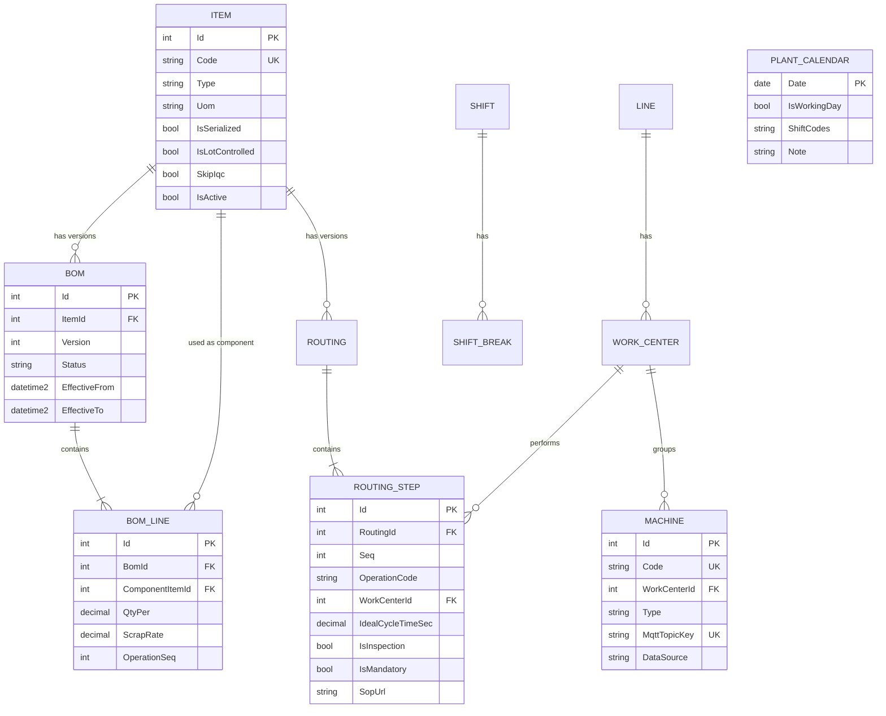

# Module 1 — Master Data (Item, BOM, Routing, Work Center, Machine, Shift, DefectCode, DowntimeReason)

> Module này dựng "từ điển" của nhà máy: sản xuất cái gì (Item), bằng vật tư gì và bao nhiêu (BOM), đi qua công đoạn nào và mất bao lâu (Routing), làm ở đâu (Work Center, Machine), khi nào (Shift), lỗi gì và dừng vì sao (DefectCode, DowntimeReason).
> Sau khi xong bạn có: CRUD API + màn hình WPF Back-office cho toàn bộ master data, BOM/Routing có version và khóa sau khi Approve, chặn BOM vòng bằng DFS, API "explode BOM" trả tổng nhu cầu NVL cho `PCB-A`, và bộ seed data dùng cho mọi module sau.
> Thời lượng ước tính: khoảng 30 giờ (2,5–3 tuần ở nhịp 1,5–2 giờ/ngày; 26 giờ của bản cũ + 4 giờ cho phần **[v2]**). Spec ước 2 tuần cho cả M0+M1 là giả định bạn đã quen MediatR/WPF; người mới nên tính rộng hơn.
> Module tiên quyết: Module 0 (solution, EF Core + SQL Server, Serilog, ProblemDetails, JWT + role, audit interceptor, khung WPF + Client.Core, `.resx`).
>
> **Cập nhật theo [spec-v2](spec-v2.md):** (1) **import master data từ Excel** theo kiểu "kiểm tra hết rồi mới ghi, ghi trong 1 transaction" (mục 2.10); (2) bảng **`PlantCalendar`** cho ngày nghỉ lễ/ngày làm bù (mục 1.2.9); (3) **`RoutingStep.SopUrl`** để kiosk mở hướng dẫn công việc (mục 1.2.7); (4) cờ **`Item.SkipIqc`** dùng cho cổng IQC ở M6; (5) thêm máy **`L1-REFLOW-01`** (OPC UA) và **`L1-GLUE-01`** (Modbus) cho M4b, cột `Machine.DataSource`. Các chỗ đổi được đánh dấu **[v2]**.

---

## 1. Kiến thức nghiệp vụ MES

### 1.1 Bức tranh tổng thể

**Master data là gì.** Trong nhà máy có hai loại dữ liệu:

- **Master data (dữ liệu nền)**: ít thay đổi, mô tả "thế giới" của nhà máy. Ví dụ: mã hàng `PCB-A`, định mức vật tư của nó, danh sách công đoạn, danh sách máy, giờ ca.
- **Transactional data (dữ liệu giao dịch)**: phát sinh liên tục khi sản xuất. Ví dụ: lệnh sản xuất, mỗi lần scan serial, mỗi sự kiện máy, mỗi lần dừng máy.

Cách nhớ: master data giống danh bạ điện thoại, transactional data giống lịch sử cuộc gọi. Lịch sử cuộc gọi chỉ có nghĩa khi danh bạ đúng. Nếu danh bạ ghi sai số của "Mai" thì mọi cuộc gọi gắn với "Mai" đều sai theo.

**Module này nằm ở đâu.** Nó là tầng thấp nhất của MES. Mọi module sau đều tham chiếu nó:

| Module sau | Dùng master data nào |
| --- | --- |
| M2 Work Order | Item, BOM (snapshot vào `WorkOrderMaterial`), Routing (snapshot vào `WorkOrderOperation`) |
| M3 Shop Floor | RoutingStep (thứ tự công đoạn), Station/WorkCenter, DefectCode |
| M4 Machine | Machine (`MqttTopicKey`), DowntimeReason (lúc Resolve Andon) |
| M5 OEE | Shift/ShiftBreak (thời gian kế hoạch), IdealCycleTimeSec, DowntimeReason |
| M6 Traceability | Item (`IsLotControlled`), BomLine (`OperationSeq` để biết vật tư tiêu thụ ở đâu) |
| M7 Quality | DefectCode, RoutingStep (`IsInspection`) |

**Ai dùng, dùng khi nào.**

- Kỹ sư (R&D, công nghệ, thiết bị) **tạo và sửa**: hiếm, có kiểm soát, có phê duyệt.
- Planner, Operator, Supervisor, QC **chỉ đọc và chọn**: Planner chọn Item khi tạo WO, Supervisor chọn DowntimeReason, QC chọn DefectCode.
- MES **đọc liên tục**: mỗi lần scan, mỗi lần tính OEE.

**Vì sao nhà máy cần.** Spec đã nói: sai master data là nguyên nhân số 1 của lỗi MES ngoài đời. Vài ví dụ cụ thể:

- Thiếu 1 mã vật tư trong BOM: kho cấp thiếu, line dừng giữa ca, hoặc sản phẩm lắp thiếu linh kiện mà không ai biết.
- Sai cycle time (ghi 3 giây thay vì 30 giây): OEE Performance ra 250%, ban giám đốc mất niềm tin vào cả hệ thống.
- Routing thiếu bước Test: sản phẩm chưa test vẫn đi đóng gói.
- Cùng một lỗi nhưng mỗi ca ghi một kiểu ("cầu thiếc", "bridge", "short"): Pareto lỗi vô nghĩa.

Vì vậy master data cần: mã duy nhất, có version, có phê duyệt, không xóa cứng, và có người chịu trách nhiệm (xem mục 1.2.11).

### 1.2 Khái niệm & thuật ngữ

Toàn bộ ví dụ dùng sản phẩm demo `PCB-A` (bo mạch điều khiển nhỏ) đúng như bộ seed ở mục 3.

#### 1.2.1 Item và item type

**Item** là một "mã hàng": mọi thứ mà nhà máy mua, làm ra, hoặc bán đều có một Item. Mỗi Item có `Code` duy nhất (ví dụ `RES-10K-0402`), tên, loại (Type) và đơn vị tính.

Có 3 loại (Type) mà spec chốt:

| Type | Tên tiếng Việt | Nghĩa | Ví dụ |
| --- | --- | --- | --- |
| Raw | Nguyên vật liệu (NVL) | Mua từ nhà cung cấp, không tự làm | `RES-10K-0402` (điện trở), `IC-MCU-QFN` (vi điều khiển), `PCB-BARE` (bo trần) |
| Semi | Bán thành phẩm | Tự làm ra nhưng chưa xong, còn dùng làm nguyên liệu cho công đoạn sau | `PCBA-SMT` (bo đã gắn linh kiện SMT, chưa lắp connector) |
| Finished | Thành phẩm | Sản phẩm cuối, giao cho khách | `PCB-A` |

Hai cờ đi kèm, quyết định cách truy xuất (chi tiết ở M2, M6):

- `IsSerialized`: mỗi sản phẩm có một mã riêng (serial). Spec: `true` cho thành phẩm. Ví dụ `PCB-A` có serial `PA2610000001`, `PA2610000002`...
- `IsLotControlled`: được quản lý theo lô (lot). Ví dụ một cuộn (reel) điện trở 10.000 con có `LotNo` riêng. Khi khách khiếu nại, ta truy về lô đó.
- **[v2]** `SkipIqc`: NVL được miễn kiểm tra đầu vào (IQC, M6). Mặc định `false`: mọi lot mới nhập đều phải qua IQC mới được nạp lên máy. Đặt `true` cho vật tư rủi ro thấp, ví dụ túi đóng gói `PACK-BAG`. Ngoài đời danh sách miễn IQC do QC quyết định dựa trên lịch sử chất lượng của nhà cung cấp (ship-to-stock). Chỉ có nghĩa với Item `Raw`.

Quy tắc chi tiết hóa (không mâu thuẫn spec, nên đưa vào validator):

- Raw: `IsSerialized = false`, `IsLotControlled = true` (vật tư điện tử gần như luôn theo lot).
- Finished: `IsSerialized = true`, `IsLotControlled = false`.
- Semi: cả hai `false` trong MVP. Lý do: serial của `PCB-A` được cấp lúc release WO (M2) và gắn lên bo ngay từ đầu chuyền SMT, nên bán thành phẩm đi theo serial của thành phẩm, không cần serial riêng.

Vì sao phải phân biệt Type: vì hệ thống xử lý khác nhau. Explode BOM chỉ cộng dồn NVL (Raw) ở lá của cây; Semi là nút trung gian. Kho chỉ cấp phát Raw. Máy SMT chỉ nạp Raw.

#### 1.2.2 UoM (Unit of Measure, đơn vị tính)

UoM là đơn vị đo số lượng của Item: `pcs` (con/chiếc), `reel` (cuộn), `kg`, `g`, `m`.

Vì sao quan trọng: `QtyPer` trong BOM chỉ có nghĩa khi biết đơn vị. "12" điện trở là 12 pcs. "0,0006" kem hàn là 0,0006 kg (0,6 g/bo). Nếu lẫn đơn vị (BOM ghi kg, kho cấp gram) thì lệch cả 1000 lần. Đây là lỗi interface ERP rất hay gặp.

Quyết định cho MVP:

- Mỗi Item có **một** UoM cơ sở, chính là đơn vị mà BOM và máy dùng để tiêu thụ. Điện trở: `pcs`, không phải `reel`.
- Reel/thùng là chuyện của **lot** (M6): một lot điện trở có `Qty = 10000` (pcs), không phải "1 reel". Không làm bảng quy đổi UoM ở MVP. Ghi lý do ở mục 4.
- Với UoM rời rạc (`pcs`), khi báo nhu cầu phải làm tròn **lên** số nguyên, và chỉ làm tròn ở kết quả cuối sau khi cộng dồn (xem ví dụ 1.2.4). Với UoM liên tục (`kg`, `g`, `m`) giữ thập phân.

#### 1.2.3 BOM đơn cấp

**BOM (Bill of Materials, định mức vật tư)** trả lời: "làm 1 đơn vị Item cha thì cần bao nhiêu đơn vị mỗi Item con". Mỗi dòng BOM là một `BomLine`: Item con, `QtyPer` (số lượng cho 1 đơn vị cha), `ScrapRate`, `OperationSeq`.

**BOM đơn cấp (single-level)**: chỉ liệt kê con trực tiếp. Ví dụ BOM của bán thành phẩm `PCBA-SMT` (làm ở công đoạn SMT):

| Item con | Type | QtyPer | UoM | ScrapRate | OperationSeq |
| --- | --- | --- | --- | --- | --- |
| `PCB-BARE` | Raw | 1 | pcs | 0,5% | 10 |
| `RES-10K-0402` | Raw | 12 | pcs | 2% | 10 |
| `CAP-100N-0402` | Raw | 20 | pcs | 2% | 10 |
| `IC-MCU-QFN` | Raw | 1 | pcs | 0,5% | 10 |
| `SOLDER-PASTE` | Raw | 0,0006 | kg | 5% | 10 |

Đọc: "1 bo `PCBA-SMT` cần 1 bo trần, 12 điện trở 10k, 20 tụ 100n, 1 MCU và 0,6 g kem hàn".

`OperationSeq` cho biết vật tư này **tiêu thụ ở công đoạn nào** của routing (10 = SMT). M6 dùng nó: khi serial scan OK ở công đoạn 10 thì ghi tiêu thụ đúng các vật tư của công đoạn 10.

#### 1.2.4 BOM đa cấp (multi-level) và ví dụ PCB-A

**BOM đa cấp**: bán thành phẩm có BOM riêng, nên tạo thành cây. Item cha `PCB-A` dùng `PCBA-SMT` như một "linh kiện", còn `PCBA-SMT` lại có BOM của nó ở trên.

BOM của thành phẩm `PCB-A`:

| Item con | Type | QtyPer | UoM | ScrapRate | OperationSeq |
| --- | --- | --- | --- | --- | --- |
| `PCBA-SMT` | Semi | 1 | pcs | 1% | 20 |
| `CONN-USBC` | Raw | 1 | pcs | 0,5% | 20 |
| `SHIELD-CAN` | Raw | 1 | pcs | 0,5% | 20 |
| `PACK-BAG` | Raw | 1 | pcs | 0% | 40 |

Cây đầy đủ:

```
PCB-A (Finished)
├─ PCBA-SMT x1   scrap 1%     (Semi, có BOM riêng)
│   ├─ PCB-BARE       x1        scrap 0,5%
│   ├─ RES-10K-0402   x12       scrap 2%
│   ├─ CAP-100N-0402  x20       scrap 2%
│   ├─ IC-MCU-QFN     x1        scrap 0,5%
│   └─ SOLDER-PASTE   x0,0006   scrap 5%   (kg)
├─ CONN-USBC   x1   scrap 0,5%
├─ SHIELD-CAN  x1   scrap 0,5%
└─ PACK-BAG    x1   scrap 0%
```

Ghi chú về `OperationSeq` ở BOM cấp dưới: vì MVP chỉ có **một** routing (của `PCB-A`, 4 bước SMT → Assembly → Test → Pack), các dòng BOM của `PCBA-SMT` cũng dùng số Seq của routing đó (10 = SMT). Nếu sau này bán thành phẩm có routing riêng thì đổi lại. Đây là quyết định đơn giản hóa có chủ đích.

**Explode BOM (nổ BOM)** là tính tổng nhu cầu NVL cho một số lượng thành phẩm, đi xuống mọi cấp. Công thức mỗi dòng: `nhu cầu con = nhu cầu cha × QtyPer × (1 + ScrapRate)`, cha lại là kết quả của cấp trên.

Tính tay cho **200 `PCB-A`**:

| Bước | Phép tính | Kết quả |
| --- | --- | --- |
| `PCBA-SMT` | 200 × 1 × 1,01 | **202** |
| `PCB-BARE` | 202 × 1 × 1,005 = 203,01 | **204** (làm tròn lên) |
| `RES-10K-0402` | 202 × 12 × 1,02 = 2472,48 | **2473** |
| `CAP-100N-0402` | 202 × 20 × 1,02 = 4120,8 | **4121** |
| `IC-MCU-QFN` | 202 × 1 × 1,005 = 203,01 | **204** |
| `SOLDER-PASTE` | 202 × 0,0006 × 1,05 = 0,12726 | **0,127 kg** |
| `CONN-USBC` | 200 × 1 × 1,005 | **201** |
| `SHIELD-CAN` | 200 × 1 × 1,005 | **201** |
| `PACK-BAG` | 200 × 1 × 1 | **200** |

Hai điểm mấu chốt:

1. **Scrap cộng dồn qua các cấp.** 1% hao hụt của `PCBA-SMT` làm nhu cầu 202 chứ không phải 200, và 202 mới là con số nhân xuống điện trở, tụ... Nếu quên scrap ở cấp giữa, điện trở chỉ tính 200 × 12 × 1,02 = 2448, thiếu 25 con so với 2473.
2. **Chỉ làm tròn ở cuối.** Cộng dồn số thập phân (203,01) rồi mới `ceil`. Nếu làm tròn từng dòng trung gian (202 → 203 → 204...) sai số tích lũy, nhất là khi cùng một NVL xuất hiện ở nhiều nhánh của cây (phải **cộng** các nhánh lại rồi mới làm tròn).

Kết quả này chính là **DoD** của module: API explode `PCB-A` × 200 phải trả đúng bảng trên.

#### 1.2.5 Scrap rate (tỷ lệ hao hụt)

**ScrapRate** là phần vật tư dự kiến hao trong quá trình làm, không nằm trong sản phẩm: linh kiện rơi, máy gắp lỗi (pick-up error), reel đầu/cuối cuộn bỏ, kem hàn dính dao gạt. Ví dụ điện trở 0402 rất nhỏ, máy SMT hay làm rơi nên 2%. Kem hàn còn dính trên stencil và hộp nên 5%.

Phân biệt với hai thứ hay nhầm:

- Không phải tỷ lệ **sản phẩm NG** (đó là Quality, M5/M7).
- Không phải hao hụt do sai sót bất thường. Nó là mức hao **bình thường được chấp nhận**, do kỹ sư đặt dựa trên số liệu lịch sử.

Quy ước lưu trữ (chốt cho dự án, ghi vào validator):

- Lưu dạng **phân số**: 2% là `0.02`, không phải `2`. Ràng buộc `0 <= ScrapRate < 1`, kiểu `decimal(9,6)`.
- Công thức dùng `× (1 + ScrapRate)`. Cách khác là `÷ (1 − ScrapRate)` (coi scrap là % của lượng **cấp phát**). Hai cách cho kết quả hơi khác (với 2%: 1,02 so với 1,0204). Chọn một cách và dùng thống nhất trong toàn hệ thống; ERP của khách có thể dùng cách còn lại, nên khi tích hợp (M8) phải hỏi.

#### 1.2.6 BOM version và hiệu lực

Sản phẩm thay đổi theo thời gian. Kỹ sư phát hiện bo `PCB-A` bị nhiễu điện từ và quyết định thêm 2 tụ lọc: `CAP-100N-0402` từ 20 lên 22 con. Có hai cách làm:

- Cách ngây thơ: sửa thẳng số 20 thành 22. Hậu quả: lệnh sản xuất đã release hôm qua (WO đang chạy) bỗng đòi 22 tụ, các serial đã làm xong không còn khớp với BOM, và không ai biết lô hàng tháng trước dùng định mức nào.
- Cách đúng: tạo **version mới** của BOM, giữ nguyên version cũ.

Mỗi `Bom` có:

- `Version` (số nguyên tăng dần: 1, 2, 3...).
- `Status`: `Draft` (đang soạn, sửa được) hoặc `Approved` (đã duyệt, **khóa**, chỉ đọc).
- `EffectiveFrom` / `EffectiveTo`: khoảng hiệu lực. Dùng khoảng nửa mở `[From, To)`: có hiệu lực từ `From` (gồm) đến trước `To` (không gồm). `To = NULL` nghĩa là chưa hết hạn.

Ví dụ với `PCB-A`:

| Version | Status | EffectiveFrom | EffectiveTo | Nội dung |
| --- | --- | --- | --- | --- |
| 1 | Approved | 2026-10-01 | 2026-11-03 | 20 tụ |
| 2 | Approved | 2026-11-03 | NULL | 22 tụ |
| 3 | Draft | (chưa đặt) | NULL | đang soạn, chưa có hiệu lực |

Quy tắc (spec): tại một thời điểm, mỗi Item chỉ có **một** version Approved có hiệu lực. Khi Approve version 2 với `EffectiveFrom = 2026-11-03`, hệ thống tự đặt `EffectiveTo = 2026-11-03` cho version 1. Vì khoảng nửa mở, tại đúng thời điểm 2026-11-03 chỉ có version 2 hiệu lực, không bị hai version chồng nhau.

Liên hệ M2: WO khi **release** sẽ chụp (snapshot) BOM đang hiệu lực vào `WorkOrderMaterial` và ghi `BomVersion`. Sau đó master đổi thế nào WO cũng không đổi. Version là điều kiện để snapshot có nghĩa.

Routing cũng có version theo cùng cơ chế (spec: `Routing` có `Version`, `Status`).

#### 1.2.7 Routing, RoutingStep và ideal cycle time

**Routing (quy trình công nghệ, 工順)** là chuỗi công đoạn (operation) mà sản phẩm phải đi qua theo thứ tự. Routing gắn với Item (thành phẩm) và có version.

Mỗi `RoutingStep` gồm:

| Cột | Ý nghĩa |
| --- | --- |
| `Seq` | Thứ tự bước. Nên đánh 10, 20, 30, 40 (cách quãng) để sau này chèn bước 25 không phải đánh số lại |
| `OperationCode` | Mã công đoạn: `SMT`, `ASSY`, `TEST`, `PACK` |
| `WorkCenterId` | Làm ở đâu |
| `IdealCycleTimeSec` | Thời gian chuẩn làm 1 sản phẩm tại bước này (giây) |
| `IsInspection` | Bước kiểm tra (Test, AOI...): có kết quả OK/NG và sinh DefectCode |
| `IsMandatory` | Bắt buộc: không được bỏ qua |
| `SopUrl` **[v2]** | Đường dẫn tới tài liệu hướng dẫn công việc (SOP / Work Instruction: PDF hoặc ảnh) của bước. Kiosk M3 có nút "SOP" mở tài liệu này. Có thể để trống |

Routing của `PCB-A` (seed):

| Seq | OperationCode | Work Center | IdealCycleTimeSec | IsInspection | IsMandatory |
| --- | --- | --- | --- | --- | --- |
| 10 | SMT | `WC-SMT` | 30 | không | có |
| 20 | ASSY | `WC-ASSY` | 60 | không | có |
| 30 | TEST | `WC-TEST` | 45 | có | có |
| 40 | PACK | `WC-PACK` | 20 | không | có |

**Ideal cycle time** là thời gian **lý tưởng** làm 1 sản phẩm khi máy chạy trơn tru, không dừng, không chậm. Không phải thời gian trung bình thực tế. Nó là "tốc độ tối đa hợp lý" mà kỹ sư công nghệ đo hoặc lấy từ thông số máy.

Vì sao MES cần: M5 tính Performance = `(IdealCycleTime × Total Count) / Run Time`. Ví dụ bước SMT, 30 giây/bo:

- Máy chạy 60 phút (3600 giây), đếm 100 bo. Performance = (30 × 100) / 3600 = 3000/3600 = **83,3%**. Máy chạy chậm hơn lý tưởng (lý tưởng là 120 bo/giờ).
- Nếu kỹ sư nhập nhầm 3 giây: (3 × 100) / 3600 = 8,3% (quá thấp). Nhập nhầm 300 giây: 833% (vô lý). Performance > 100% là dấu hiệu master data sai (spec M5 yêu cầu cảnh báo).

**[v2] SOP gắn theo version routing.** Ngoài đời, khi đổi quy trình (ví dụ thêm bước dán keo) thì SOP cũng đổi. `SopUrl` nằm trên `RoutingStep` nên đi theo version routing: WO đang chạy routing v1 vẫn mở SOP v1. M2 snapshot luôn `SopUrl` vào `WorkOrderOperation`. Ở MVP, file SOP để trong một thư mục (ví dụ `docs/sop/PCB-A/TEST-v1.pdf`, API phục vụ dạng static file). Không làm quản lý tài liệu (phê duyệt, phân phối) vì đó là việc của hệ thống quản lý tài liệu (DMS).

Đơn vị và quy ước: giây, kiểu `decimal(9,3)` (một số máy nhanh có cycle time < 1 giây), bắt buộc > 0. Với máy chạy theo tấm (panel gồm 4 bo, 1 lần gắp), cycle time tính **trên 1 bo** = thời gian tấm / 4. Phải thống nhất đơn vị "1 sản phẩm" giữa cycle time và bộ đếm máy, nếu không Performance sai hệ số.

#### 1.2.8 Work Center vs Machine vs Station

Ba khái niệm dễ lẫn. Từ lớn đến nhỏ, đặt trong `Site → Line`:

| Khái niệm | Là gì | Ví dụ | Ai tham chiếu |
| --- | --- | --- | --- |
| **Work Center** | Nhóm năng lực: "nơi làm loại công việc X" trên một line. Có thể gồm 1 hoặc nhiều máy | `WC-SMT` của Line 1 gồm 1 máy in kem + 1 máy gắp + 1 lò reflow | `RoutingStep.WorkCenterId` |
| **Machine** | Thiết bị vật lý cụ thể, có thể gửi dữ liệu | `L1-SMT-01` (máy gắp linh kiện), có `MqttTopicKey` và `DataSource` | M4 (MQTT), M4b (gateway), M5 (OEE theo máy) |
| **Station** | Điểm làm việc nơi operator scan (M0: `Site`, `Line`, `Station`) | Bàn Test số 1 với 1 màn hình kiosk | `POST /stations/{id}/scan` (M3) |

Vì sao tách, chứ không gộp thành một bảng "thiết bị":

- Routing nói **"công đoạn Test"**, không nói "máy Test số 3". Hôm nay Test làm trên máy 1, mai máy 1 hỏng thì chuyển sang máy 2, routing không đổi. Work Center là lớp trừu tượng giúp routing ổn định.
- OEE tính theo **máy** (thiết bị có trạng thái, bộ đếm), nhưng route check tính theo **công đoạn/trạm** (sản phẩm đi qua bước nào).
- Một Work Center có thể có 2 máy chạy song song (tăng năng lực), lúc đó năng lực gấp đôi nhưng routing vẫn một bước.

`Machine` có `MqttTopicKey`: đoạn `{machine}` trong topic MQTT của M4, ví dụ `L1-SMT-01` cho topic `minimes/{site}/{area}/{line}/L1-SMT-01/state` (**[v2]** topic theo Unified Namespace có thêm cấp `area`, xem M0 và M4). Phải **duy nhất** và không chứa ký tự `/`, `+`, `#` (đó là ký tự phân cấp và wildcard của MQTT; M4 sẽ giải thích). Validator M1 nên chặn ngay từ đầu.

**[v2] `Machine.DataSource`** (`Mqtt` | `OpcUa` | `Modbus`): máy gửi dữ liệu bằng giao thức nào ở phía nhà máy. MES **không** dùng cột này để kết nối, vì mọi dữ liệu máy đều đến MES qua MQTT: máy OPC UA/Modbus được Edge Gateway (M4b) đọc rồi đẩy lên MQTT. Cột chỉ để hiển thị trên dashboard và để khi có sự cố biết phải kiểm tra ở gateway hay ở máy. Địa chỉ thật (endpoint OPC UA, địa chỉ thanh ghi Modbus) nằm trong file cấu hình của gateway, không nằm trong master data MES; lý do ở mục 4.

Máy seed của Line 1 (spec v2):

| Machine | Work Center | DataSource | Vai trò trong demo |
| --- | --- | --- | --- |
| `L1-SMT-01` | `WC-SMT` | Mqtt | Máy gắp linh kiện, gửi state/count trực tiếp qua MQTT |
| `L1-REFLOW-01` | `WC-SMT` | OpcUa | Lò reflow: bộ đếm + nhiệt độ vùng peak (tag process cho SPC ở M7) |
| `L1-GLUE-01` | `WC-ASSY` | Modbus | Máy dán keo đời cũ, chỉ có thanh ghi bộ đếm và trạng thái |
| `L1-TEST-01` | `WC-TEST` | Mqtt | Máy test, kết quả OK/NG theo serial gửi qua API scan |

Máy reflow và máy dán keo là **Machine** trong Work Center có sẵn, không phải bước routing riêng. Routing vẫn 4 bước; OEE vẫn tính theo từng máy.

Liên kết Station với Work Center: spec M0 chỉ nói Station "ở mức tối thiểu", và route check ở M3 cần biết trạm này làm công đoạn nào. Đề xuất (chi tiết hóa, không mâu thuẫn spec): thêm cột `Station.WorkCenterId` bằng một migration trong M1. Nếu bạn muốn giữ M0 nguyên, có thể để bước này cho M3, nhưng phải làm trước khi viết route check.

#### 1.2.9 Shift, ShiftBreak và lịch ca

**Shift (ca làm việc)** là khung giờ nhà máy chạy: có giờ bắt đầu, giờ kết thúc, chạy những ngày nào trong tuần. **ShiftBreak** là các khoảng nghỉ trong ca (ăn ca, giải lao) khi cả line dừng theo kế hoạch.

Demo (2 ca/ngày theo spec), mỗi ca 8 giờ:

| Shift | Giờ | Ngày chạy | Nghỉ giữa ca |
| --- | --- | --- | --- |
| `S1` (ca sáng) | 06:00–14:00 | T2–T7 | 10:00–10:15 (15 phút), 11:30–12:15 (45 phút) |
| `S2` (ca chiều) | 14:00–22:00 | T2–T7 | 18:00–18:45 (45 phút), 20:00–20:15 (15 phút) |
| `S3` (ca đêm, tùy chọn/test) | 22:00–06:00 | T2–T6 | 01:00–01:45, 03:30–03:45 |

Mỗi ca nghỉ tổng 60 phút. Ca 8 giờ có 480 phút, trừ 60 phút nghỉ còn **420 phút thời gian sản xuất kế hoạch** (trước khi trừ PlannedStop khác). Đây là mẫu số của Availability (M5).

**Ca qua nửa đêm (`CrossesMidnight`).** Ca `S3` bắt đầu 22:00 và kết thúc 06:00 hôm sau. Nếu chỉ lưu giờ bằng kiểu `time` và so `End > Start` thì sẽ ra độ dài âm. Quy tắc:

- `CrossesMidnight = true` khi `EndTime <= StartTime`.
- Độ dài ca = `End − Start + 24h` nếu qua nửa đêm.
- Một break có giờ **nhỏ hơn** `StartTime` của ca (ví dụ 01:00 trong ca bắt đầu 22:00) thuộc về **phần sau nửa đêm**, tức là ngày lịch kế tiếp.
- Ca đêm thứ Sáu 22:00 kết thúc sáng thứ Bảy. Nó thuộc **ngày sản xuất thứ Sáu** (production date), không phải thứ Bảy. Cách tính ngày sản xuất là việc của M5; ở M1 chỉ cần lưu đủ dữ liệu (`StartTime`, `EndTime`, `CrossesMidnight`, `Days`) để M5 làm được.

`Days` lưu các ngày trong tuần ca chạy. Cách gọn: enum có `[Flags]` (`Mon = 1, Tue = 2, Wed = 4...`), lưu thành một cột `int`.

**[v2] `PlantCalendar`: ngày nghỉ lễ và ngày làm bù.** `Shift.Days` chỉ nói "thường lệ chạy T2–T7". Ngoài đời còn có Tết, 30/4, 2/9, ngày nghỉ bù, hoặc Chủ nhật tăng ca khi đơn hàng gấp. Nếu không ghi nhận, OEE (M5) sẽ coi ngày Tết là 2 ca "có kế hoạch" mà máy không chạy: Availability bằng 0 và kéo OEE cả tháng xuống.

| Cột | Ý nghĩa |
| --- | --- |
| `Date` (PK, `date`) | Ngày sản xuất (theo giờ nhà máy; ca đêm thuộc ngày bắt đầu ca) |
| `IsWorkingDay` | `false` = nghỉ cả ngày (lễ); `true` = làm việc dù `Shift.Days` không có ngày này (tăng ca Chủ nhật) |
| `ShiftCodes` | Tùy chọn: chỉ các ca này chạy hôm đó (ví dụ Chủ nhật chỉ chạy `S1`). Trống = mọi ca theo `Shift.Days` |
| `Note` | `Tet holiday`, `Overtime for order X` |

Quy tắc tra cứu "ca X có chạy ngày D không": có dòng `PlantCalendar` cho D thì dòng đó quyết định; không có thì theo `Shift.Days`. Chỉ lưu **ngoại lệ**, không sinh sẵn 365 dòng/năm. Hàm `IsShiftScheduled(shift, productionDate)` đặt trong Domain để M5 dùng lại.

Giờ trong `Shift` là **giờ địa phương của nhà máy** (`time`, không kèm ngày/múi giờ), vì nó là quy định "ca sáng 6 giờ" chứ không phải một thời điểm tuyệt đối. Dữ liệu giao dịch (M4, M5) vẫn lưu UTC; M5 chuyển giữa hai bên. Cần một `FactoryTimeZoneId` ở cấu hình (ví dụ `SE Asia Standard Time` trên Windows, `Asia/Ho_Chi_Minh` trên Linux); M5 dạy chi tiết.

#### 1.2.10 DefectCode và DowntimeReason: vì sao là master data

Đây là hai **danh mục có kiểm soát (controlled vocabulary)**: người dùng chọn từ danh sách, không gõ tự do.

**DefectCode (mã lỗi)**: `Code`, `Name`, `Category`. Ví dụ:

| Code | Name | Category |
| --- | --- | --- |
| `SLD-BRG` | Solder bridge (cầu thiếc) | Solder |
| `SLD-OPN` | Open solder joint (hàn hở) | Solder |
| `CMP-MIS` | Missing component (thiếu linh kiện) | Component |
| `CMP-POL` | Wrong polarity (ngược chiều) | Component |
| `FUN-NOPWR` | No power on test | Functional |
| `COS-SCR` | Scratch on board | Cosmetic |

**DowntimeReason (lý do dừng máy)**: `Code`, `Name`, `Category` (`Planned`/`Unplanned`), `CountsAgainstAvailability`. Ví dụ:

| Code | Name | Category | CountsAgainstAvailability |
| --- | --- | --- | --- |
| `PM` | Preventive maintenance | Planned | không |
| `NOPLAN` | No production plan | Planned | không |
| `CHG-MODEL` | Model changeover (đổi model, 段取り) | Planned | có (để đo và giảm thời gian đổi model) |
| `MCH-FAULT` | Machine fault | Unplanned | có |
| `MAT-WAIT` | Waiting for material | Unplanned | có |
| `FDR-JAM` | Feeder jam | Unplanned | có |

Vì sao là master data mà không phải chuỗi tự do hay enum trong code:

1. **Phân tích được.** Pareto (M5, M7) là `GROUP BY Code`. Ba ca ghi "cầu thiếc", "bridge", "short" thì thành ba cột riêng, không cộng được. Danh mục buộc mọi người dùng chung một từ vựng.
2. **Nghiệp vụ tự cấu hình được.** `CountsAgainstAvailability` cho phép nhà máy quyết định "đổi model có tính vào Availability không" mà không sửa code. Enum trong code thì mỗi thay đổi phải deploy lại.
3. **Mở rộng mà không sửa code.** Xưởng mới, dòng sản phẩm mới có lỗi mới, Admin thêm một dòng.
4. **Không xóa cứng.** `NG` của tháng trước đã dùng `SLD-BRG`; xóa mã đó làm mất nghĩa dữ liệu lịch sử. Chỉ `IsActive = false` (mã cũ ẩn khỏi danh sách chọn, vẫn hiển thị trong báo cáo cũ).

Phân biệt hai cột của DowntimeReason (cả hai cần vì trả lời hai câu hỏi khác nhau):

- `Category` (Planned/Unplanned): **phân loại nghiệp vụ** để báo cáo ("mất bao nhiêu giờ do dừng đột xuất?").
- `CountsAgainstAvailability`: **công tắc tính toán** cho OEE. Theo công thức của M5, `Planned Production Time = Thời gian ca − Nghỉ giữa ca − PlannedStop`. Lý do nào có cờ `false` thì bị **trừ khỏi mẫu số** (không bị phạt). Lý do nào có cờ `true` thì **ở lại trong mẫu số như một tổn thất** làm giảm Availability. M5 là nơi chốt công thức cuối cùng; M1 chỉ lưu đúng dữ liệu.

#### 1.2.11 Ai trong nhà máy sở hữu từng loại dữ liệu

"Sở hữu" nghĩa là người chịu trách nhiệm về độ đúng, và là người duy nhất được đề xuất thay đổi. MES chỉ **lưu** chứ không quyết định thay họ.

| Dữ liệu | Chủ sở hữu ngoài đời | Nguồn thường gặp | Vai trò trong MES của ta (M0) |
| --- | --- | --- | --- |
| Item, UoM | Bộ phận mua hàng/kế hoạch vật tư + R&D | ERP (SAP), tạo mã khi có NVL/sản phẩm mới | Admin |
| BOM | R&D / Kỹ sư NPI (New Product Introduction), duyệt bởi trưởng bộ phận kỹ thuật | Bản vẽ, ECN (Engineering Change Notice, thông báo thay đổi kỹ thuật) rồi vào ERP | Admin (soạn + Approve) |
| Routing, IdealCycleTime | Kỹ sư công nghệ/sản xuất (Process/Industrial Engineer, 生産技術) | Đo thực tế (time study), thông số máy | Admin |
| Work Center, Machine | Kỹ sư thiết bị + Bảo trì | Danh mục tài sản, sơ đồ bố trí line | Admin |
| Shift, ShiftBreak | Quản lý sản xuất + Nhân sự | Nội quy lao động, kế hoạch ca | Admin |
| DefectCode | QC/Quality Engineer (品質保証) | Tiêu chuẩn chất lượng (IPC cho điện tử), yêu cầu khách hàng | Admin (QC chỉ đọc ở MVP) |
| DowntimeReason | Trưởng sản xuất + Bảo trì + Lean/IE | Thống nhất giữa các bên; có cả ý nghĩa tính KPI | Admin |

Trong MVP role của M0 là `Planner/Operator/Supervisor/QC/Maintenance/Admin`. Đề xuất phân quyền M1 (chi tiết hóa): **ghi** master data cần role `Admin`; **đọc** cho mọi role đã đăng nhập. Nếu bạn muốn sát thực tế hơn, thêm policy: QC được sửa `DefectCode`, Maintenance được sửa `Machine`/`DowntimeReason`. Nguyên tắc nêu được khi phỏng vấn: **mỗi loại dữ liệu có một chủ sở hữu rõ ràng và mọi thay đổi có dấu vết** (audit của M0 đã bật cho bảng master).

Ngoài đời, khi có ERP, Item và BOM đến từ ERP còn MES chỉ nhận. Vì MVP không có ERP (M8 tùy chọn), Admin nhập tay. Cột `ExternalRef`/mã ERP sẽ thêm ở M8.

### 1.3 Một ngày ở xưởng: master data thay đổi và được dùng thế nào

Nhân vật: **Hùng** (kỹ sư công nghệ), **Mai** (planner), **Lan** (operator Test), **Tuấn** (QC), **Đức** (supervisor ca sáng).

**Thứ Hai, 08:30, văn phòng kỹ thuật.** Bo `PCB-A` đang bị khách phàn nàn nhiễu ở tần số cao. Hùng nhận ECN: thêm 2 tụ lọc 100nF. Hùng mở Back-office, vào BOM của `PCB-A`... nhưng thấy version 1 đã ở trạng thái Approved nên các ô nhập bị khóa. Đó là chủ ý. Hùng bấm "New version" và hệ thống tạo version 2 ở trạng thái Draft, sao chép mọi dòng từ version 1. Anh sửa `CAP-100N-0402` từ 20 lên 22 ở BOM của `PCBA-SMT`.

**09:10.** Hùng bấm Save. Validator chạy: mã NVL tồn tại, `QtyPer > 0`, `ScrapRate` trong `[0, 1)`, và không tạo vòng. Ổn. Anh chưa bấm Approve vì cần trưởng phòng kỹ thuật duyệt và cần chọn ngày hiệu lực.

**09:40, xưởng.** Mai đã release WO cho 200 `PCB-A` từ sáng thứ Sáu tuần trước, theo BOM version 1. Line đang chạy. Nếu BOM được sửa "sống" thì WO này sẽ đổi định mức giữa chừng. Nhưng vì WO đã snapshot BOM v1 lúc release (M2) và version 2 mới ở Draft, WO không bị ảnh hưởng. Đó là lý do có version.

**10:20, ca sáng.** Máy gắp `L1-SMT-01` dừng vì kẹt feeder. Đức nhận Andon, xử lý xong, rồi chọn lý do dừng trong danh sách: `FDR-JAM - Feeder jam`. Anh không gõ tay "kẹt feeder" vì danh sách buộc dùng chung một mã. Cuối tuần Pareto sẽ cộng đúng mọi lần kẹt feeder.

**11:05, trạm Test.** Lan test bo `PCB-A` số 87, kết quả NG. Cô chọn mã lỗi `SLD-BRG` (cầu thiếc) từ danh sách. Tuấn (QC) xem báo cáo và thấy 6/9 lỗi hôm nay là `SLD-BRG`, kết luận lò reflow hoặc khuôn in đang có vấn đề. Nếu ghi tự do thì 6 lỗi đó có thể đã rải ra thành 4 cái tên khác nhau.

**14:00, đổi ca.** Ca sáng kết thúc 14:00, ca chiều bắt đầu. OEE (M5) của ca sáng lấy thời gian kế hoạch = 480 − 60 phút nghỉ = 420 phút từ bảng `Shift` và `ShiftBreak`. Nếu ai đó sửa nhầm nghỉ giữa ca từ 60 thành 30 phút, mẫu số Availability đổi và OEE của cả tháng lệch theo.

**15:30, phòng kỹ thuật.** Hùng nhận thấy anh nhập cycle time bước Test là 4,5 giây (thay vì 45 giây). Sáng mai dashboard sẽ hiện Performance 1000%. Rất may bước Approve có màn hình so sánh version cũ và mới (diff), và một đồng nghiệp bắt được lỗi trước khi bấm duyệt. Với dữ liệu đã Approve, cách sửa duy nhất là tạo version mới của Routing.

**16:00.** Trưởng phòng duyệt BOM v2, `EffectiveFrom` = thứ Hai tuần sau 06:00 (đầu ca sáng, để không đổi định mức giữa ca). Hệ thống đặt `EffectiveTo` của v1 = đúng thời điểm đó. Từ lúc ấy, WO mới release sẽ snapshot v2.

### 1.4 Quy tắc nghiệp vụ & lý do tồn tại của từng quy tắc

| # | Quy tắc | Lý do |
| --- | --- | --- |
| 1 | `Item.Code` duy nhất (không phân biệt hoa/thường), chỉ ký tự `A–Z 0–9 - _ .` | Mã là khóa nghiệp vụ mà mọi người nhắc tới, nhãn in ra, ERP đối chiếu. Hai mã khác nhau chỉ ở hoa/thường gây nhầm lẫn thật |
| 2 | `(Bom.ItemId, Version)` duy nhất; `Version` tăng dần | Có thể chỉ đúng "BOM v2 của PCB-A" trong mọi tài liệu |
| 3 | BOM không có vòng lặp (A dùng B, B dùng A, dù gián tiếp) | Nổ BOM sẽ đệ quy vô hạn (nhu cầu tăng mãi hoặc treo). Vòng cũng vô nghĩa vật lý: không thể lắp A từ B nếu B cần A |
| 4 | Một dòng BOM không tự tham chiếu Item cha; không trùng `ComponentItemId` trong cùng một BOM | Tránh nhập trùng; nếu cần cùng một NVL ở hai công đoạn, dùng hai `OperationSeq` khác nhau và gộp bằng cách rõ ràng (xem mục 1.5) |
| 5 | Chỉ một version `Approved` có hiệu lực tại một thời điểm cho mỗi Item; khoảng hiệu lực `[From, To)` không chồng nhau | Nếu hai version cùng hiệu lực, WO release snapshot version nào? Không xác định được |
| 6 | Approve xong thì khóa sửa; muốn đổi phải tạo version mới | Bảo vệ tính đúng của lịch sử (WO, serial đã làm theo version nào). Đây cũng là yêu cầu của audit khách hàng |
| 7 | Chỉ `Approve` được khi BOM có ít nhất 1 dòng, mọi Item con đang `IsActive`, và không tạo vòng | Không cho duyệt BOM rỗng hay BOM tham chiếu mã đã ngừng |
| 8 | Routing có ít nhất 1 bước; `Seq` tăng dần, không trùng; `IdealCycleTimeSec > 0` | Routing rỗng thì sản phẩm không có chỗ để scan. `Seq` trùng làm route check không biết bước nào trước |
| 9 | Routing của thành phẩm nên có ít nhất một bước `IsInspection` (cảnh báo, không chặn) | Spec không bắt buộc; routing không có bước kiểm tra nào là dấu hiệu nghi vấn (xem mục 1.5, ý 6) |
| 10 | `Machine.MqttTopicKey` duy nhất, không chứa `/ + #` hoặc khoảng trắng | Nó trở thành một phần của topic MQTT (M4). Ký tự sai làm subscribe sai hoặc bị broker từ chối |
| 11 | Ca: `Start != End`, break nằm trong khoảng ca (tính cả ca qua nửa đêm), break không chồng nhau, tổng break < độ dài ca | Số liệu sai sẽ cho thời gian kế hoạch âm hoặc sai |
| 12 | `DowntimeReason.Category = Planned` với `CountsAgainstAvailability` cho phép cả hai giá trị; `Unplanned` luôn `true` | Dừng đột xuất không thể được "miễn" khỏi Availability. Planned thì tùy chính sách nhà máy |
| 13 | Không xóa cứng master đã được tham chiếu; dùng `IsActive = false` (Item, Machine, WorkCenter, DefectCode, DowntimeReason). Bom/Routing đã Approved thì chuyển sang "hết hiệu lực" bằng `EffectiveTo` | Lịch sử (WO, scan, downtime) vẫn cần tra ra tên và thuộc tính. Xóa cứng làm mất khóa ngoại hoặc mất nghĩa |
| 14 | Item `IsActive = false` không được chọn ở BOM/Routing/WO mới, nhưng vẫn hiện trong dữ liệu cũ | Ngừng dùng nhưng không phá lịch sử |
| 15 **[v2]** | Import Excel: **kiểm tra toàn bộ file trước, có 1 dòng lỗi thì không ghi dòng nào**; ghi trong 1 transaction | Import nửa vời (Item vào rồi, BOM lỗi) để lại dữ liệu "mồ côi" rất khó dọn; người dùng cần danh sách lỗi đầy đủ theo dòng để sửa 1 lần |
| 16 **[v2]** | Import chỉ tạo mới Item và tạo BOM/Routing ở trạng thái **Draft**; không bao giờ tự Approve, không sửa đè bản Approved | Import là đường tắt nhập liệu, không phải đường tắt phê duyệt. Quy tắc 6 vẫn áp dụng |
| 17 **[v2]** | `PlantCalendar` chỉ lưu ngoại lệ; một ngày có tối đa 1 dòng | Tránh hai dòng mâu thuẫn cho cùng một ngày |
| 18 **[v2]** | `SkipIqc = true` chỉ hợp lệ cho Item `Raw` | IQC là kiểm tra hàng mua vào; Semi/Finished không đi qua IQC |

Ghi chú quy tắc 9: nó **chưa** là quy tắc cứng của spec, chỉ là gợi ý. Nếu làm, đưa vào validator dạng cảnh báo (không chặn).

### 1.5 Sai lầm/sự cố thường gặp ngoài đời

1. **Thiếu hoặc sai mã vật tư trong BOM.** Máy SMT nạp đúng theo BOM nhưng BOM thiếu điện trở R47. Bo ra khỏi line chỉ thiếu một linh kiện nhỏ, test chức năng không bắt được, khách trả hàng. Cách giảm: bước Approve có đối chiếu với bản vẽ/CAD BOM, có người thứ hai duyệt.
2. **Sửa BOM đè lên version đang dùng.** Không có version, kỹ sư sửa số 20 thành 22 khi WO đang chạy. Kho cấp theo số mới, WO cũ báo thiếu, không ai giải thích được. Đây là lý do tồn tại của snapshot (M2) và khóa sau Approve.
3. **Quên scrap ở bán thành phẩm** (ví dụ 1.2.4: thiếu 25 điện trở cho 200 bo). Dấu hiệu: line dừng ở đơn hàng cuối vì hết linh kiện dù kho báo đủ theo BOM.
4. **Sai đơn vị.** BOM ghi kem hàn `0.6` (ý là gram) nhưng UoM là `kg`: nhu cầu tính ra gấp 1000 lần. Hoặc điện trở khai theo `reel` ở một nơi và `pcs` ở nơi khác. Cách giảm: một UoM cơ sở, khóa sau khi Item đã có BOM.
5. **Sai cycle time.** Nhập nhầm đơn vị (phút thay vì giây, hoặc thời gian của tấm 4 bo thay vì 1 bo). Performance > 100% hoặc rất thấp. Cách giảm: validator chặn ngoài khoảng hợp lý (ví dụ 0,1–3600 giây) và cảnh báo ở M5.
6. **Routing thiếu bước hoặc sai thứ tự.** Ví dụ bỏ Test khỏi routing của model mới. Route check (M3) trung thành làm theo routing nên cho sản phẩm đi thẳng tới Pack. MES đúng logic nhưng dữ liệu sai.
7. **Ca qua nửa đêm xử lý sai.** Ca đêm tính độ dài âm hoặc gán nhầm sang ngày sau; OEE ca đêm ra 0 hoặc số vô lý; báo cáo sản lượng "ngày thứ Bảy" chứa phần cuối ca đêm thứ Sáu.
8. **Mã lỗi/lý do dừng tự do hoặc quá nhiều.** Danh sách 200 lý do dừng thì operator chọn bừa ("Khác"). Thực tế: 15–30 mã, nhóm theo Category, nhóm "Other" phải có chú thích và bị theo dõi (nếu > 10% thì xem lại danh mục).
9. **Xóa mã cũ.** Ai đó xóa `SLD-BRG` vì "đã đổi tên". Báo cáo tháng trước mất dòng lỗi phổ biến nhất hoặc lỗi khóa ngoại. Dùng `IsActive`.
10. **Master data không đồng bộ với ERP.** ERP đã ngừng mã, MES vẫn còn (hoặc ngược lại), dẫn tới interface lỗi. Ngoài phạm vi MVP nhưng nên biết để nói trong phỏng vấn.
11. **Trùng nhánh trong BOM đa cấp.** Cùng một NVL (ví dụ `CAP-100N-0402`) xuất hiện ở cả `PCBA-SMT` (20 con) và trực tiếp ở `PCB-A` (2 con thêm tay). Explode phải **cộng** hai nhánh (22 + scrap) chứ không lấy nhánh cuối. Đây cũng là ca kiểm tra "kim cương" (diamond) của thuật toán DFS.

### 1.6 Bảng thuật ngữ

| English | Tiếng Việt | 日本語 | Giải thích ngắn |
| --- | --- | --- | --- |
| Master data | Dữ liệu nền | マスタ / マスタデータ | Dữ liệu ít đổi mô tả nhà máy: mã hàng, BOM, máy, ca |
| Item | Mã hàng | 品目 | Mọi thứ mua, làm, bán; có Code duy nhất |
| Raw material | Nguyên vật liệu | 原材料 | Mua ngoài, không tự làm |
| Semi-finished goods | Bán thành phẩm | 半製品 | Tự làm nhưng chưa xong, làm nguyên liệu cho bước sau |
| Finished goods | Thành phẩm | 完成品 / 製品 | Sản phẩm cuối giao khách |
| WIP (Work in Process) | Sản phẩm dở dang | 仕掛品 | Hàng nằm giữa các công đoạn |
| UoM (Unit of Measure) | Đơn vị tính | 単位 | pcs, reel, kg, g, m |
| BOM (Bill of Materials) | Định mức vật tư | 部品表 (BOM) | Cần bao nhiêu mỗi con cho 1 đơn vị cha |
| Multi-level BOM | BOM đa cấp | 多階層BOM | Bán thành phẩm có BOM riêng, tạo thành cây |
| Component | Thành phần/linh kiện con | 構成品目 / 子品目 | Item nằm dưới trong BOM |
| Scrap rate | Tỷ lệ hao hụt | 損耗率 / ロス率 | Phần vật tư dự kiến hao khi sản xuất |
| BOM explosion | Nổ BOM | 所要量展開 | Tính tổng nhu cầu NVL qua mọi cấp |
| Version / Revision | Phiên bản | 版数 / 改訂 | Bản BOM/Routing theo thời gian |
| Effective date | Ngày hiệu lực | 有効日 | Khoảng thời gian một version được dùng |
| Draft / Approved | Nháp / Đã duyệt | 作成中 / 承認済み | Trạng thái của version |
| ECN (Engineering Change Notice) | Thông báo thay đổi kỹ thuật | 設計変更通知 (ECN) | Văn bản kích hoạt việc sửa BOM/Routing |
| Routing | Quy trình công nghệ | 工順 / 工程表 | Chuỗi công đoạn theo thứ tự |
| Operation | Công đoạn | 工程 | Một bước trong routing (SMT, Test...) |
| Ideal cycle time | Thời gian chu kỳ chuẩn | 標準サイクルタイム / 理論サイクルタイム | Thời gian lý tưởng làm 1 sản phẩm |
| Work Center | Trung tâm sản xuất / tổ công đoạn | 作業区 / ワークセンター | Nhóm năng lực làm một loại công việc |
| Machine | Máy / thiết bị | 設備 / 機械 | Thiết bị vật lý cụ thể |
| Station | Trạm | ステーション / 工程ステーション | Điểm làm việc nơi operator scan |
| Shift | Ca làm việc | 勤務シフト / 直 | Khung giờ chạy |
| Break | Giờ nghỉ giữa ca | 休憩 | Khoảng dừng theo kế hoạch trong ca |
| Production date | Ngày sản xuất | 生産日 | Ngày mà một ca thuộc về (ca đêm thuộc ngày bắt đầu) |
| Defect code | Mã lỗi | 不良コード | Danh mục loại lỗi sản phẩm |
| Downtime reason | Lý do dừng máy | 停止理由 | Danh mục nguyên nhân dừng máy |
| Planned / Unplanned stop | Dừng có / không kế hoạch | 計画停止 / 計画外停止 | Phân loại downtime |
| Changeover / Setup | Đổi model / chuẩn bị | 段取り替え | Thời gian chuyển sản phẩm |
| Soft delete | Xóa mềm | 論理削除 | Đánh dấu ngừng dùng thay vì xóa hàng |
| Process engineering | Kỹ thuật công nghệ | 生産技術 | Bộ phận sở hữu routing, cycle time |
| Quality assurance | Đảm bảo chất lượng | 品質保証 | Bộ phận sở hữu mã lỗi |

---

## 2. Kiến thức lập trình

Phần này chỉ giải thích những thứ **mới** so với những gì bạn đã biết (C#, ASP.NET Core Web API, EF Core cơ bản). Những thứ đã dạy ở M0 (Clean Architecture, ProblemDetails middleware, JWT, audit interceptor, WPF/MVVM cơ bản, `.resx`) chỉ được tham chiếu.

### 2.1 MediatR và CQRS (command, query, handler, pipeline behavior)

**Nó là gì.**

- **CQRS (Command Query Responsibility Segregation)**: tách thao tác **ghi** (Command: thay đổi trạng thái, không cần trả dữ liệu lớn) khỏi thao tác **đọc** (Query: chỉ đọc, không đổi gì). Ở mức dùng trong dự án này, đây chỉ là một quy ước đặt tên và tách class, **không** phải hai database khác nhau.
- **MediatR** là thư viện "người trung gian": controller không gọi thẳng service mà gửi một object yêu cầu (`IRequest<T>`) cho MediatR, MediatR tìm handler tương ứng (`IRequestHandler<TRequest,TResponse>`) và gọi nó.
- **Pipeline behavior (`IPipelineBehavior<,>`)**: đoạn code chạy **trước/sau mọi handler**, giống middleware của ASP.NET Core nhưng cho tầng Application. Dùng cho validation, logging, transaction.

**Vấn đề nó giải quyết.** Cách ngây thơ: một `ItemService` có 20 method, mỗi method tự validate, tự log, tự bắt lỗi. Sau vài tháng class dài 2000 dòng, khó test, và mỗi method validate theo một kiểu. Với MediatR:

- Mỗi use case là một class nhỏ (`CreateItemCommand` + `CreateItemHandler`). Tìm dễ, test độc lập.
- Việc chung (validate, log) viết **một lần** trong pipeline, tự áp dụng cho mọi use case.
- Controller mỏng: chỉ nhận HTTP, gửi request, trả HTTP.

**Về license (phải biết).** Từ **MediatR v13 (2025)**, thư viện chuyển sang license thương mại; có bản Community miễn phí cho cá nhân/tổ chức nhỏ nhưng cần đăng ký license key. Đừng dựa vào trí nhớ về giá hay điều khoản, hãy đọc trang chính thức của thư viện (GitHub `jbogard/MediatR` và trang của tác giả) trước khi dùng. Lựa chọn cho dự án học tập:

1. Dùng **MediatR 12.x** (license Apache 2.0). API trong tài liệu này viết theo 12.x.
2. Dùng bản mới nhất với license Community nếu bạn đủ điều kiện, cấu hình license key theo README.
3. **Tự viết dispatcher đơn giản** (khoảng 40 dòng: tra handler trong DI theo kiểu request rồi gọi). Học được đủ khái niệm, không phụ thuộc thư viện. Xem mục 4.

**Khái niệm cốt lõi.**

- Request là một `record` bất biến chứa dữ liệu vào. Tên theo nghiệp vụ: `CreateItemCommand`, `GetBomExplosionQuery`.
- Một request có đúng **một** handler.
- Thứ tự pipeline: behavior 1 → behavior 2 → handler. Mỗi behavior gọi `next()` để đi tiếp.

**Snippet: command + handler.** (MediatR 12.x. `IAppDbContext`, `ConflictException` là abstraction/exception do bạn tự định nghĩa ở Application và ánh xạ sang ProblemDetails trong middleware của M0.)

```csharp
public sealed record CreateItemCommand(string Code, string Name, ItemType Type,
    string Uom, bool IsSerialized, bool IsLotControlled) : IRequest<int>;

public sealed class CreateItemHandler : IRequestHandler<CreateItemCommand, int>
{
    private readonly IAppDbContext _db;               // interface do Application định nghĩa
    public CreateItemHandler(IAppDbContext db) => _db = db;

    public async Task<int> Handle(CreateItemCommand cmd, CancellationToken ct)
    {
        // Kiểm tra sớm để có thông báo đẹp; unique index vẫn là chốt chặn cuối (xem 2.3)
        if (await _db.Items.AnyAsync(i => i.Code == cmd.Code, ct))
            throw new ConflictException($"Item code '{cmd.Code}' already exists.");

        var item = Item.Create(cmd.Code, cmd.Name, cmd.Type, cmd.Uom,
                               cmd.IsSerialized, cmd.IsLotControlled);  // domain tự kiểm tra bất biến
        _db.Items.Add(item);
        await _db.SaveChangesAsync(ct);
        return item.Id;
    }
}

// Controller mỏng:
[HttpPost] public async Task<IActionResult> Create(CreateItemCommand cmd, ISender sender, CancellationToken ct)
    => CreatedAtAction(nameof(Get), new { id = await sender.Send(cmd, ct) }, null);
```

**Snippet: pipeline behavior chạy validator trước mọi handler.**

```csharp
public sealed class ValidationBehavior<TRequest, TResponse> : IPipelineBehavior<TRequest, TResponse>
    where TRequest : notnull
{
    private readonly IEnumerable<IValidator<TRequest>> _validators;   // DI tự gom mọi validator của TRequest
    public ValidationBehavior(IEnumerable<IValidator<TRequest>> validators) => _validators = validators;

    public async Task<TResponse> Handle(TRequest request, RequestHandlerDelegate<TResponse> next,
                                        CancellationToken ct)
    {
        if (_validators.Any())
        {
            var ctx = new ValidationContext<TRequest>(request);
            var results = await Task.WhenAll(_validators.Select(v => v.ValidateAsync(ctx, ct)));
            var failures = results.SelectMany(r => r.Errors).Where(f => f is not null).ToList();
            if (failures.Count > 0) throw new ValidationException(failures);  // middleware M0 -> 400
        }
        return await next();          // sang behavior kế tiếp hoặc handler
    }
}

// Đăng ký (MediatR 12.x; nếu tên method khác ở phiên bản bạn cài, xem README):
services.AddMediatR(cfg => cfg.RegisterServicesFromAssembly(typeof(CreateItemCommand).Assembly));
services.AddTransient(typeof(IPipelineBehavior<,>), typeof(ValidationBehavior<,>));
```

**Query** viết tương tự nhưng: handler dùng `AsNoTracking()`, `Select` thẳng ra DTO (của `MiniMes.Contracts`), không trả entity ra ngoài (tránh lộ cấu trúc DB, tránh vòng tham chiếu khi serialize).

**Bẫy thường gặp.**

- Nhét quá nhiều logic nghiệp vụ vào handler thay vì domain. Handler chỉ điều phối (tải entity, gọi method domain, lưu). Quy tắc như "Approve rồi thì không sửa" thuộc về `Bom.Approve()` / `Bom.AddLine()`.
- Handler gọi handler khác qua `Send` lồng nhau: khó theo dõi. Dùng chung qua domain service hoặc method riêng.
- Quên đăng ký behavior: validator viết rồi nhưng không chạy. Kiểm tra bằng một test tích hợp gửi request sai và mong đợi HTTP 400.
- Thứ tự behavior là thứ tự đăng ký. Validation phải chạy **trước** transaction/handler.
- Lỗi `ValidationException` nhầm namespace: `FluentValidation.ValidationException`, không phải `System.ComponentModel.DataAnnotations`.

### 2.2 FluentValidation

**Nó là gì.** Thư viện mô tả quy tắc kiểm tra dữ liệu đầu vào bằng code C# dạng chuỗi gọi (fluent), tách khỏi class dữ liệu.

**Vấn đề nó giải quyết.** Cách ngây thơ: `[Required]`, `[MaxLength]` (Data Annotations) trên DTO. Ổn với quy tắc đơn giản nhưng khó diễn tả quy tắc có điều kiện ("Raw thì không được serialized"), quy tắc trên tập hợp ("Seq không trùng"), và khó đặt thông báo lỗi có ngữ cảnh. Viết `if` rải rác trong handler thì mỗi nơi một kiểu, không tái sử dụng.

**Khái niệm cốt lõi.**

- `AbstractValidator<T>`: một class cho mỗi request.
- `RuleFor(x => x.Prop)`, chuỗi `.NotEmpty()`, `.MaximumLength(n)`, `.GreaterThan(0)`, `.Matches(regex)`, `.Must(predicate)`, `.When(cond)`, `.WithMessage("...")`.
- `RuleForEach(x => x.Items).ChildRules(...)` cho danh sách con.
- Đăng ký tất cả validator trong assembly: `services.AddValidatorsFromAssembly(...)` (package `FluentValidation.DependencyInjectionExtensions`).

**Phân chia trách nhiệm (rất hay bị hỏi).**

| Loại kiểm tra | Đặt ở đâu | Ví dụ |
| --- | --- | --- |
| Định dạng, độ dài, khoảng giá trị của request | FluentValidator (Application) | `Code` chỉ gồm ký tự hợp lệ, `ScrapRate` trong `[0,1)` |
| Bất biến của entity (luôn đúng dù đến từ API, job hay test) | Domain (constructor/method) | BOM đã Approved không thêm dòng được |
| Cần truy vấn DB (trùng mã, tồn tại) | Handler, **và** ràng buộc DB (unique index/FK) | Item code đã tồn tại |

**Snippet: validator cho Item và Routing.**

```csharp
public sealed class CreateItemValidator : AbstractValidator<CreateItemCommand>
{
    private static readonly string[] Uoms = { "pcs", "reel", "kg", "g", "m" };
    public CreateItemValidator()
    {
        RuleFor(x => x.Code).NotEmpty().MaximumLength(40)
            .Matches("^[A-Za-z0-9._-]+$").WithMessage("Code may contain letters, digits, '.', '_' and '-' only.");
        RuleFor(x => x.Name).NotEmpty().MaximumLength(200);
        RuleFor(x => x.Uom).Must(u => Uoms.Contains(u)).WithMessage("Unknown unit of measure.");
        // Quy tắc có điều kiện theo Type
        RuleFor(x => x.IsSerialized).Equal(false).When(x => x.Type == ItemType.Raw)
            .WithMessage("A raw material cannot be serialized.");
        RuleFor(x => x.IsSerialized).Equal(true).When(x => x.Type == ItemType.Finished)
            .WithMessage("A finished good must be serialized.");
    }
}

public sealed class SaveRoutingValidator : AbstractValidator<SaveRoutingCommand>
{
    public SaveRoutingValidator()
    {
        RuleFor(x => x.Steps).NotEmpty().WithMessage("A routing needs at least one step.");
        RuleFor(x => x.Steps).Must(s => s.Select(t => t.Seq).Distinct().Count() == s.Count)
            .WithMessage("Step sequence numbers must be unique.");           // quy tắc trên tập hợp
        RuleForEach(x => x.Steps).ChildRules(step =>
            step.RuleFor(t => t.IdealCycleTimeSec).GreaterThan(0).LessThanOrEqualTo(3600));
    }
}
```

**Bẫy thường gặp.**

- Validator chạy truy vấn DB (`MustAsync`) thì có **race condition**: hai request cùng kiểm tra "chưa có" rồi cùng insert. Luôn giữ unique index làm chốt cuối và bắt `DbUpdateException` chuyển thành 409.
- Lẫn `ScrapRate = 2` với `0.02` (xem 1.2.5): validator phải chặn `>= 1`, và UI phải hiển thị `%` nhưng gửi phân số.
- Thông báo lỗi bằng tiếng Anh ở server, nhưng chuỗi UI trong `.resx`: với lỗi từ server (`ProblemDetails`), Client.Core hiển thị nguyên thông báo; đừng cố dịch lỗi server ở M1.
- `Must(...)` viết lambda phức tạp trong validator: tách ra method có tên, dễ đọc dễ test.

### 2.3 EF Core configuration cho master data (unique index, quan hệ nhiều đường, owned type, soft delete)

M0 đã dạy migration và interceptor audit; ở đây chỉ nêu phần đặc thù của master data. Dùng `IEntityTypeConfiguration<T>` (mỗi entity một file trong `Infrastructure/Persistence/Configurations`) thay vì nhét hết vào `OnModelCreating`.

**Snippet: Item, Bom, BomLine.**

```csharp
public sealed class ItemConfiguration : IEntityTypeConfiguration<Item>
{
    public void Configure(EntityTypeBuilder<Item> b)
    {
        b.ToTable("Item");
        b.Property(x => x.Code).HasMaxLength(40).IsRequired();
        b.HasIndex(x => x.Code).IsUnique();                       // khóa nghiệp vụ; collation mặc định SQL Server không phân biệt hoa/thường
        b.Property(x => x.Type).HasConversion<string>().HasMaxLength(16);   // lưu chữ 'Raw' dễ đọc trong DB
        b.Property(x => x.Uom).HasMaxLength(10).IsRequired();
    }
}
public sealed class BomConfiguration : IEntityTypeConfiguration<Bom>
{
    public void Configure(EntityTypeBuilder<Bom> b)
    {
        b.HasIndex(x => new { x.ItemId, x.Version }).IsUnique();  // spec: (Bom.ItemId, Version)
        b.HasOne<Item>().WithMany().HasForeignKey(x => x.ItemId)
            .OnDelete(DeleteBehavior.Restrict);                   // không cascade từ Item
        b.HasMany(x => x.Lines).WithOne().HasForeignKey(l => l.BomId)
            .OnDelete(DeleteBehavior.Cascade);                    // dòng BOM chết theo BOM (chỉ khi Draft bị xóa)
    }
}
public sealed class BomLineConfiguration : IEntityTypeConfiguration<BomLine>
{
    public void Configure(EntityTypeBuilder<BomLine> b)
    {
        b.Property(x => x.QtyPer).HasPrecision(18, 6);
        b.Property(x => x.ScrapRate).HasPrecision(9, 6);
        b.HasOne<Item>().WithMany().HasForeignKey(x => x.ComponentItemId)
            .OnDelete(DeleteBehavior.Restrict);                   // FK thứ hai tới Item: phải Restrict
        b.ToTable(t => t.HasCheckConstraint("CK_BomLine_Scrap", "[ScrapRate] >= 0 AND [ScrapRate] < 1"));
    }
}
```

**Vì sao `Restrict`.** `Bom` trỏ tới `Item` (là cha) và `BomLine` trỏ tới `Item` (là con), thêm đường `Item → Bom → BomLine`. SQL Server không cho nhiều đường cascade tới cùng bảng ("may cause cycles or multiple cascade paths") và về nghiệp vụ cũng không muốn xóa Item kéo theo xóa BOM. Đặt `Restrict` cho các FK tới `Item`.

**"Tự tham chiếu" ở đâu.** BOM là đồ thị mà mỗi nút là một `Item`, và một Item vừa là cha (có `Bom`) vừa là con (có mặt trong `BomLine`). Không có bảng nào tự trỏ tới chính nó, nhưng về logic đây là quan hệ tự tham chiếu gián tiếp. Chính vì thế cần DFS ở mục 2.4 (EF/SQL không tự chặn vòng).

**Owned collection: ShiftBreak.** Break chỉ có nghĩa bên trong một ca, không được dùng độc lập. Mô hình hóa bằng owned collection: vòng đời gắn với `Shift`, EF tự tạo bảng riêng.

```csharp
b.OwnsMany(x => x.Breaks, o => o.ToTable("ShiftBreak"));   // bảng ShiftBreak, khóa ngoại ShiftId do EF tự tạo
b.Property(x => x.StartTime);        // TimeOnly -> cột time (EF Core 8 + SQL Server)
```

Owned type không có `DbSet` riêng; thay đổi qua `Shift`. Đủ cho MVP. Nếu M5 cần truy vấn break độc lập với hiệu năng cao, có thể chuyển thành entity thường.

**Soft delete bằng `IsActive` (và cái bẫy của global query filter).** EF có `HasQueryFilter(x => x.IsActive)` để ẩn hàng "đã xóa" khỏi mọi truy vấn. **Không dùng nó cho `IsActive` ở đây**, vì `IsActive = false` chỉ nghĩa "không chọn được cho việc mới". Một `BomLine` cũ vẫn trỏ tới Item đã ngừng; nếu filter ẩn Item đó thì `Include`/join trả `null` hoặc mất cả dòng, cây BOM cũ hiển thị thiếu. Cách làm đúng:

- Truy vấn cho **danh sách chọn** (dropdown Item khi tạo BOM mới): tự thêm `.Where(i => i.IsActive)`.
- Truy vấn cho **hiển thị dữ liệu cũ**: không lọc.
- Có thể gói thành extension method `.OnlyActive()` để dễ nhớ.
- Xóa cứng chỉ cho phép khi entity **chưa được tham chiếu** (ví dụ Item vừa tạo nhầm). Kiểm tra bằng handler; FK `Restrict` là chốt cuối.

**Migration.** Ví dụ lệnh (chỉnh tên project theo solution của bạn): `dotnet ef migrations add M1_MasterData -p src/MiniMes.Infrastructure -s src/MiniMes.Api`, sau đó `dotnet ef database update`. Mở file migration đọc xem có unique index và check constraint như mong đợi trước khi chạy. Audit interceptor của M0 tự ghi `AuditLog` cho các bảng master.

**Bẫy thường gặp.**

- Quên `HasPrecision` cho `decimal`: EF cảnh báo và mặc định `decimal(18,2)`, làm `ScrapRate = 0.005` bị làm tròn thành `0.01`.
- Enum lưu thành số nguyên: đổi thứ tự enum sau này làm sai dữ liệu. Lưu chuỗi hoặc gán số tường minh.
- Unique index trên cột nullable: SQL Server chỉ cho **một** `NULL`. Cột như `Machine.MqttTopicKey` nếu có thể rỗng thì cần filtered index (`HasFilter("[MqttTopicKey] IS NOT NULL")`), hoặc bắt buộc có giá trị.

### 2.4 Phát hiện vòng BOM bằng DFS

**Nó là gì.** DFS (Depth-First Search, tìm kiếm theo chiều sâu) là cách duyệt đồ thị: đi sâu hết một nhánh rồi mới quay lại nhánh khác. Dùng để phát hiện **chu trình** (cycle) trong đồ thị có hướng.

**Vấn đề nó giải quyết.** Cách ngây thơ: chỉ kiểm tra `ComponentItemId != ItemId` (không cho tự chứa mình). Bắt được vòng trực tiếp `A → A` nhưng bỏ sót `A → B → C → A`. Cách ngây thơ khác: dùng một `HashSet<int> visited` và báo "vòng" khi gặp lại nút đã thăm. Sai, vì BOM hợp lệ có thể có **hình kim cương**: `PCB-A` dùng `PCBA-SMT` (có 20 tụ) và dùng trực tiếp 2 tụ; cùng một `CAP-100N-0402` xuất hiện ở hai nhánh nhưng không hề có vòng.

**Khái niệm cốt lõi: ba màu.**

- **Trắng** (chưa thăm).
- **Xám** (đang nằm trên đường đi hiện tại, chưa xử lý xong con của nó).
- **Đen** (đã xử lý xong toàn bộ nhánh con).

Gặp một nút **xám** nghĩa là ta quay lại chính một nút đang nằm trên đường đi: đó là vòng. Gặp nút **đen** là hợp lệ (đã kiểm tra, nhánh đó không có vòng). Độ phức tạp `O(V + E)`.

**Đồ thị nào để kiểm tra.** Nút là `ItemId`, cạnh `cha → con` lấy từ BOM. Vì mỗi Item có nhiều version, chỉ dùng **version hiện hành** của mỗi Item (Draft mới nhất hoặc Approved đang hiệu lực) cộng với BOM đang lưu (thay thế bản của Item đó). Không dùng mọi version cũ, vì v1 `A → B` và v2 `B → A` xảy ra tuần tự là hợp lệ (không bao giờ cùng hiệu lực). Kiểm tra chạy: (1) khi Save một BOM Draft, (2) khi Approve (đề phòng dữ liệu đổi giữa hai lần).

**Snippet (Domain, hàm thuần, dễ unit test).**

```csharp
public static class BomCycleDetector
{
    // graph: itemId -> danh sách itemId con. Trả về đường đi tạo vòng (vd 1,2,3,1) hoặc null nếu không có vòng.
    public static IReadOnlyList<int>? FindCycle(IReadOnlyDictionary<int, List<int>> graph)
    {
        var state = new Dictionary<int, int>();   // vắng mặt = trắng, 1 = xám, 2 = đen
        var path = new List<int>();               // đường đi hiện tại, để báo lỗi dễ hiểu
        foreach (var start in graph.Keys)
            if (Visit(start) is { } cycle) return cycle;
        return null;

        List<int>? Visit(int node)
        {
            state.TryGetValue(node, out var s);
            if (s == 2) return null;                                  // đen: đã kiểm tra, an toàn
            if (s == 1)                                               // xám: quay lại nút trên đường đi = vòng
            {
                var cycle = path.Skip(path.IndexOf(node)).ToList();
                cycle.Add(node);
                return cycle;
            }
            state[node] = 1; path.Add(node);
            if (graph.TryGetValue(node, out var children))
                foreach (var c in children)
                    if (Visit(c) is { } found) return found;
            path.RemoveAt(path.Count - 1); state[node] = 2;           // xong nhánh: chuyển đen
            return null;
        }
    }
}
```

**Test (xUnit) theo yêu cầu spec: vòng trực tiếp, vòng gián tiếp 3 cấp, BOM hợp lệ nhiều cấp; thêm ca kim cương.**

```csharp
[Fact] public void Direct_cycle_A_uses_A()
    => Assert.NotNull(BomCycleDetector.FindCycle(new Dictionary<int, List<int>> { [1] = new() { 1 } }));

[Fact] public void Indirect_cycle_over_three_levels()
{
    var g = new Dictionary<int, List<int>> { [1] = new() { 2 }, [2] = new() { 3 }, [3] = new() { 1 } };
    Assert.Equal(new[] { 1, 2, 3, 1 }, BomCycleDetector.FindCycle(g));   // thông báo lỗi: "1 -> 2 -> 3 -> 1"
}

[Fact] public void Valid_multilevel_and_diamond_are_not_cycles()
{   // 1 = PCB-A, 2 = PCBA-SMT, 3 = tụ dùng ở cả hai nhánh (kim cương)
    var g = new Dictionary<int, List<int>> { [1] = new() { 2, 3 }, [2] = new() { 3 }, [3] = new() };
    Assert.Null(BomCycleDetector.FindCycle(g));
}
```

**Bẫy thường gặp.**

- Recursion quá sâu gây `StackOverflowException`: BOM thực tế vài chục cấp thì ổn; nếu cần an toàn hơn, thêm giới hạn độ sâu (ví dụ 50) và báo lỗi, hoặc viết lại bằng stack tường minh.
- Chỉ kiểm tra khi Save mà không kiểm tra khi Approve: dữ liệu BOM khác có thể đổi giữa hai lần.
- Báo lỗi "BOM has a cycle" mà không nói vòng nào: người dùng không sửa được. Hiển thị mã Item của đường đi (`PCB-A -> PCBA-SMT -> PCB-A`), tra từ ID sang `Code` ở handler.

### 2.5 Explode BOM: recursive CTE (và đệ quy trong code để đối chiếu)

**Nó là gì.** Recursive CTE (Common Table Expression đệ quy) là câu `WITH ... UNION ALL ...` trong T-SQL, trong đó phần thứ hai tự tham chiếu chính CTE đang định nghĩa, lặp cho tới khi không còn hàng mới. Hợp với dữ liệu dạng cây/đồ thị như BOM.

**Vấn đề nó giải quyết.** Cách ngây thơ: vòng lặp trong C# gọi DB cho mỗi Item ("lấy BOM của A, rồi với mỗi con lấy BOM của nó..."). Cây 3 cấp × 9 dòng cũng là hàng chục round-trip (vấn đề N+1). CTE làm cả cây trong **một** truy vấn, DB tự tối ưu.

**Khái niệm cốt lõi.**

- **Anchor member**: cấp 1, các con trực tiếp của Item gốc, nhu cầu = `Qty × QtyPer × (1 + ScrapRate)`.
- **Recursive member**: join `Explosion` với BOM đang hiệu lực của từng con, nhân dồn nhu cầu (chính là scrap cộng dồn ở 1.2.4).
- Cuối cùng `GROUP BY` NVL và `SUM` để **cộng các nhánh** cùng một NVL, rồi làm tròn lên ở kết quả cuối theo UoM.
- `OPTION (MAXRECURSION n)`: mặc định 100; đặt 50 để nếu lỡ có vòng (DB bị sửa tay, bỏ qua DFS) thì SQL Server báo lỗi 530 thay vì chạy mãi.

```sql
DECLARE @ItemId int = 1, @Qty decimal(18,6) = 200, @AsOf datetime2 = SYSUTCDATETIME();
WITH ActiveBom AS (      -- mỗi Item chỉ có 1 BOM Approved hiệu lực tại @AsOf (quy tắc 5)
    SELECT Id, ItemId FROM Bom
    WHERE Status = 'Approved' AND EffectiveFrom <= @AsOf AND (EffectiveTo IS NULL OR @AsOf < EffectiveTo)
),
Explosion AS (
    SELECT l.ComponentItemId AS ItemId,                      -- anchor: cấp 1
           CAST(@Qty * l.QtyPer * (1 + l.ScrapRate) AS decimal(28,9)) AS Qty, 1 AS Lvl
    FROM ActiveBom b JOIN BomLine l ON l.BomId = b.Id WHERE b.ItemId = @ItemId
    UNION ALL
    SELECT l.ComponentItemId,                                -- recursive: đi xuống con của con
           CAST(e.Qty * l.QtyPer * (1 + l.ScrapRate) AS decimal(28,9)), e.Lvl + 1
    FROM Explosion e
    JOIN ActiveBom b ON b.ItemId = e.ItemId                  -- chỉ Semi mới có BOM; Raw thì dừng
    JOIN BomLine l   ON l.BomId = b.Id
)
SELECT i.Id AS ItemId, i.Code, i.Uom,
       CASE WHEN i.Uom IN ('pcs','reel') THEN CEILING(SUM(e.Qty)) ELSE ROUND(SUM(e.Qty), 3) END AS TotalQty
FROM Explosion e JOIN Item i ON i.Id = e.ItemId
WHERE i.Type = 'Raw'                                         -- chỉ trả NVL ở lá
GROUP BY i.Id, i.Code, i.Uom
OPTION (MAXRECURSION 50);
```

Gọi từ C# (EF Core 8; `Database.SqlQuery<T>` map cột theo **tên** property, nếu phiên bản EF của bạn không có thì dùng Dapper):

```csharp
var rows = await _db.Database.SqlQuery<ExplodedRow>($"""
    ... (câu SQL trên, dùng {itemId}, {qty}, {asOf} thay cho các @biến) ...
    """).ToListAsync(ct);          // gọi ToListAsync NGAY, đừng nối thêm LINQ: EF sẽ bọc thành subquery và CTE không nằm trong subquery được
```

**Vì sao vừa CTE vừa đệ quy trong code.** Dự án dùng **CTE cho API explode** (một round-trip; M6 sẽ dùng lại kỹ thuật này cho truy xuất). Đồng thời `GET /api/items/{id}/bom-tree` (dữ liệu cho `TreeView`) dựng cây bằng đệ quy trong code: tải sẵn mọi BOM đang hiệu lực vào từ điển rồi đệ quy trong bộ nhớ. Tổng NVL cộng từ cây phải **bằng** kết quả CTE; dùng đó làm test đối chiếu (integration test). Hàm đệ quy thuần cho đối chiếu:

```csharp
static void Explode(int itemId, decimal qty, Func<int, BomModel?> activeBom, Dictionary<int, decimal> acc)
{
    var bom = activeBom(itemId);
    if (bom is null) return;                                 // Raw: hết cây
    foreach (var l in bom.Lines)
    {
        var need = qty * l.QtyPer * (1 + l.ScrapRate);       // scrap cộng dồn qua từng cấp
        acc[l.ComponentItemId] = acc.GetValueOrDefault(l.ComponentItemId) + need;   // cộng các nhánh
        Explode(l.ComponentItemId, need, activeBom, acc);
    }
}   // sau đó lọc Type == Raw, làm tròn lên theo UoM
```

**Bẫy thường gặp.**

- Semi không có BOM hiệu lực: cả nhánh biến mất khỏi kết quả mà không có lỗi. Trước khi trả kết quả, kiểm tra riêng "Semi nào trong cây chưa có BOM Approved" và trả 422 kèm danh sách.
- Cột trung gian `decimal` mặc định độ chính xác thấp làm mất lẻ: `CAST` sang `decimal(28,9)` như trên.
- Làm tròn từng dòng thay vì làm tròn tổng (xem 1.2.4).
- Quên `@AsOf`: nổ BOM "hôm nay" cho một WO lập cho tuần sau có thể lấy nhầm version. API nhận `asOf` (mặc định bây giờ, UTC).
- Bảng số lớn thì cần index `BomLine(BomId)` và `Bom(ItemId, Status, EffectiveFrom)`; với seed 9 dòng chưa thấy khác biệt, đo ở M3.

### 2.6 WPF: DataGrid, TreeView, HierarchicalDataTemplate, ObservableCollection

(WPF cơ bản, binding, `DataContext` xem Module 0.)

**Nó là gì và giải quyết gì.** Cách ngây thơ: tự tạo `TextBlock` lồng nhau bằng code để vẽ cây BOM, và xóa/vẽ lại cả lưới mỗi khi dữ liệu đổi. WPF cho phép **khai báo** hình dạng dữ liệu bằng template và để binding tự cập nhật.

**Khái niệm cốt lõi.**

- `ObservableCollection<T>`: danh sách tự báo cho UI khi thêm/xóa/di chuyển phần tử (`INotifyCollectionChanged`). `List<T>` thì không. Cũng có `Move(oldIndex, newIndex)`, dùng cho nút Up/Down.
- `DataGrid` với `AutoGenerateColumns="False"` và khai báo cột tường minh (tiêu đề lấy từ `.resx`).
- Lọc mà không đụng danh sách gốc: `ICollectionView` (từ `CollectionViewSource.GetDefaultView(collection)`) có thuộc tính `Filter` và `Refresh()`. Danh sách Item vài trăm dòng thì lọc phía client là đủ; hàng chục nghìn dòng thì lọc phía server (tham số query).
- `TreeView` + `HierarchicalDataTemplate`: template biết cách vẽ một nút **và** nói nút con nằm ở property nào (`ItemsSource`). WPF lặp đệ quy cho mọi cấp.

```xml
<!-- BomTreeView.xaml (xmlns:vm="clr-namespace:MiniMes.BackOffice.Wpf.ViewModels") -->
<TreeView ItemsSource="{Binding RootNodes}">
  <TreeView.ItemContainerStyle>
    <Style TargetType="TreeViewItem">
      <Setter Property="IsExpanded" Value="True"/>          <!-- mở sẵn mọi cấp -->
    </Style>
  </TreeView.ItemContainerStyle>
  <TreeView.Resources>
    <HierarchicalDataTemplate DataType="{x:Type vm:BomNodeViewModel}" ItemsSource="{Binding Children}">
      <StackPanel Orientation="Horizontal">
        <TextBlock Text="{Binding Code}" FontWeight="SemiBold"/>
        <TextBlock Text="{Binding QtyText}"   Margin="8,0,0,0"/>     <!-- "x12" -->
        <TextBlock Text="{Binding ScrapText}" Margin="8,0,0,0" Foreground="Gray"/>  <!-- "scrap 2%" -->
      </StackPanel>
    </HierarchicalDataTemplate>
  </TreeView.Resources>
</TreeView>
```

```csharp
// ItemListViewModel: lọc DataGrid bằng ICollectionView (CommunityToolkit.Mvvm)
public partial class ItemListViewModel : ObservableObject
{
    public ObservableCollection<ItemDto> Items { get; } = new();
    public ICollectionView ItemsView { get; }
    [ObservableProperty] private string _filterText = "";        // sinh property FilterText

    public ItemListViewModel()
    {
        ItemsView = CollectionViewSource.GetDefaultView(Items);
        ItemsView.Filter = o => o is ItemDto i &&
            (string.IsNullOrWhiteSpace(FilterText)
             || i.Code.Contains(FilterText, StringComparison.OrdinalIgnoreCase)
             || i.Name.Contains(FilterText, StringComparison.OrdinalIgnoreCase));
    }
    partial void OnFilterTextChanged(string value) => ItemsView.Refresh();   // hook do toolkit sinh ra
}
```

**Bẫy thường gặp.**

- Sửa `ObservableCollection` từ thread nền: `NotSupportedException`. Dùng `await` để tiếp tục trên UI thread, không dùng `Task.Run` cho việc gán vào collection.
- Thay cả `Items = new ...` mà property không phát `PropertyChanged`: lưới không đổi. Hoặc dùng `Clear()` + `Add()`, hoặc dùng `[ObservableProperty]` cho danh sách.
- `HierarchicalDataTemplate` không khớp vì thiếu `DataType`: nút hiện ra dưới dạng chuỗi `ToString()`.
- `StackPanel` lồng trong cột `DataGrid` với 1000 dòng chậm; bật ảo hóa (`VirtualizingPanel.IsVirtualizing`, mặc định bật với `DataGrid`) và tránh đặt `ScrollViewer` bao ngoài.

### 2.7 ICommand, RelayCommand, AsyncRelayCommand

**Nó là gì.** `ICommand` là cách WPF nối một nút bấm với logic trong ViewModel: `Execute()` khi bấm, `CanExecute()` để bật/tắt nút. `RelayCommand` (CommunityToolkit.Mvvm) là cài đặt sẵn; `AsyncRelayCommand` dành cho tác vụ `async` (gọi API).

**Vấn đề nó giải quyết.** Cách ngây thơ: viết `Button_Click` trong code-behind, gọi API bằng `.Result` (treo UI), tự bật/tắt nút rải rác. Với command: logic nằm trong ViewModel (test được), nút tự tắt khi `CanExecute` là false, `AsyncRelayCommand` tự tắt nút khi đang chạy nên không bấm đúp hai lần.

**Snippet: routing editor với nút Up/Down và Save** (`IApiClient` là ApiClient của M0; tên method minh họa, dạng pseudo-code):

```csharp
public partial class RoutingEditorViewModel : ObservableObject
{
    private readonly IApiClient _api;
    public ObservableCollection<RoutingStepRow> Steps { get; } = new();

    [ObservableProperty]
    [NotifyCanExecuteChangedFor(nameof(MoveUpCommand))]      // đổi Selected thì đánh giá lại nút
    [NotifyCanExecuteChangedFor(nameof(MoveDownCommand))]
    private RoutingStepRow? _selected;

    [RelayCommand(CanExecute = nameof(CanMoveUp))]
    private void MoveUp() => MoveSelected(-1);
    private bool CanMoveUp() => Selected is not null && Steps.IndexOf(Selected) > 0;

    [RelayCommand(CanExecute = nameof(CanMoveDown))]
    private void MoveDown() => MoveSelected(+1);
    private bool CanMoveDown() => Selected is not null && Steps.IndexOf(Selected) < Steps.Count - 1;

    private void MoveSelected(int delta)
    {
        var i = Steps.IndexOf(Selected!);
        Steps.Move(i, i + delta);
        for (var k = 0; k < Steps.Count; k++) Steps[k].Seq = (k + 1) * 10;   // đánh lại 10,20,30...
        MoveUpCommand.NotifyCanExecuteChanged();        // vị trí đổi nhưng Selected không đổi -> phải gọi tay
        MoveDownCommand.NotifyCanExecuteChanged();
    }

    [RelayCommand]                                       // sinh SaveCommand kiểu AsyncRelayCommand
    private async Task SaveAsync(CancellationToken ct)
        => await _api.SaveRoutingAsync(Steps.Select(s => s.ToDto()).ToList(), ct);   // pseudo-code
}
```

**Bẫy thường gặp.**

- Sau khi `Move`, `Selected` giữ nguyên nhưng chỉ số đổi, nếu quên gọi `NotifyCanExecuteChanged` thì nút Up/Down không cập nhật.
- `async void` trong ViewModel: lỗi biến mất hoặc sập app. Dùng `[RelayCommand] private async Task ...`.
- Tên command sinh ra: method `SaveAsync` sinh `SaveCommand` (bỏ hậu tố `Async`).
- Lỗi trong command async không hiện ra cho người dùng nếu không bắt: bọc `try/catch` và đưa thông báo lên `StatusText`, hoặc dùng cơ chế xử lý lỗi chung của Client.Core (M0).

### 2.8 Validation trên UI

**Vấn đề.** Server luôn kiểm tra lại (đúng và bắt buộc), nhưng người dùng muốn biết ngay ô nào sai, không phải chờ round-trip và không muốn nhìn một hộp thoại chung chung.

**Hai tầng.**

1. **Phản hồi nhanh phía client** với `ObservableValidator` của CommunityToolkit.Mvvm: ViewModel cài `INotifyDataErrorInfo`, WPF tự viền đỏ ô lỗi (`ValidatesOnNotifyDataErrors` mặc định bật). Chỉ nhân bản quy tắc **đơn giản** (bắt buộc, độ dài, định dạng) để tránh hai bộ luật lệch nhau.
2. **Nguồn sự thật phía server**: `ValidationProblemDetails` (HTTP 400) với danh sách lỗi theo trường; Client.Core (M0) chuyển thành thông báo và ViewModel hiển thị trong một danh sách lỗi.

```csharp
public partial class ItemEditViewModel : ObservableValidator      // kế thừa ObservableValidator
{
    [ObservableProperty]
    [NotifyDataErrorInfo]                                          // kiểm tra mỗi khi giá trị đổi
    [Required(ErrorMessage = "Code is required.")]                 // trong dự án: lấy chuỗi từ Strings.resx
    [MaxLength(40)]
    [RegularExpression("^[A-Za-z0-9._-]+$", ErrorMessage = "Letters, digits, '.', '_' and '-' only.")]
    private string _code = "";

    public ObservableCollection<string> ServerErrors { get; } = new();

    [RelayCommand]
    private async Task SaveAsync(CancellationToken ct)
    {
        ValidateAllProperties();                                   // ép kiểm tra mọi ô, kể cả ô chưa chạm tới
        if (HasErrors) return;
        ServerErrors.Clear();
        try { /* gọi API */ }
        catch (ApiValidationException ex)                          // giả định: Client.Core ném khi nhận 400 (pseudo-code)
        { foreach (var m in ex.Messages) ServerErrors.Add(m); }
    }
}
```

**Bẫy thường gặp.**

- Chỉ kiểm tra khi giá trị đổi: ô chưa từng chạm vẫn rỗng và không báo lỗi. Gọi `ValidateAllProperties()` trước khi lưu.
- Mẫu lỗi mặc định của WPF chỉ viền đỏ, không hiện chữ. Thêm `Validation.ErrorTemplate` hoặc một `TextBlock` gắn với `Validation.Errors`.
- Nhân bản mọi quy tắc nghiệp vụ lên client: sửa server mà quên client nên hai bên lệch. Chỉ nhân bản quy tắc định dạng.
- Lỗi server dạng `409 Conflict` (trùng mã) không phải lỗi validation; hiển thị thành thông báo cạnh ô `Code`, không phải hộp thoại lỗi hệ thống.

### 2.9 Seed data an toàn (chạy lại nhiều lần không hỏng)

Seed 2 lần không được tạo trùng hoặc lỗi. Không dùng `HasData` trong migration cho bộ này: BOM phải đi qua logic `Approve` của domain (khóa, hiệu lực), và khóa ngoại cần ID thật. Thay vào đó viết `MasterDataSeeder` chạy lúc khởi động ở môi trường Development.

```csharp
public sealed class MasterDataSeeder
{
    public static async Task RunAsync(IServiceProvider sp, CancellationToken ct = default)
    {
        using var scope = sp.CreateScope();
        var db = scope.ServiceProvider.GetRequiredService<AppDbContext>();
        if (await db.Items.AnyAsync(i => i.Code == "PCB-A", ct)) return;      // idempotent: có rồi thì bỏ qua

        var raw = SeedItems.Raw();                                             // 8 NVL (mục 3, bước 8)
        var smt = Item.Create("PCBA-SMT", "PCB-A SMT assembly", ItemType.Semi, "pcs", false, false);
        var pcbA = Item.Create("PCB-A", "Control board PCB-A", ItemType.Finished, "pcs", true, false);
        db.Items.AddRange(raw.Append(smt).Append(pcbA));
        await db.SaveChangesAsync(ct);                                         // cần ID trước khi tạo BOM

        // ... tạo Bom(PCBA-SMT), Bom(PCB-A) + dòng như mục 1.2.3/1.2.4, gọi bom.Approve(...) ...
        // ... Routing 4 bước, WorkCenter, Machine, Shift, DefectCode, DowntimeReason ...
        await db.SaveChangesAsync(ct);
    }
}
```

**Bẫy:** seed chạy trước migration nên bảng chưa có; gọi `Database.MigrateAsync()` trước. Không để seed chạy ở Production.

### 2.10 [v2] Import master data từ Excel bằng ClosedXML

**Nó là gì.** `ClosedXML` là thư viện .NET (MIT) đọc/ghi file `.xlsx` mà không cần cài Excel. Ở M1 dùng để import Item/BOM/Routing; ở M5 dùng lại để **xuất** báo cáo.

**Vấn đề nó giải quyết.** Ở nhà máy VN, khi ra model mới, kỹ sư NPI gửi BOM bằng file Excel (thường xuất từ ERP hoặc phần mềm CAD), 50–300 dòng. Gõ tay từng dòng vào màn hình là không thực tế, và hay sai. Gần như mọi MES (qcadoo, OpenMES, ktg-mes) đều có chức năng import.

**Khái niệm cốt lõi.**

- **File mẫu (template) cố định**: 3 sheet `Items`, `BomLines`, `RoutingSteps`, hàng 1 là tên cột. API có endpoint tải file mẫu (`GET /api/import/template`), sinh bằng chính ClosedXML để file mẫu và code đọc không lệch nhau.

  | Sheet | Cột |
  | --- | --- |
  | `Items` | Code, Name, Type, Uom, IsSerialized, IsLotControlled, SkipIqc |
  | `BomLines` | ParentCode, ComponentCode, QtyPer, ScrapRate, OperationSeq |
  | `RoutingSteps` | ItemCode, Seq, OperationCode, WorkCenterCode, IdealCycleTimeSec, IsInspection, IsMandatory, SopUrl |

- **Hai pha: Validate → Commit.**
  1. `POST /api/import/master-data?dryRun=true`: đọc file, kiểm tra từng dòng (kiểu dữ liệu, mã trùng trong file, mã đã tồn tại trong DB, UoM hợp lệ, ComponentCode tồn tại trong file hoặc DB, Seq không trùng), **và** chạy DFS chặn vòng (mục 2.4) trên đồ thị gộp "DB + file". Trả danh sách lỗi `{ sheet, row, column, message }`. Không ghi gì.
  2. Không còn lỗi thì gọi lại với `dryRun=false`: chạy lại toàn bộ kiểm tra (dữ liệu có thể đã đổi giữa hai lần gọi), rồi ghi tất cả trong **1 transaction**. BOM/Routing tạo ở trạng thái Draft (quy tắc 16).
- **Dùng lại validator có sẵn.** Mỗi dòng được đổi thành `CreateItemCommand`/... rồi chạy qua đúng `IValidator<T>` của FluentValidation đã viết ở mục 2.2. Không viết bộ quy tắc thứ hai cho import.
- **Gửi file lên API, không đọc Excel ở WPF.** WPF chỉ chọn file và gửi `multipart/form-data`. Đọc và kiểm tra nằm ở server để quy tắc chỉ có một chỗ.

**Snippet** (đọc 1 sheet, gom lỗi theo dòng):

```csharp
public sealed record ImportError(string Sheet, int Row, string Column, string Message);

public static List<ItemRow> ReadItems(XLWorkbook wb, List<ImportError> errors)
{
    var ws = wb.Worksheet("Items");
    var header = ws.Row(1).CellsUsed().ToDictionary(c => c.GetString().Trim(), c => c.Address.ColumnNumber,
                                                     StringComparer.OrdinalIgnoreCase);
    var rows = new List<ItemRow>();
    foreach (var r in ws.RowsUsed().Skip(1))
    {
        string Get(string col) => header.TryGetValue(col, out var i) ? r.Cell(i).GetString().Trim() : "";
        var code = Get("Code").ToUpperInvariant();
        if (code.Length == 0) { errors.Add(new("Items", r.RowNumber(), "Code", "Code is required")); continue; }
        if (!Enum.TryParse<ItemType>(Get("Type"), true, out var type))
        { errors.Add(new("Items", r.RowNumber(), "Type", $"Invalid type '{Get("Type")}'")); continue; }
        rows.Add(new ItemRow(r.RowNumber(), code, Get("Name"), type, Get("Uom"),
                             ParseBool(Get("IsSerialized")), ParseBool(Get("IsLotControlled")), ParseBool(Get("SkipIqc"))));
    }
    foreach (var dup in rows.GroupBy(x => x.Code).Where(g => g.Count() > 1))
        errors.Add(new("Items", dup.Last().Row, "Code", $"Duplicate code '{dup.Key}' in file"));
    return rows;
}
```

**Bẫy.**

1. Ô Excel kiểu số: `0402` thành `402`, mã `1E5` thành `100000`. Đọc bằng `GetString()` (lấy giá trị đã định dạng), và hướng dẫn trong file mẫu: cột mã đặt định dạng Text.
2. Dấu thập phân: `0,0006` (máy cài tiếng Việt) và `0.0006`. Ô kiểu số thì đọc bằng `GetDouble()`; ô kiểu chuỗi thì parse bằng `CultureInfo.InvariantCulture` rồi thử thêm `vi-VN`. Có test cho cả hai.
3. Dòng trống ở giữa, khoảng trắng thừa, chữ hoa/thường: `Trim()` và `ToUpperInvariant()` cho mã.
4. File lớn: giới hạn kích thước upload (ví dụ 5 MB) và số dòng (ví dụ 5.000); trả lỗi rõ ràng.
5. Ghi từng dòng bằng `SaveChanges` trong vòng lặp thì chậm và không còn "tất cả hoặc không có gì". Gom tất cả rồi `SaveChangesAsync` một lần trong transaction. Audit interceptor của M0 vẫn ghi đủ.

### Sơ đồ luồng dữ liệu của module

Luồng ghi (Approve BOM) và luồng đọc (Explode). Module này chưa dùng MQTT hay SignalR.

```
WPF BackOffice                  API                    Application                    Domain            DB
------------------   ------------------------   ---------------------------   ------------------   -----------
BomViewModel
 ApproveCommand ──▶ ApiClient (Client.Core)
                    POST /api/boms/{id}/approve
                    [JWT, role Admin] ─────────▶ BomsController
                                                 ISender.Send(ApproveBomCommand)
                                                 ├ ValidationBehavior (FluentValidation)
                                                 └ ApproveBomHandler
                                                    1. tải Bom + Lines ───────────────────────────────────────▶ SELECT
                                                    2. dựng đồ thị (version hiện hành)
                                                    3. BomCycleDetector.FindCycle ─▶ (DFS)
                                                    4. bom.Approve(effectiveFrom) ─▶ Bom.Approve (guard Status,
                                                       đặt EffectiveTo cho bản cũ          không sửa sau khi duyệt)
                                                    5. SaveChangesAsync ─▶ EF Core ─▶ AuditInterceptor ─────────▶ UPDATE + AuditLog
                    ◀── 204 | 400 ProblemDetails (vòng, BOM rỗng) | 409 (xung đột hiệu lực)
 hiển thị lỗi/OK ◀──

Luồng đọc:  GET /api/items/{id}/explosion?qty=200&asOf=...
 ExplosionView ─▶ ApiClient ─▶ ItemsController ─▶ GetBomExplosionQuery ─▶ BomExplosionQuery (SQL CTE) ─▶ SQL Server
              ◀── [{ItemId, Code, Uom, TotalQty}]     (không qua Domain: đọc thuần, trả DTO)
```

---

## 3. Kế hoạch thực hiện

Tổng cộng khoảng 30 giờ (**[v2]** +4 giờ: bước 7 thêm `PlantCalendar`, bước 8b import Excel, SOP và máy mới trong seed). Mỗi bước kết thúc bằng một thứ chạy/kiểm tra được; commit sau mỗi bước.

- [x] **Bước 1 — ERD và chốt dữ liệu mẫu trên giấy** (1,5 giờ)
  - Mục tiêu: nhìn thấy toàn bộ bảng và quan hệ trước khi viết code.
  - Việc cần làm: vẽ ERD bằng Mermaid (hoặc dbdiagram.io); viết ra bảng số liệu `PCB-A` (mục 1.2.3, 1.2.4, 1.2.7) và kết quả explode 200 con làm "đáp án" cho test sau này; quyết định `Station.WorkCenterId` (mục 1.2.8).
  - File: `docs/erd-master-data.md`.
  - Kiểm tra: đối chiếu từng entity/cột trong spec mục "Entity chính" của M1 với ERD, không thiếu cột nào.
  - **Ghi chú khi làm (13/10/2026):** `docs/erd-master-data.md` có ERD Mermaid, bảng cột + ràng buộc từng bảng, đối chiếu với "Entity chính" của spec (đủ), dữ liệu seed, đáp án explode (tính lại bằng code, khớp spec ở mọi NVL `pcs`). Quyết định: `Station.WorkCenterId` nullable ở M1 bước 7; Routing có `EffectiveFrom/To` như BOM (theo mục 1.2.6); Machine lấy Line qua WorkCenter (không có `LineId` riêng); `DefectCode.Category` là chuỗi, `DowntimeReason.Category` là enum. Câu hỏi mở: làm tròn NVL đơn vị liên tục (`SOLDER-PASTE` chính xác 0,12726 kg, spec ghi 0,127 kg).
  - ERD gợi ý:



- [x] **Bước 2 — Domain entities, EF configuration, migration** (3 giờ)
  - Mục tiêu: DB có đủ bảng master với ràng buộc đúng.
  - Việc cần làm: enum `ItemType`, `BomStatus`, `DowntimeCategory`, `[Flags] DaysOfWeek`; entity có constructor/factory giữ bất biến (`Item.Create`, `Bom.AddLine` chỉ khi Draft); `IEntityTypeConfiguration` cho từng entity (mục 2.3); unique index `Item.Code`, `(Bom.ItemId, Version)`, `Machine.MqttTopicKey`; check constraint `ScrapRate`; `OnDelete(Restrict)` cho FK tới Item; đăng ký bảng master vào danh sách audit của M0; migration `M1_MasterData`.
  - File: `src/MiniMes.Domain/MasterData/{Items,Boms,Routings,Equipment,Calendar,DefectCodes,Downtime}/*.cs`; `src/MiniMes.Infrastructure/Persistence/Configurations/*Configuration.cs`; `src/MiniMes.Infrastructure/Persistence/Migrations/`.
  - Kiểm tra: `dotnet ef database update` chạy; xem bảng trong SSMS/Azure Data Studio thấy index unique và check constraint; thử insert tay 2 Item cùng `Code` phải lỗi.
  - Unit test: `Bom.AddLine` trên BOM Approved ném lỗi; `Item.Create(Raw, isSerialized: true)` ném lỗi.
  - **Ghi chú khi làm (13/10/2026):** đặt tên khác snippet: một enum `VersionStatus` (Draft/Approved) dùng chung cho BOM và Routing thay vì `BomStatus`; `[Flags] WorkDays` thay vì `DaysOfWeek` (tránh trùng `System.DayOfWeek`); class `Units` (pcs/kg/g/m, `IsDiscrete`) cho UoM, không có `reel` (reel là số lượng của lot, M6); entity `PlantCalendarDay` (bảng `PlantCalendar`, khóa là `Date`). Bảng số nhiều như M0 (`Items`, `Boms`...). Bất biến trong entity ném `DomainException`: cờ serial/lot theo Type, `SkipIqc` chỉ Raw, mã `A–Z 0–9 - _ .`, BOM/Routing chỉ sửa khi Draft, không tự tham chiếu, không trùng component/Seq, `ScrapRate` trong [0,1), Unplanned luôn tính Availability; `Bom.Approve`/`Routing.Approve` chỉ kiểm phần trong aggregate (kiểm chéo ở bước 5). Ràng buộc DB: 11 unique index, 4 check constraint (`ScrapRate`, `QtyPer>0`, cycle time > 0, Unplanned), FK tới Item/WorkCenter `Restrict`, `ShiftBreak` owned. Audit: mọi entity gắn `IAudited`; interceptor ghi `DateOnly`/`TimeOnly` dạng ISO. Kiểm tra: chèn trùng mã (kể cả khác hoa/thường), `ScrapRate = 2`, Unplanned không tính, xóa Item đang có BOM → đều bị DB chặn; 52 unit test mới (105/105), integration 29/29 (migration chạy được trên DB trống).

- [x] **Bước 3 — Một pattern CRUD hoàn chỉnh cho Item** (3 giờ)
  - Mục tiêu: có khuôn mẫu duy nhất để nhân ra các entity khác.
  - Việc cần làm: cài MediatR (chọn 12.x hoặc phương án ở mục 2.1) và FluentValidation; `ValidationBehavior`; các use case `CreateItem`, `UpdateItem`, `DeactivateItem`, `GetItems` (lọc, phân trang), `GetItemById`; `ItemsController` yêu cầu role `Admin` cho ghi; DTO ở `MiniMes.Contracts`; ánh xạ `ValidationException` → 400, `ConflictException` → 409 trong middleware M0 (sửa nếu chưa có).
  - File: `src/MiniMes.Application/MasterData/Items/{Commands,Queries}/...`, `src/MiniMes.Application/Common/Behaviors/ValidationBehavior.cs`, `src/MiniMes.Api/Controllers/ItemsController.cs`, `src/MiniMes.Contracts/MasterData/ItemDto.cs`.
  - Kiểm tra: Swagger — tạo `RES-10K-0402` được; tạo lại cùng mã trả 409; tạo Raw với `isSerialized=true` trả 400 kèm thông báo; không có token trả 401, role `Operator` trả 403.
  - **Ghi chú khi làm (13/10/2026):** MediatR **12.5.0** (ghim, có test `MediatR_stays_on_version_12`), FluentValidation 12.2.0, Application dùng gói EF Core lõi cho `IAppDbContext` (cấm `Microsoft.Data.SqlClient`/provider SQL Server). Mỗi use case một file (command/query + validator + handler) trong `Application/MasterData/Items/`. Validator **dùng lại hằng số và quy tắc của Domain** (`MasterDataRules.CodePattern`, `Units.All`, `Item.ExpectedTraceability`) thay vì tự khai báo như snippet mục 2.2 (snippet có `reel` và chữ thường, lệch Domain). Vi phạm unique index đổi thành `ConflictException` tại **một chỗ**: `AppDbContext.SaveChangesAsync` (Infrastructure biết số lỗi SQL 2601/2627, Application thì không). 400 trả `errors` theo tên ô (để WPF hiện lỗi cạnh ô ở bước 8). Sau khi tạo, `Code/Type/Uom` và cờ truy xuất không đổi được; PUT chỉ sửa `Name`, `SkipIqc`. Ngừng dùng: `POST /api/items/{id}/deactivate` (không có DELETE). Kiểm tra: unit test validator (13), integration test 12 ca (201, 409, 400 kèm thông báo theo ô, 401, 403, 404, lọc + phân trang, audit khi sửa, 422 khi SkipIqc cho Finished, deactivate, không DELETE, **2 request đồng thời cùng mã → đúng một 201 và một 409**, vi phạm index → `ConflictException`); mutation bỏ đăng ký `ValidationBehavior` → test 400 đỏ (dữ liệu vẫn bị Domain chặn 422). README ghi license MediatR.

- [x] **Bước 3b — Chuyển code M0 sang MediatR** (1,5 giờ; bước thêm, user duyệt 13/10/2026)
  - Mục tiêu: cả hệ thống chỉ còn một pattern (CLAUDE.md mục 5: "từ M1 mọi use case đi qua MediatR").
  - Việc cần làm: Factory (Site/Area/Line/Station), Auth (login, login-operator), AuditLog (tìm kiếm) thành command/query + validator + handler; controller chỉ nhận `ISender`; bỏ `FactorySave` (trùng với `AppDbContext.SaveChangesAsync`); thống nhất phân trang.
  - Kiểm tra: 29 integration test của M0 xanh mà không sửa (lưới an toàn: hành vi không đổi).
  - **Ghi chú khi làm (13/10/2026):** Factory gom mỗi entity một file (`Application/Factory/Sites.cs`…) vì mỗi use case chỉ vài dòng; Items giữ mỗi use case một file. Validation của Factory chuyển từ DataAnnotations trên Contracts sang FluentValidation dùng lại `FactoryRules` → bỏ `CodeRules` ở Contracts và test đồng bộ của nó; DTO Contracts giờ là class thuần. Auth: luật đăng nhập nằm trong handler ở Application; băm mật khẩu và ký JWT ẩn sau `IPasswordVerifier`, `ITokenIssuer` (Infrastructure cài bằng ASP.NET Identity hasher và `JwtTokenService`), nên Application không tham chiếu ASP.NET. `IAppDbContext` thêm `Sites/Areas/Lines/Stations/Users/AuditLogs`. Thay đổi hành vi (cố ý): `GET /api/audit-logs` với `page`/`pageSize` ngoài khoảng trả **400** thay vì lặng lẽ kẹp giá trị (giống `/api/items`), `To` phải sau `From`; đăng nhập để trống mã/mật khẩu trả **400** thay vì 401. Test mới: `FactoryValidatorTests` (13), `ControllerConventionTests` (mọi controller nghiệp vụ chỉ nhận `ISender`; mutation thêm tham số vào `SitesController` → đỏ). Kết quả: unit 130/130, integration 42/42; API dev: login 200/401/400, operator token đúng role + station, station sai mã/loại → 400 kèm lỗi theo ô, trùng → 409, audit `pageSize=500` → 400.

- [x] **Bước 4 — Phát hiện vòng BOM bằng DFS** (2,5 giờ)
  - Mục tiêu: hàm thuần `BomCycleDetector` + test đầy đủ.
  - Việc cần làm: viết test trước (vòng trực tiếp, gián tiếp 3 cấp, hợp lệ nhiều cấp, kim cương, đồ thị rỗng, nút không có con) và thấy đỏ, rồi viết hàm theo mục 2.4 cho tới khi xanh.
  - File: `src/MiniMes.Domain/MasterData/Boms/BomCycleDetector.cs`; `tests/MiniMes.UnitTests/MasterData/BomCycleDetectorTests.cs`.
  - Kiểm tra: `dotnet test` xanh; cố tình đổi `Gray` thành `HashSet visited` đơn giản và xác nhận test kim cương chuyển đỏ (để hiểu vì sao cần ba màu).
  - **Ghi chú khi làm (13/10/2026):** viết 10 test trước với stub trả `null` → 4 ca có vòng đỏ, rồi cài theo snippet 2.4 (dùng `enum Color` thay số 1/2 cho dễ đọc) → 10/10 xanh. Ngoài các ca spec liệt kê, thêm: đường vòng bắt đầu tại nút lặp chứ không phải gốc (`1→2→3→2` báo `2,3,2`), vòng nằm ở nhánh không đi tới từ gốc đầu tiên, kim cương đi tới từ hai gốc khác nhau, cấu trúc PCB-A của seed. Mutation đổi ba màu thành `visited` đơn giản → **7/10 đỏ**, gồm cả 2 ca kim cương; đáng chú ý là ngay cả BOM nhiều cấp hợp lệ cũng đỏ, vì vòng ngoài duyệt lại nút con như một gốc mới. Không thêm giới hạn độ sâu (BOM thật vài cấp); handler ở Bước 5 sẽ đổi ID thành `Code` khi báo lỗi.

- [x] **Bước 5 — BOM CRUD, version, Approve và khóa sửa** (2,5 giờ)
  - Mục tiêu: vòng đời Draft → Approved đúng quy tắc.
  - Việc cần làm: use case `CreateBomDraft` (version = max + 1, tùy chọn sao chép từ version trước), `SaveBomLines` (chỉ Draft; chạy DFS trên đồ thị "version hiện hành + bản đang lưu"), `ApproveBom` (kiểm tra BOM không rỗng, con `IsActive`, không vòng; đặt `EffectiveFrom`, đóng `EffectiveTo` của bản Approved cũ trong **cùng transaction**; từ chối nếu `EffectiveFrom` nhỏ hơn hiệu lực của bản cũ); tương tự cho Routing (Seq không trùng, ≥ 1 bước).
  - File: `src/MiniMes.Domain/MasterData/Boms/Bom.cs` (method `Approve`), `src/MiniMes.Application/MasterData/Boms/Commands/*`, `.../Routings/*`, `BomsController`, `RoutingsController`.
  - Kiểm tra: (a) tạo BOM A→B rồi B→A: bước lưu dòng thứ hai trả 400 kèm đường vòng; (b) sau Approve, `SaveBomLines` trả 422 (vi phạm quy tắc nghiệp vụ, xem M0 mục 2.5); (c) Approve v2 thì v1 có `EffectiveTo` đúng bằng `EffectiveFrom` của v2 (kiểm tra bằng truy vấn); (d) thêm test đơn vị cho `Approve` với các nhánh lỗi.
  - **Ghi chú khi làm (13/10/2026):** Domain: `Bom.Approve(effectiveFrom, previous)` / `Routing.Approve(...)` vừa kiểm tra vừa đóng `EffectiveTo` của bản Approved đang mở (từ chối nếu `EffectiveFrom <= previous.EffectiveFrom`; `previous` sai item/trạng thái → `InvalidOperationException` vì là lỗi lập trình), thêm `ClearLines`/`ClearSteps` (Draft only). API: `GET /api/boms?itemId=`, `GET /api/boms/{id}`, `POST /api/boms` (`CreateDraftRequest(ItemId, CopyFromLatest=true)`), `PUT /api/boms/{id}/lines` (thay toàn bộ dòng), `POST /api/boms/{id}/approve` (`EffectiveFromUtc` trống = bây giờ); Routing tương tự với `/steps`. **Bổ sung so với spec (cần biết):** (1) mỗi Item tối đa **1 Draft** cùng lúc (tạo Draft thứ hai → 422) và tối đa **1 bản Approved đang mở**, chặn thêm bằng filtered unique index `UX_{Boms,Routings}_OneDraftPerItem`, `..._OneOpenApprovedPerItem` (migration `M1_VersionRules`) → race cho 409; (2) Item Raw hoặc inactive không có BOM/Routing (422); (3) `EffectiveFromUtc` trong quá khứ → 400 (chỉ được lên lịch, không viết lại quá khứ); (4) `IdealCycleTimeSec` ≤ 3600 (mục 1.5 ý 5); WorkCenter phải tồn tại (400) và active (422). Đồ thị DFS = mọi version có `EffectiveTo IS NULL` (Draft + Approved đang mở) của item khác + dòng đang lưu; vòng khi lưu → 400 `errors.Lines` kèm đường đi theo `Code`, khi Approve → 422. Đóng v1 và mở v2 trong **một** `SaveChanges` (một transaction); filtered index kiểm tra theo từng câu lệnh nên phụ thuộc EF gửi UPDATE theo thứ tự khóa (v1 Id nhỏ hơn đóng trước) — đã ghi chú trong `ApproveBomHandler`. Quy tắc 9 (cảnh báo routing không có bước kiểm tra) chưa làm. Kiểm tra: unit 8 test mới (Approve các nhánh lỗi, đóng hiệu lực, Clear khi Approved); integration 15 test: (a) A→B rồi B→A → 400 có `A -> B -> A`, (b) lưu sau Approve → 422, (c) truy vấn DB: `v1.EffectiveTo == v2.EffectiveFrom`, v1 đã đóng không tính vòng, v2 bắt đầu trước v1 → 422 và không đổi gì, quá khứ → 400, Draft thứ hai → 422, 2 request tạo Draft đồng thời → một 201, Raw/inactive → 422, trùng component / scrap `2` → 400, Operator đọc được không ghi được; Routing: copy + đóng v1 + khóa, Seq trùng / 7200 giây → 400, rỗng → 422, WorkCenter lạ → 400. Mutation: bỏ kiểm tra vòng khi lưu → test (a) đỏ.

- [x] **Bước 6 — Explode BOM (CTE) và bom-tree** (3 giờ)
  - Mục tiêu: `PCB-A` × 200 ra đúng bảng ở mục 1.2.4.
  - Việc cần làm: `BomExplosionQuery` bằng SQL CTE (mục 2.5) + endpoint `GET /api/items/{id}/explosion?qty=&asOf=`; endpoint `GET /api/items/{id}/bom-tree` dựng cây bằng đệ quy trong code; kiểm tra Semi thiếu BOM trả 422; ghi lý do chọn CTE vào `ARCHITECTURE.md` (spec yêu cầu ghi lại).
  - File: `src/MiniMes.Infrastructure/Persistence/Queries/BomExplosionQuery.cs`, `src/MiniMes.Application/MasterData/Boms/Queries/{GetBomExplosion,GetBomTree}/*`, `tests/MiniMes.IntegrationTests/MasterData/BomExplosionTests.cs` (Testcontainers SQL Server, seed rồi so với bảng: 202, 204, 2473, 4121, 204, 0,127 kg, 201, 201, 200).
  - Kiểm tra: test tích hợp xanh; tổng NVL từ `bom-tree` bằng kết quả CTE (test đối chiếu); thử `qty=0` và `qty` âm trả 400.
  - **Ghi chú khi làm (13/10/2026):** Endpoint: `GET /api/items/{id}/explosion?qty=&asOfUtc=` và `GET /api/items/{id}/bom-tree?qty=&asOfUtc=` (qty mặc định 1, asOf mặc định bây giờ). Kết quả explode gồm **mọi item dưới gốc** (cả Semi `PCBA-SMT` 202, vì bảng 1.2.4 có nó), mỗi dòng có `Type`, `ExactQty`, `RequiredQty`; khác snippet 2.5 (lọc `Type = 'Raw'`, làm tròn trong SQL): CTE chỉ cộng tổng chính xác, **làm tròn ở Domain** `Units.RoundRequirement` (`pcs` lên, `kg/g/m` giữ chính xác 0,12726 → chốt câu hỏi mở trong ERD). Application gọi interface `IBomExplosionQuery`, Infrastructure cài bằng `Database.SqlQuery<T>` (FormattableString → tham số SQL); lỗi 530 (MAXRECURSION) → 422. `bom-tree` dùng hàm thuần `Domain/MasterData/Boms/BomExplosion.cs` (`BuildTree`, `Totals`, giới hạn 50 cấp) trên các BOM hiệu lực tải bằng **một** truy vấn. Gốc không có BOM hiệu lực → 422; Semi thiếu BOM → 422 kèm mã. Lý do chọn CTE ghi ở `ARCHITECTURE.md` **ADR-005**. Kiểm tra: unit 15 test (bảng PCB-A không cần DB, kim cương cộng nhánh, scrap cấp giữa, qty ≤ 0, vòng dừng ở độ sâu 50); integration 16 test (bảng 8 dòng `pcs` + kem hàn 0,12726/0,127 + 9 dòng, cây = CTE, qty 0/âm → 400, Semi thiếu BOM → 422 nêu mã, `asOf` tuần sau lấy version tuần sau, không BOM → 422, Item lạ → 404). Mutation bỏ `(1 + ScrapRate)` ở phần đệ quy của CTE → 6 test đỏ, gồm test đối chiếu cây.

- [x] **Bước 7 — CRUD các master còn lại theo cùng pattern** (4 giờ)
  - Mục tiêu: WorkCenter, Machine, Shift/ShiftBreak, **[v2]** PlantCalendar, DefectCode, DowntimeReason có API.
  - Việc cần làm: nhân pattern bước 3; validator `Machine.MqttTopicKey` (không chứa `/ + #` hoặc khoảng trắng, duy nhất); validator Shift (break trong ca kể cả ca qua nửa đêm, không chồng, tổng break < độ dài ca) và hàm tính `PlannedProductionMinutes` cho ca (để M5 tái sử dụng); soft delete bằng `IsActive`; migration `Station.WorkCenterId` nếu quyết định làm ở đây.
  - File: `src/MiniMes.Domain/MasterData/Calendar/Shift.cs` (có `Duration`, `CrossesMidnight`), controller và use case tương ứng.
  - **[v2]** `PlantCalendar` CRUD (Admin) + hàm Domain `IsShiftScheduled(shift, productionDate, calendarEntry?)`; validator `SkipIqc` chỉ cho Raw; `Machine.DataSource` là enum.
  - Kiểm tra: unit test ca `S1` cho 420 phút, ca `S3` (22:00–06:00, break 01:00–01:45 và 03:30–03:45) cho 420 phút; tạo Machine với key `L1/SMT` trả 400; **[v2]** unit test `IsShiftScheduled`: thứ Hai bình thường → true, 30/4 có dòng `IsWorkingDay=false` → false, Chủ nhật có dòng `IsWorkingDay=true, ShiftCodes=S1` → S1 true, S2 false.
  - **Ghi chú khi làm (13/10/2026):** API (đọc: mọi role; ghi: Admin; "xóa" = `POST {id}/deactivate`; danh sách không phân trang vì vài chục dòng): `/api/work-centers` (lọc `lineId`, `isActive`), `/api/machines` (lọc `workCenterId`), `/api/shifts`, `/api/defect-codes`, `/api/downtime-reasons`, `/api/plant-calendar` (`GET ?from=&to=`, `PUT /{date}` upsert, `DELETE /{date}` vì dòng ngoại lệ không bị bảng nào tham chiếu và có audit, `GET /{date}/shifts` trả các ca chạy ngày đó). `Code` không đổi được; thêm: `MqttTopicKey` của Machine cũng không đổi được (gateway/simulator dùng nó). **Shift:** quy tắc nằm trong Domain (`Shift.Reschedule` kiểm cả bộ giờ + ngày + break; mọi thứ quy về "phút kể từ giờ bắt đầu ca" nên ca qua nửa đêm không cần nhánh riêng); `DurationMinutes`, `PlannedProductionMinutes` cho M5; validator dựng thử `Shift` để lỗi break thành **400 trên ô `Breaks`**; mã ca tối đa 10 ký tự (khớp cột DB). `Days` trong API là danh sách `["Mon",...]`. **PlantCalendar:** `ShiftCodes` lưu dạng `S1,S2` (chuẩn hóa), ngày nghỉ không được kèm ca (400), mã ca lạ → 400; `ProductionCalendar.IsShiftScheduled` (Domain): có dòng lịch thì dòng đó quyết định, `IsWorkingDay=true` + `ShiftCodes` trống = **mọi ca** chạy (quyết định khi làm: spec chỉ nói "trống = mọi ca theo Shift.Days", hiểu theo nghĩa đó thì Chủ nhật tăng ca không có ca nào chạy); ca inactive không bao giờ chạy. **DowntimeReason:** Unplanned + không tính Availability → 400 trên ô `CountsAgainstAvailability`. **`Station.WorkCenterId`** (nullable, migration `M1_StationWorkCenter`): tạo/sửa Station nhận `WorkCenterId`; Work Center phải cùng line (422), lạ → 400; sửa lỗi `LineId = 0` trước `SaveChanges` (ghi ở `docs/incidents.md`). Kiểm tra: unit 20 test (`S1`, `S3` = 420 phút, break qua nửa đêm trong ca đêm, break ngoài ca/chồng/tổng ≥ ca, `IsShiftScheduled` đủ 3 ca của spec + Chủ nhật không có dòng, ca inactive, chuẩn hóa mã); integration 16 test (Machine `L1/SMT` → 400, trùng topic key → 409, đổi DataSource giữ topic key, Work Center inactive không nhận máy, Operator 403, Station cùng/khác line, ca `S3` 420 phút, break sai → 400, lịch lễ / tăng ca Chủ nhật / mã lạ / audit theo ngày, DefectCode CRUD, Downtime Unplanned). API dev: `L1/SMT` → 400 kèm lỗi ô `MqttTopicKey`.

- [x] **Bước 8b — [v2] Import Excel** (2,5 giờ; làm trước bước 8 để màn hình WPF gọi được API)
  - Mục tiêu: import được Item + BOM + Routing của một model mới từ 1 file, tất cả hoặc không có gì.
  - Việc cần làm: cài `ClosedXML`; `GET /api/import/template` sinh file mẫu 3 sheet; `POST /api/import/master-data?dryRun=` (role Admin) theo mục 2.10; đọc từng sheet thành DTO dòng, chạy lại validator FluentValidation của từng command, kiểm tra tham chiếu chéo (ComponentCode, WorkCenterCode), DFS chặn vòng trên đồ thị gộp; ghi 1 transaction, BOM/Routing ở Draft. Đặt file mẫu có dữ liệu `PCB-B` (model thứ hai) trong `docs/samples/import-PCB-B.xlsx`.
  - File: `src/MiniMes.Application/MasterData/Import/{ImportMasterDataCommand,ExcelMasterDataReader,ImportError}.cs`, `src/MiniMes.Api/Controllers/ImportController.cs`, `tests/MiniMes.UnitTests/MasterData/ExcelReaderTests.cs` (tạo workbook trong bộ nhớ bằng ClosedXML, không cần file thật), `tests/MiniMes.IntegrationTests/MasterData/ImportTests.cs`.
  - Kiểm tra: (a) file `PCB-B` hợp lệ → dry-run 0 lỗi, commit tạo đủ Item/BOM Draft/Routing Draft; (b) sửa 1 ô UoM thành `xyz` → dry-run trả đúng `Items` dòng 5 cột `Uom`, commit cũng bị từ chối, **DB không có dòng nào mới** (đếm trước/sau); (c) file có BOM vòng → lỗi nêu đường vòng; (d) `0,0006` và `0.0006` đều đọc thành 0.0006; (e) import lại cùng file → lỗi "Code already exists" chứ không tạo trùng.
  - **Ghi chú khi làm (13/10/2026):** `ClosedXML` **0.105.1** cài ở Application (reader + template ở `Application/MasterData/Import/`). API: `GET /api/import/template`, `POST /api/import/master-data?dryRun=true|false` (Admin, `multipart/form-data` field `file`, tối đa 5 MB, 5.000 dòng/sheet). **Luôn trả 200** với `ImportResultDto { DryRun, Committed, ItemCount, BomCount, RoutingCount, Errors[{Sheet, Row, Column, Message}] }`: file bị từ chối là kết quả nghiệp vụ bình thường (CLAUDE.md mục 5), không phải exception. Dùng lại validator: `CreateItemValidator` cho từng dòng Items; tách `BomLineInputValidator`, `RoutingStepInputValidator` ra khỏi validator của bước 5 để API và import dùng chung. Kiểm tra chéo: mã trùng trong file, mã đã có trong DB, Component/Parent/ItemCode có trong file hoặc DB (active, cha không phải Raw), WorkCenterCode có trong DB (active), Seq trùng, item DB đã có Draft → lỗi, DFS trên đồ thị gộp (DB `EffectiveTo IS NULL` + file; item mới dùng id âm tạm). Commit: `IAppDbContext.BeginTransactionAsync` (mới) → lưu Item (lấy Id) → lưu BOM/Routing Draft (version = max + 1) → `CommitAsync`; audit interceptor dùng chung transaction. Đọc số: ô kiểu số dùng `GetDouble()`; ô chữ chỉ có dấu `,` thì coi là dấu thập phân, **không** chấp nhận dấu phân cách hàng nghìn, và không tra culture `vi-VN` (kết quả giống nhau trên mọi máy/CI). Template sinh từ cùng danh sách cột với reader, cột mã định dạng Text; bỏ `AdjustToContents` (cần font hệ thống, không có trên runner Linux). File mẫu `docs/samples/import-PCB-B.xlsx` sinh bằng script `docs/samples/make-import-PCB-B.cs` (`dotnet run docs/samples/make-import-PCB-B.cs`); PCB-B dùng lại `RES-10K-0402`, `CAP-100N-0402`, `SOLDER-PASTE`, `WC-SMT/ASSY/TEST/PACK` có sẵn trong DB (seed bước 9; test tự tạo nếu chưa có). Kiểm tra: unit 13 test reader (d: `0,0006` / `0.0006` / ô số → 0.0006; `1,5` = 1.5; mã trim + viết hoa, `0402` giữ số 0; dòng trống; TRUE/yes/x; lỗi đúng ô; thiếu sheet/cột; không phải xlsx; template đọc lại không lỗi); integration 6 test: (a) dry-run 0 lỗi → commit tạo 5 Item, 2 BOM Draft (2 và 5 dòng), 1 Routing Draft 4 bước, (e) import lại → `Items` dòng 2 `Code 'PCB-B' already exists.` và không trùng, (b) `Items` dòng 5 cột `Uom` ở cả dry-run và commit, đếm Items/Boms/Routings trước = sau, (c) `PCB-B -> PCBB-SMT -> PCB-B`, Component/WorkCenter lạ đúng ô, template + Operator 403, file không phải Excel → lỗi `File`. Mutation bỏ xử lý dấu phẩy → 2 test đỏ. Chưa có test riêng cho rollback khi lần lưu thứ hai lỗi (khó gây lỗi sau khi đã qua kiểm tra); nguyên tử nhờ transaction tường minh.

- [x] **Bước 8 — WPF Back-office: Item, BOM (cây), Routing (Up/Down), danh mục, Import** (6,5 giờ)
  - Mục tiêu: người không biết SQL thao tác được toàn bộ master data.
  - Việc cần làm: (a) `ItemListView` với DataGrid + ô lọc + nút New/Edit/Deactivate; (b) `ItemEditView` với `ObservableValidator` (mục 2.8); (c) `BomView`: chọn Item, chọn version, hiện `TreeView` + `HierarchicalDataTemplate`, nút New version / Approve (bật/tắt theo `Status`), khung "Explode" nhập qty và hiện bảng tổng NVL; (d) `RoutingEditorView`: DataGrid các bước + nút Up/Down + Save (mục 2.7); (e) các màn hình danh mục đơn giản (DefectCode, DowntimeReason, Machine, Shift, **[v2]** PlantCalendar) dùng chung một view generic nếu được; (f) **[v2]** `RoutingEditorView` có cột `SopUrl`; màn hình `ImportView`: chọn file (`OpenFileDialog`), nút "Validate" hiện lỗi trong DataGrid (Sheet/Row/Column/Message), nút "Import" chỉ bật khi validate 0 lỗi, nút tải file mẫu; toàn bộ chuỗi UI vào `Strings.resx`.
  - File: `src/MiniMes.BackOffice.Wpf/Views/MasterData/*.xaml`, `.../ViewModels/MasterData/*ViewModel.cs`, các method mới trong `src/MiniMes.Client.Core/Api/MasterDataApi.cs`.
  - Kiểm tra bằng tay: mở cây `PCB-A` thấy 3 cấp, nhập qty 200 bấm Explode thấy đúng bảng; đổi thứ tự bước Routing rồi Save, mở lại đúng thứ tự, `Seq` = 10,20,30,40; nút Approve mờ khi BOM đã Approved; tạo Item trùng mã hiện lỗi cạnh ô `Code`.
  - **Ghi chú khi làm, phiên 1/4 (13/10/2026): khung + Item.** Client.Core: `Api/MasterDataApi.cs` (`IMasterDataApi`, đủ mọi endpoint M1 để các phiên sau chỉ việc dùng); `ApiClient` thêm `PostAsync(url)`, `DeleteAsync`, `GetBytesAsync`, `PostFileAsync` (multipart) và `ApiException.FieldErrors` (lỗi 400 theo ô); `Navigation/IPageNavigator` (vùng nội dung của shell: menu và trang đổi trang qua đây, ViewModel Transient), `IDialogService` (hỏi xác nhận, chọn file; WPF cài bằng `MessageBox`/`OpenFileDialog`), `ViewModels/FieldErrors` (một thông báo mỗi ô, gộp lỗi client `ObservableValidator` và lỗi server 400/409). Đăng ký riêng bằng `AddBackOfficeViewModels()` để Kiosk (không có `IDialogService`) không vỡ khi bật `ValidateOnBuild`. BackOffice: trang chủ sau đăng nhập là `ShellView` (menu trái, trang phải). `ItemListViewModel`: lọc + phân trang **phía server** (`ICollectionView`/`CollectionViewSource` của snippet 2.6 là kiểu WPF, Client.Core `net10.0` không dùng được; danh sách Item thật có hàng nghìn dòng), New/Edit (double-click)/Deactivate (hỏi xác nhận, chỉ bật với Item active). `ItemEditViewModel`: quy tắc định dạng phía client (bắt buộc, độ dài, `^[A-Z0-9._-]+$`, chuỗi lỗi từ `Strings.resx`), chọn Type tự điền cờ truy xuất, `SkipIqc` chỉ bật cho Raw, khi sửa thì khóa Code/Type/UoM/cờ; **409 trùng mã hiện dưới ô Code**, 400 hiện dưới từng ô. Kiểm tra: unit 14 test ViewModel (fake `IMasterDataApi` sinh từ interface); chạy app thật bằng UI Automation: mã `res 10k` → lỗi định dạng dưới ô; mã `TMP-RES-10K` (đã có) → `Item code 'TMP-RES-10K' already exists.` dưới ô Code, không phải hộp thoại lỗi; Show inactive → 1 dòng.
  - **Ghi chú khi làm, phiên 2/4 (13/10/2026): BOM.** `BomViewModel` + `BomView`: chọn Item (chỉ Semi/Finished làm cha; mọi Item active làm con), danh sách version (mới nhất trước), 3 tab: **Lines** (sửa khi Draft: Add/Remove/Save gửi cả danh sách, cột Component là ComboBox trong `DataGridTemplateColumn` lấy danh sách từ DataContext của DataGrid vì cột không nằm trong visual tree), **Tree** (BOM **đang hiệu lực** theo `bom-tree`, `TreeView` + `HierarchicalDataTemplate` của `BomNodeViewModel`, mở sẵn mọi cấp), **Explode** (nhập qty, chấp nhận `0,5` và `0.5`, ≤ 0 bị chặn trước khi gọi API). New version = copy bản mới nhất; Approve hỏi xác nhận, **mờ khi version đã Approved** (hoặc Draft chưa có dòng); lỗi vòng (400) hiện ở dòng lỗi của trang. Thay đổi lựa chọn chạy tải nền; `Loading` giữ Task đang chạy để test chờ và để lần tải sau nối tiếp (tách `_linesLoading` để không tự `await` chính mình khi danh sách version rỗng). Kiểm tra: unit 13 test `BomViewModel`; app thật trên DB dev (đã nạp PCB-A đúng dữ liệu seed của ERD qua API bằng script tạm): cây PCB-A 3 cấp; Explode 200 → 202, 204, 2473, 4121, 204, 0.12726 kg, 201, 201, 200; version 1 Approved → Approve và Save lines mờ; New version → v2 Draft, Approve bật. DB dev còn lại PCB-A v2 Draft (dùng tiếp ở phiên sau).
  - **Ghi chú khi làm, phiên 3/4 (17/10/2026): Routing.** `RoutingEditorViewModel` + `RoutingEditorView`: chọn Item, version (New version copy bản mới nhất, Approve hỏi xác nhận), lưới bước sửa khi Draft với cột Operation, Work Center (ComboBox), Ideal cycle (s), Inspection, Mandatory, **SOP URL [v2]**; Add / Remove / **Up / Down** / Save. `Seq` chỉ đọc: Up/Down đánh lại 10, 20, 30… (snippet 2.7, gọi lại `NotifyCanExecuteChanged` sau `Move` vì dòng chọn không đổi); bước mới = Seq lớn nhất + 10; OperationCode viết hoa, SopUrl trống → null khi gửi. **Lỗi bắt được:** DTO là `record`, version tải lại sau Save bằng giá trị với bản cũ nên setter không báo đổi và lưới trống; BOM editor (phiên 2) cũng bị → đặt `SelectedVersion = null` trước khi chọn lại, test hồi quy cả hai, ghi ở `docs/incidents.md`. Kiểm tra: unit 7 test Routing + 1 test hồi quy BOM; app thật (DB dev có routing PCB-A v1 theo ERD, nạp bằng script tạm): v1 Approved → Up/Approve mờ; New version → chọn PACK → Up → `30:PACK, 40:TEST` → Save "Saved 4 steps." → rời trang, mở lại → v2 Draft đúng thứ tự `10 SMT, 20 ASSY, 30 PACK, 40 TEST`, SopUrl giữ nguyên. DB dev còn PCB-A routing v2 Draft.
  - **Ghi chú khi làm, phiên 4/4 (17/10/2026): danh mục + Import.** **Một view generic** `CatalogView` cho 6 danh mục: lớp cơ sở `CatalogViewModel` (lưới + form; danh sách, chọn, hỏi xác nhận, ánh xạ lỗi 400 vào đúng ô theo tên field API, 409 vào ô Code, vòng đời form) và mỗi danh mục chỉ khai báo cột (`CatalogColumn`, có `Format` để ngày/giờ không phụ thuộc culture), field (`CatalogField` Text/Bool/Choice) và lời gọi API: `WorkCentersViewModel`, `MachinesViewModel`, `ShiftsViewModel` (ngày dạng `Mon,Tue`, break dạng `10:00-10:15, 11:30-12:15`, giờ sai định dạng chặn ở client, quy tắc break để server quyết), `PlantCalendarViewModel` (năm nay + năm sau, "Remove" = xóa dòng ngoại lệ), `DefectCodesViewModel`, `DowntimeReasonsViewModel`. Một `DataTemplate` cho `CatalogViewModel` (WPF khớp template theo cả kiểu cơ sở); cột lưới sinh trong code-behind từ `Columns`. `ImportViewModel` + `ImportView`: tải file mẫu (SaveFileDialog), chọn file (OpenFileDialog), Validate (dry-run) hiện lỗi Sheet/Row/Column/Message, **Import chỉ bật khi đúng file đó vừa validate 0 lỗi** và gửi **đúng các byte đã kiểm tra** (sửa file sau Validate cũng không lọt). Dòng gợi ý/lỗi rỗng ẩn đi (style `CollapsedWhenEmpty`). Kiểm tra: unit 11 test (catalog qua 3 danh mục + import); app thật: Machine key `L1/SMT` → lỗi dưới ô MqttTopicKey; ca đêm có break 12:00 → lỗi dưới ô Breaks, sửa lại → 420 phút; Calendar mã ca lạ → lỗi dưới ô Shifts, lưu ngày tăng ca → hiện trong lưới (sau khi sửa lỗi 2 năm, xem `docs/incidents.md`). Hộp thoại chọn file của Windows không điều khiển được bằng UI Automation, nên Import được kiểm bằng script chạy **chính `ImportViewModel` + `MasterDataApi` + multipart** với API dev (chỉ thay hộp thoại): template 8,6 KB, Validate PCB-B 0 lỗi → Import bật → Import tạo 5 Item, 2 BOM, 1 Routing Draft → Validate lại → `Code 'PCB-B' already exists.`. DB dev còn: ca `TS3`, ngày tăng ca 2026-10-18, dữ liệu PCB-B.

- [ ] **Bước 9 — Seed data và nghiệm thu DoD** (1,5 giờ)
  - Mục tiêu: clone → chạy → có ngay dữ liệu demo cho M2.
  - Việc cần làm: `MasterDataSeeder` (mục 2.9) tạo: 1 Finished (`PCB-A`), 1 Semi (`PCBA-SMT`), 8 Raw (`PCB-BARE`, `RES-10K-0402`, `CAP-100N-0402`, `IC-MCU-QFN`, `SOLDER-PASTE`, `CONN-USBC`, `SHIELD-CAN`, `PACK-BAG`), BOM cho hai cấp (Approved, hiệu lực từ ngày seed), routing 4 bước, Line 1 với 4 Work Center và các Machine (**[v2]** `L1-SMT-01` Mqtt, `L1-REFLOW-01` OpcUa, `L1-GLUE-01` Modbus, `L1-TEST-01` Mqtt, ...), 2 ca (+ ca đêm mẫu), 8–10 DefectCode, 8–10 DowntimeReason, **[v2]** `PlantCalendar` có các ngày lễ VN của năm hiện tại và 1 Chủ nhật tăng ca, `SopUrl` cho 4 bước routing (file PDF mẫu trong `docs/sop/`), `PACK-BAG` có `SkipIqc = true`; chạy lại 2 lần không lỗi; cập nhật README (lệnh, tài khoản, cách gọi explode).
  - File: `src/MiniMes.Infrastructure/Persistence/Seed/MasterDataSeeder.cs`, `README.md`.
  - Kiểm tra: tick toàn bộ checklist mục 5.1.

### Nếu bị kẹt

| Triệu chứng | Nguyên nhân thường gặp | Cách xử lý |
| --- | --- | --- |
| Migration lỗi "may cause cycles or multiple cascade paths" | Hai FK cascade tới `Item` (từ `Bom` và `BomLine`) | `OnDelete(DeleteBehavior.Restrict)` cho mọi FK tới `Item` (mục 2.3) |
| Validator viết rồi nhưng gửi dữ liệu sai vẫn lưu được | Chưa đăng ký `ValidationBehavior` hoặc `AddValidatorsFromAssembly` | Đặt breakpoint ở `ValidationBehavior.Handle`; viết test tích hợp gửi request sai mong đợi 400 |
| Cây BOM WPF trống | Thiếu `DataType` ở `HierarchicalDataTemplate`, hoặc `Children` không phải `ObservableCollection`/không có getter public | Xem cửa sổ Output của Visual Studio, có dòng `BindingExpression path error` |
| Explode ra thiếu NVL | Semi không có BOM Approved đang hiệu lực tại `@AsOf`, hoặc `EffectiveFrom` là tương lai | Chạy riêng `SELECT * FROM Bom` xem `Status`, `EffectiveFrom`, `EffectiveTo`; thêm kiểm tra 422 (mục 2.5) |
| Explode ra số lệch so với tính tay vài đơn vị | Làm tròn từng dòng, hoặc quên scrap ở cấp giữa | So sánh từng dòng với bảng mục 1.2.4; in `Qty` trước `CEILING` |
| `SqlQuery<T>` báo lỗi khi nối `.Where(...)` | EF bọc câu CTE vào subquery | Gọi `ToListAsync` ngay, lọc trong SQL hoặc trong bộ nhớ |
| Ca đêm ra độ dài âm | Chưa xử lý `CrossesMidnight` | `if (end <= start) duration += 24h` và test ca 22:00–06:00 |
| Lỗi 500 khi tạo mã trùng dù đã kiểm tra `AnyAsync` | Race condition hoặc đã bỏ qua kiểm tra | Bắt `DbUpdateException` (số lỗi 2601/2627 của SQL Server) và ném `ConflictException` |
| Nút Up/Down không bật/tắt | Quên `NotifyCanExecuteChanged` sau `Move` | Xem mục 2.7 |

---

## 4. Vì sao chọn giải pháp này

| Quyết định | Đã chọn | Phương án khác đã cân nhắc | Vì sao không chọn | Khi nào nên đổi |
| --- | --- | --- | --- | --- |
| Cách chặn vòng BOM | DFS ba màu trong Domain khi Save/Approve | (a) Chỉ kiểm tra khi explode; (b) trigger/ràng buộc DB | (a) lỗi lộ ra quá muộn, lúc WO đã cần; (b) DB không diễn tả được "không có chu trình" gọn, khó báo lỗi rõ | Khi BOM lên hàng chục nghìn nút và Save chậm: kiểm tra tăng dần chỉ trên các nhánh bị ảnh hưởng |
| Cách explode BOM | Recursive CTE (kèm đệ quy trong code để dựng cây và đối chiếu) | Chỉ đệ quy trong code | Nhiều round-trip nếu tải từng cấp; CTE một lần và tái sử dụng kỹ thuật cho M6 | Khi luật hiệu lực/thay thế vật tư phức tạp đến mức khó viết trong SQL |
| Quản lý thay đổi | Version + Draft/Approved + `[From, To)`, WO snapshot ở M2 | (a) Sửa đè, dựa vào AuditLog M0; (b) chỉ lưu bản sao trong WO | (a) audit cho biết "ai sửa" nhưng không cho biết "định mức nào đúng lúc đó"; (b) master không có lịch sử để so sánh | Khi cần nhiều phương án song song theo khách hàng/nhà máy: thêm "alternate BOM" |
| Xóa | `IsActive = false`, không dùng global query filter | Xóa cứng; cột `IsDeleted` + `HasQueryFilter` | Xóa cứng mất lịch sử; query filter ẩn cả dữ liệu cũ cần hiển thị (mục 2.3) | Khi cần ẩn thật sự theo tenant hoặc quy định lưu trữ |
| Tách Work Center / Machine | Hai bảng, routing trỏ Work Center | Một bảng "Equipment" | Routing sẽ gắn cứng vào một máy; đổi máy phải sửa routing; khó nhóm máy song song | Khi mỗi Work Center luôn đúng một máy và không bao giờ đổi (xưởng rất nhỏ) |
| Cycle time đặt ở | `RoutingStep.IdealCycleTimeSec` | Bảng riêng (Item × Machine) | Thêm bảng khi chưa cần; spec đã chốt cột này; snapshot vào WO đơn giản | Khi cùng một sản phẩm chạy trên các máy tốc độ khác nhau trong cùng Work Center |
| UoM | Một UoM cơ sở trên Item, lưu chuỗi | Bảng UoM + bảng quy đổi (reel ↔ pcs) | Quy đổi thêm bài toán làm tròn và lỗi mà MVP không cần; lot đã chứa số lượng theo UoM cơ sở | Khi có ERP (M8) dùng nhiều đơn vị mua/xuất |
| Danh mục lỗi/lý do dừng | Bảng master có `IsActive` | Enum trong code; nhập tự do | Enum cần deploy để đổi; tự do không phân tích được (mục 1.2.10) | Không cần đổi; chỉ điều chỉnh mức độ phân cấp (nhóm/mã con) khi danh mục lớn |
| Kiểu CQRS | MediatR + `ValidationBehavior` | Service class thường; tự viết dispatcher | Service class phình to, validate rải rác; MediatR có ràng buộc license từ v13 (mục 2.1) | Nếu license là vấn đề: dispatcher tự viết hoặc MediatR 12.x |
| Hiệu lực BOM | `datetime2` UTC nửa mở | `date` theo giờ địa phương | Thống nhất quy ước UTC toàn dự án; nhưng nhớ chọn `EffectiveFrom` trùng đầu ca (mục 1.3) | Khi nghiệp vụ chỉ nói theo "ngày" và không có ca đêm |
| **[v2]** Import master data | Excel (ClosedXML) ở server, 2 pha dry-run → commit, 1 transaction, tạo Draft | (a) CSV; (b) đọc Excel ở WPF rồi gọi API từng dòng; (c) EPPlus | (a) người dùng nhà máy làm việc bằng Excel, CSV dễ hỏng dấu tiếng Việt và dấu thập phân; (b) mất "tất cả hoặc không", quy tắc nằm 2 nơi; (c) EPPlus từ v5 cần license thương mại | Khi có ERP (M8): master data đến qua interface, import Excel chỉ còn cho dữ liệu ngoài ERP (cycle time, SOP) |
| **[v2]** Ngày nghỉ | Bảng `PlantCalendar` chỉ lưu ngoại lệ | Sinh sẵn lịch 365 ngày × ca | Lịch sinh sẵn phải chạy job tạo mỗi năm, sửa ca là phải sinh lại | Khi mỗi line có lịch riêng: thêm cột `LineId` |
| **[v2]** Địa chỉ kết nối máy (endpoint, thanh ghi) | Ở file cấu hình của Edge Gateway (M4b) | Lưu trong bảng `Machine` của MES | MES không kết nối trực tiếp tới máy; để địa chỉ ở MES thì gateway phải gọi MES mới khởi động được, mất khả năng chạy độc lập khi MES/mạng hỏng | Khi có nhiều gateway cần quản lý tập trung: thêm API cấu hình cho gateway, nhưng gateway vẫn giữ bản cache cục bộ |
| Lọc danh sách | Client-side với `ICollectionView` | Lọc/phân trang ở server | Vài trăm Item, đơn giản và phản hồi tức thì | Khi > vài nghìn dòng: chuyển sang query có tham số |

**Giải thích để nói lại khi phỏng vấn.**

*Vì sao cần version BOM?* Vì sản phẩm thay đổi nhưng lịch sử không được đổi theo. Nếu sửa đè định mức thì lệnh đang chạy đổi số giữa chừng, các serial đã làm không còn khớp với BOM, và khi khách hỏi "lô tháng trước dùng định mức nào" không ai trả lời được. Version cho hai thứ: (1) tại mọi thời điểm chỉ có một định mức hiệu lực, (2) WO snapshot đúng version lúc release (M2). Audit log chỉ cho biết ai sửa gì, không thay thế được version vì nó không nói định mức nào "có hiệu lực" lúc sản xuất.

*Master data sai thì MES ảnh hưởng gì?* MES chỉ thực thi những gì master data nói. Routing thiếu bước Test thì route check cho hàng đi thẳng Pack. Cycle time sai thì OEE Performance vô nghĩa. BOM thiếu vật tư thì máy nạp đúng theo BOM nhưng sản phẩm thiếu linh kiện. Lỗi không nằm trong code nên rất khó phát hiện: hệ thống chạy đúng logic trên dữ liệu sai. Vì vậy phải có version, phê duyệt hai người, không xóa cứng, cảnh báo giá trị bất thường (Performance > 100%).

*Vì sao phát hiện vòng BOM bằng DFS ba màu chứ không phải "đã thăm"?* Vì BOM thật có hình kim cương (cùng một linh kiện dưới hai nhánh) và không phải vòng. "Đã thăm" báo động sai; ba màu chỉ báo khi quay về nút **đang nằm trên đường đi hiện tại**.

---

## 5. Hoàn thành module

### 5.1 Definition of Done (checklist)

**DoD của spec (bắt buộc)**

- [ ] API explode BOM của `PCB-A` × 200 trả đúng: `PCB-BARE` 204, `RES-10K-0402` 2473, `CAP-100N-0402` 4121, `IC-MCU-QFN` 204, `SOLDER-PASTE` 0,127 kg, `CONN-USBC` 201, `SHIELD-CAN` 201, `PACK-BAG` 200.
- [ ] Không tạo được BOM vòng (trực tiếp và gián tiếp 3 cấp); thông báo lỗi nêu đường vòng.

**Nghiệp vụ**

- [ ] Unique index `Item.Code` và `(Bom.ItemId, Version)` hoạt động (thử tạo trùng).
- [ ] BOM/Routing Approved bị khóa sửa; muốn đổi phải tạo version mới; Approve v2 đóng hiệu lực v1 đúng thời điểm, không chồng lấn.
- [ ] Routing có ≥ 1 bước, `Seq` không trùng, `IdealCycleTimeSec > 0`.
- [ ] Ca qua nửa đêm tính đúng độ dài và thời gian kế hoạch (420 phút cho cả ca mẫu ngày và đêm).
- [ ] Không xóa cứng master đã được tham chiếu; `IsActive = false` ẩn khỏi danh sách chọn nhưng dữ liệu cũ vẫn hiển thị.

**Kỹ thuật**

- [ ] Mọi use case theo một pattern MediatR + FluentValidation; ghi chú license MediatR trong README.
- [ ] Unit test `BomCycleDetector` (≥ 4 ca), `Bom.Approve`, `Shift` xanh; integration test explode (Testcontainers) xanh.
- [ ] Ghi vào `ARCHITECTURE.md` lý do chọn CTE và version BOM; ERD trong `docs/`.
- [ ] Ghi `AuditLog` cho thay đổi master (kiểm tra 1 lần Approve).
- [ ] WPF Back-office: Item (lọc), BOM (cây + explode), Routing (Up/Down), danh mục; chuỗi UI trong `.resx`; lỗi server hiện cạnh ô đúng.
- [ ] Seed idempotent: chạy 2 lần không lỗi; đủ dữ liệu cho M2.

**[v2] Bổ sung**

- [ ] Import file `PCB-B` hợp lệ tạo đủ Item/BOM/Routing ở Draft; file có 1 dòng sai (ví dụ UoM `xyz`) → **không import dòng nào**, báo đúng sheet/dòng/cột.
- [ ] `PlantCalendar`: `IsShiftScheduled` đúng cho ngày thường, ngày lễ, Chủ nhật tăng ca (unit test).
- [ ] `RoutingStep.SopUrl` lưu và hiển thị được; seed có SOP cho 4 bước.
- [ ] Seed có `L1-REFLOW-01` (OpcUa) và `L1-GLUE-01` (Modbus); `SkipIqc` chỉ nhận cho Raw.

### 5.2 Tự kiểm tra

**1. Vì sao BOM `PCB-A` × 200 cần 202 `PCBA-SMT` chứ không phải 200?**
<details><summary>Gợi ý</summary>Dòng BOM `PCBA-SMT` có `ScrapRate = 1%`: 200 × 1 × 1,01 = 202. Con số 202 (không phải 200) mới được nhân xuống các NVL của `PCBA-SMT` (scrap cộng dồn qua các cấp).</details>

**2. Tính nhu cầu `CAP-100N-0402` nếu BOM v2 dùng 22 con/bo (scrap 2%), cho 200 `PCB-A`.**
<details><summary>Gợi ý</summary>202 × 22 × 1,02 = 4532,88, làm tròn lên 4533. Chỉ làm tròn ở kết quả cuối.</details>

**3. Vì sao không làm tròn từng dòng trong lúc explode?**
<details><summary>Gợi ý</summary>Sai số cộng dồn qua các cấp, và khi cùng NVL xuất hiện ở nhiều nhánh thì phải cộng số thập phân rồi mới làm tròn; làm tròn từng nhánh cho tổng lớn hơn hoặc lệch so với thực tế.</details>

**4. Version 1 hiệu lực `[10-01, 11-03)`, version 2 từ `11-03`. Tại đúng 11-03 00:00, version nào có hiệu lực? Vì sao chọn khoảng nửa mở?**
<details><summary>Gợi ý</summary>Version 2. Nửa mở `[From, To)` đảm bảo tại mọi thời điểm có đúng một version hiệu lực, không chồng và không hở.</details>

**5. `A → B → C` và `A → C` có phải vòng không? Thuật toán "HashSet đã thăm" xử lý sao, ba màu xử lý sao?**
<details><summary>Gợi ý</summary>Không phải vòng (hình kim cương). HashSet sẽ báo sai khi gặp `C` lần hai. Ba màu: `C` đã ở trạng thái đen (xong) nên bỏ qua, chỉ báo vòng khi gặp nút xám.</details>

**6. Vì sao FK từ `BomLine.ComponentItemId` tới `Item` phải là `Restrict`?**
<details><summary>Gợi ý</summary>Có nhiều đường cascade tới `Item` (từ `Bom` và `BomLine`), SQL Server không cho; và về nghiệp vụ, xóa Item không được kéo theo xóa BOM/lịch sử.</details>

**7. Vì sao không dùng `HasQueryFilter(x => x.IsActive)` cho soft delete của Item?**
<details><summary>Gợi ý</summary>Item đã ngừng vẫn được tham chiếu bởi BOM/WO cũ; filter toàn cục làm chúng biến mất hoặc navigation thành null khi hiển thị dữ liệu cũ. Chỉ lọc `IsActive` ở danh sách chọn cho việc mới.</details>

**8. Ca `22:00–06:00` có 2 break (45 + 15 phút). Thời gian sản xuất kế hoạch là bao nhiêu và ca đêm thứ Sáu thuộc ngày sản xuất nào?**
<details><summary>Gợi ý</summary>480 − 60 = 420 phút. Thuộc ngày sản xuất thứ Sáu (ngày bắt đầu ca), dù kết thúc sáng thứ Bảy.</details>

**9. `Category` và `CountsAgainstAvailability` của DowntimeReason khác nhau thế nào?**
<details><summary>Gợi ý</summary>`Category` phân loại nghiệp vụ để báo cáo; `CountsAgainstAvailability` là công tắc tính toán: `false` bị trừ khỏi thời gian kế hoạch, `true` ở lại làm tổn thất Availability. Công thức cuối do M5 chốt.</details>

**10. Cycle time nhập 4,5 giây thay vì 45. Hệ thống nào phát hiện được, ở tầng nào?**
<details><summary>Gợi ý</summary>Validator chỉ chặn khoảng phi lý (≤ 0 hoặc quá lớn) nên khó bắt; M5 phát hiện Performance > 100% và cảnh báo master data; quy trình duyệt hai người (Approve) mới là chốt chính.</details>

**11. [v2] Vì sao import Excel phải "tất cả hoặc không có gì" thay vì ghi các dòng đúng và bỏ qua dòng sai?**
<details><summary>Gợi ý</summary>Dữ liệu master liên kết với nhau: BOM tham chiếu Item, Routing tham chiếu Work Center. Ghi một phần để lại BOM thiếu dòng hoặc Item không có BOM, mà người dùng tưởng là đã import xong. Sửa file rồi import lại cả file đơn giản hơn nhiều so với dò xem dòng nào đã vào.</details>

**12. [v2] Tết nghỉ 5 ngày mà không khai `PlantCalendar` thì OEE tháng đó sai thế nào?**
<details><summary>Gợi ý</summary>M5 coi 5 ngày × 2 ca là thời gian có kế hoạch nhưng máy không chạy: toàn bộ thành Unplanned Downtime, Availability của các ngày đó bằng 0, OEE tháng giảm mạnh dù xưởng không có vấn đề gì.</details>

### 5.3 Câu hỏi phỏng vấn liên quan

**"Vì sao cần version BOM?"** Trả lời theo ba ý: (1) lịch sử không được đổi khi sản phẩm đổi, WO/serial cũ phải tra ra đúng định mức; (2) tại một thời điểm chỉ một version hiệu lực để WO release không mơ hồ; (3) phê duyệt và khóa sửa là yêu cầu kiểm soát thay đổi của khách hàng/audit. Đưa ví dụ 20 → 22 tụ.

**"Master data sai thì MES ảnh hưởng gì?"** MES đúng logic nhưng dữ liệu sai: routing thiếu bước Test cho hàng đi thẳng Pack, cycle time sai làm OEE vô nghĩa, BOM thiếu vật tư làm sản phẩm thiếu linh kiện. Biện pháp: version, phê duyệt, không xóa cứng, cảnh báo giá trị bất thường, ai sở hữu dữ liệu nào rõ ràng.

**"BOM đa cấp explode thế nào? Scrap tính ra sao?"** Nhu cầu con = nhu cầu cha × QtyPer × (1 + scrap), cộng dồn xuống từng cấp, cộng các nhánh cùng NVL rồi mới làm tròn lên. Recursive CTE làm trong một truy vấn; MAXRECURSION chặn vòng.

**"Work Center khác Machine khác Station?"** Work Center là nhóm năng lực mà routing trỏ tới (ổn định), Machine là thiết bị vật lý có dữ liệu (đổi được), Station là điểm scan của operator.

**"Vì sao lý do dừng máy/mã lỗi là master data?"** Để phân tích Pareto cần từ vựng thống nhất; để nhà máy tự cấu hình (thêm mã, chọn có tính vào Availability không) mà không deploy; và không xóa để giữ ý nghĩa của dữ liệu lịch sử.

**"Bạn phát hiện vòng lặp trong BOM thế nào?"** DFS ba màu, `O(V+E)`, báo đường vòng; kiểm tra lúc Save và Approve; phân biệt được hình kim cương.

**[v2] "Kỹ sư gửi BOM model mới bằng Excel 300 dòng, bạn đưa vào MES thế nào?"** Có file mẫu cố định; import 2 pha: dry-run trả toàn bộ lỗi theo sheet/dòng/cột, rồi commit trong 1 transaction; dùng lại đúng validator của màn hình nhập tay; BOM vào ở trạng thái Draft, vẫn phải Approve. Kể các bẫy thật: mã `0402` bị Excel đổi thành 402, dấu thập phân `,`/`.`.

**[v2] "OEE tính thời gian kế hoạch thế nào khi có ngày lễ, tăng ca?"** Ca chuẩn theo `Shift.Days`, ngoại lệ trong `PlantCalendar`; hàm `IsShiftScheduled` ở Domain dùng chung cho M5.

### 5.4 Tài liệu đọc thêm

Chỉ ghi tên trang và nơi tìm; hãy tự tìm URL trên trang chủ để tránh link cũ.

- **Microsoft Learn** (`learn.microsoft.com`): "Entity Framework Core: Indexes", "Entity type configuration" (`IEntityTypeConfiguration`), "Owned entity types", "Global query filters", "Cascade delete" (cả mục "multiple cascade paths"), "SQL Queries" (`SqlQuery`, EF Core 8).
- **Microsoft Learn**: "WITH common_table_expression (Transact-SQL)" (recursive CTE, MAXRECURSION).
- **Microsoft Learn**: "TreeView overview", "Data templating overview" (HierarchicalDataTemplate) trong tài liệu WPF; "MVVM Toolkit" (RelayCommand, AsyncRelayCommand, ObservableValidator, source generators).
- **[v2] ClosedXML**: trang GitHub `ClosedXML/ClosedXML` (README và tài liệu tại docs.closedxml.io).
- **FluentValidation**: tài liệu chính thức tại `docs.fluentvalidation.net` (mục ASP.NET Core / dependency injection, custom rules).
- **MediatR**: trang GitHub `jbogard/MediatR` và wiki (behaviors); đọc mục license trước khi chọn phiên bản.
- **Chuẩn ISA-95 / IEC 62264**: chỉ cần đọc phần tóm tắt về "product definition" và "resource model" để thấy Item/BOM/Routing/Work Center của bạn tương ứng với khái niệm chuẩn của MES.
- **Cycle detection in directed graphs** (DFS ba màu) trong sách thuật toán (ví dụ chương Depth-First Search của CLRS): đọc phần "back edge".
